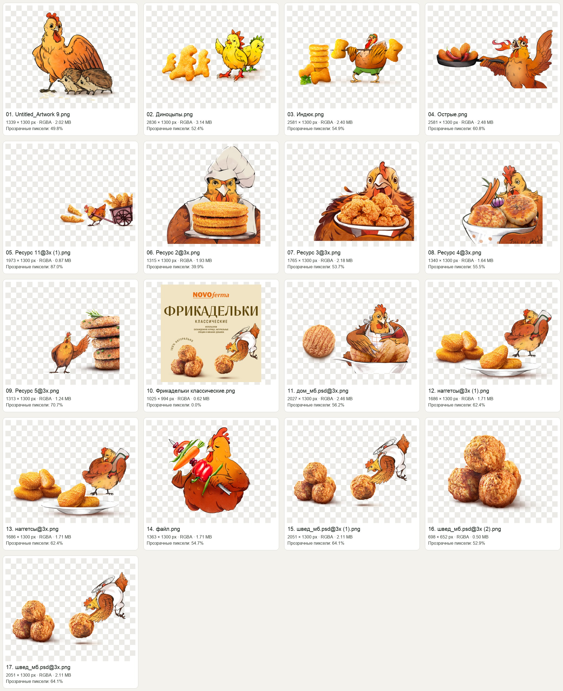

# Аудит изображений «Новофермы»

Дата: 20 сентября 2026. Источник: только PNG верхнего уровня `/Users/andrey/Downloads/Новая папка/`. Подпапки не изучались. Оригиналы не изменялись. PDF и действующий сайт в эту проверку не входят.

## Вывод

Материалы дают узнаваемую основу бренда: тёплый оранжевый цвет, нарисованные птицы, крупные изображения приготовленной еды. Они пригодны для эмоциональных акцентов, промоблоков и части каталога. Для полноценного сайта не хватает фотографий реальной упаковки по каждому SKU, независимых изображений еды в едином масштабе и материалов о производстве. Главный технический недостаток — большинство персонажей и продуктов уже соединены в один растр, поэтому свободно адаптировать их композицию на мобильном экране нельзя.

Это экспертная оценка визуальных материалов. Восприятие персонажей покупателями и влияние на продажи не исследовались; предложения по ним следует проверить на представителях целевой аудитории.

## Что обнаружено

- 17 PNG, 15 уникальных изображений; суммарно 32,32 МБ (30,83 МиБ).
- 11 уникальных смешанных композиций «еда + персонаж», 2 отдельные иллюстрации, 1 плоский макет этикетки и 1 отдельное изображение еды.
- Все файлы имеют режим RGBA; в 16 есть прозрачные пиксели. `Фрикадельки классические.png` полностью непрозрачен, несмотря на наличие альфа-канала.
- Две пары побайтово одинаковых файлов, проверено SHA-256: `наггетсы@3x.png` / `наггетсы@3x (1).png`; `швед_мб.psd@3x.png` / `швед_мб.psd@3x (1).png`. Использование одного файла из каждой пары убирает 4,01 МБ из набора исходников без потери материалов.
- Имена с `.psd` — всё ещё плоские PNG; многослойных PSD среди просмотренных файлов нет.

## Назначение каждого материала

| Файл | Размер, px | Что видно | Рекомендация |
|---|---:|---|---|
| `Untitled_Artwork 9.png` | 1339 × 1300 | Курица с двумя ежами | Иллюстрация для истории бренда или небольшого редакционного блока. Связь ежей с продуктом из одного изображения неясна: нужен контекст. |
| `Диноцыпы.png` | 2836 × 1300 | Наггетсы в форме динозавров и два цыплёнка | Промо конкретной линейки. На мобильном разделить еду и персонажей, иначе всё уменьшится. Название и позиционирование подтвердить по продуктовому каталогу. |
| `Индюк.png` | 2581 × 1300 | Панированные изделия и индюк с импровизированной штангой | Промо линейки из индейки. Персонаж может поддерживать идентификацию вида мяса, но текстовая подпись обязательна. |
| `Острые.png` | 2581 × 1300 | Сковорода с едой и огнедышащая курица | Удачный акцент на остроте. Не использовать как универсальный главный образ всего ассортимента. |
| `Ресурс 11@3x (1).png` | 1973 × 1300 | Небольшая композиция с панированными полосками, птицей и тележкой в правом нижнем секторе | Сначала удалить пустые поля в производной копии; сейчас 87% пикселей полностью прозрачны. Не назначать точный SKU по изображению. |
| `Ресурс 2@3x.png` | 1315 × 1300 | Птица-повар с тремя круглыми панированными изделиями | Категорийный акцент после подтверждения продукта. Вертикальная композиция с сильным визуальным весом персонажа. |
| `Ресурс 3@3x.png` | 1765 × 1300 | Курица с миской хрустящих кусочков | Подходит для промокарточки. Проверить, что внешний вид и размер кусочков соответствуют фактическому продукту. |
| `Ресурс 4@3x.png` | 1340 × 1300 | Курица с миской котлет и овощами | Поддержка домашней линейки. Видимый обрез нижней части лучше ставить на базовую линию блока, а не произвольно «подвешивать». |
| `Ресурс 5@3x.png` | 1313 × 1300 | Высокая стопка котлет и маленькая курица | Полезная иерархия: еда заметнее персонажа. Для каталога нужны реальные название, масса и вид мяса. |
| `Фрикадельки классические.png` | 1025 × 994 | Бежевая плоская этикетка с логотипом и фрикадельками | Референс графики упаковки. Это не фотография пакета: по нему нельзя показать форму, размер и вид товара на полке. Мелкий текст не переносить на сайт картинкой. |
| `дом_мб.psd@3x.png` | 2027 × 1300 | Котлеты, тарелка и курица | Промокомпозиция для подтверждённого SKU. Разделить на компоненты для адаптива. |
| `наггетсы@3x.png` и `наггетсы@3x (1).png` | 1686 × 1300 | Наггетсы на тарелке и курица | Взять один исходник. Хорошая узнаваемость категории, но формат остаётся широкой композицией. |
| `файл.png` | 1363 × 1300 | Курица с овощами на шампуре | Редакционный персонаж. Не использовать как самостоятельное доказательство состава или наличия овощной продукции. |
| `швед_мб.psd@3x.png` и `швед_мб.psd@3x (1).png` | 2051 × 1300 | Фрикадельки и птица-повар | Взять один исходник. Иллюстративное промо; наличие названия «швед» в имени не подтверждает коммерческое название. |
| `швед_мб.psd@3x (2).png` | 698 × 652 | Отдельные приготовленные фрикадельки с тенью | Самый удобный изолированный фуд-материал. Для чёткой картинки на экране 2× ограничить показ примерно 300–340 CSS px; для большого hero получить более крупный оригинал. |

## Замечания дизайнеру

### 1. Построить понятную иерархию «продукт → упаковка → характер бренда»

В ряде композиций птица занимает столько же места, сколько еда, или больше. На странице товара это снижает долю пространства, объясняющего покупателю, что он получит. Для первого экрана стоит собрать одну композицию с крупной едой, реальной упаковкой и одним поддерживающим персонажем. В товарной сетке использовать одинаковую площадь предмета и предсказуемые фон, свет, тень и ракурс.

Для детской или семейной линейки персонажи могут быть более заметны. Для страницы партнёров основу доверия должны давать реальные продукты, производственные возможности, условия работы и подтверждённые документы. Это два разных сценария, которые не следует решать одним и тем же набором иллюстраций.

### 2. Сохранить характер рисунка, отрегулировать частоту использования

Птицы создают узнаваемый голос бренда; их разумно сохранить. Повторение большого персонажа в каждой карточке сделает страницу похожей на галерею иллюстраций, а товары — менее различимыми. Предлагаемый принцип: большой персонаж в одном ключевом промоблоке, небольшие акценты в отдельных местах; карточки прежде всего сравнивают продукты.

Рисованные птицы, предлагающие блюда из птицы, — заметный образ. Он может восприниматься как юмор или вызывать нежелательные ассоциации; это гипотеза для короткой проверки на аудитории, а не установленный дефект. Особенно полезно проверить сюжет с птицей, играющей фрикаделькой, и образы для детского ассортимента.

### 3. Отделить фото, персонажей и тени

Большинство материалов склеены. Для полноразмерного макета запросить исходные слои или отдельные экспорты: продукт, упаковка, персонаж, декоративные элементы. На узком экране еда и упаковка могут оставаться крупными, а персонаж — уменьшаться или переходить ниже. Простое `object-fit: cover` обрежет содержимое и не решит задачу.

У нескольких композиций видимый контент достигает края изображения (`Диноцыпы`, `Ресурс 2`, `Ресурс 3`, `Ресурс 4` и другие). Перед размещением как «плавающего» объекта проверить обрез и либо опереть его на границу блока, либо восстановить композицию из исходных слоёв.

### 4. Унифицировать продуктовые изображения

Сейчас встречаются тарелки, миски, отдельные предметы, стопки, разный масштаб еды и разное соотношение рисунка с фотографией. Нужна одна схема карточки: одинаковая оптическая высота продукта и упаковки, спокойный фон, единый отступ, неизменный порядок подписей. Товар должен оставаться распознаваемым при ширине карточки 160–180 px.

Изображения выглядят как приготовленная еда. Рядом с ключевыми фотографиями стоит явно обозначать состояние продукта и, где это соответствует реальности, использовать подпись «Вариант сервировки». Пользователь должен понимать, что покупает замороженный полуфабрикат, а не готовое горячее блюдо.

### 5. Не переносить маркетинговые утверждения автоматически

На этикетке написано «100% натурально», «никаких добавок», «используем охлаждённую курицу». Эти надписи видны в приложенном изображении, но не проверены этим аудитом. Перед применением в общесайтовом тексте подтвердить актуальность формулировок по конкретным SKU. Охлаждённое сырьё и замороженный готовый полуфабрикат описывают разные этапы производства — в тексте сайта это должно быть понятно.

## Рекомендации разработчику

1. Хранить оригиналы отдельно. Выпускать производные файлы с понятными именами по SKU и назначению, например `nuggets-food-640.webp`, только после подтверждения сопоставления с каталогом. Имена исходников не считать спецификацией ассортимента.
2. Убрать дубли из поставляемого набора. Разные ссылки на один и тот же байтовый файл могут стать отдельными загрузками и усложняют поддержку.
3. Кадрировать пустые поля в производных изображениях по альфа-границам с небольшим запасом под мягкую тень. Особенно критичен `Ресурс 11@3x (1).png`: полезный bounding box 1158 × 574 px при холсте 1973 × 1300 px. Нормализовать размещение предметов в интерфейсе, не добавляя огромные прозрачные поля в каждый файл.
4. Экспортировать подходящие размеры, например 320 / 640 / 960 px для карточек, и задавать `srcset` / `sizes`. Маленький файл с фрикадельками не увеличивать программно для видимости качества: больших деталей от этого не появится.
5. Использовать современные форматы с сохранением альфа-канала: WebP, при оправданной экономии — AVIF. Для готовых фотографий с непрозрачным фоном альфа-канал не нужен. Качество проверить глазами на светлом, кремовом и тёмном фоне, включая край вырезки и мягкую тень.
6. Ориентиры бюджета, требующие проверки экспортом: 40–100 КБ на карточку и 200–350 КБ на основное изображение первого экрана. Это целевые значения, а не результат уже выполненной оптимизации. Загружать hero приоритетно, карточки вне первого экрана — лениво.
7. Задавать `width` / `height` или `aspect-ratio`, чтобы изображения не сдвигали текст при загрузке. Декоративным персонажам назначать `alt=""`; содержательному изображению товара — краткий alt по реальному продукту. Не дублировать рекламный текст в alt.
8. Заголовки, массу, способ приготовления, состав и кнопки выводить HTML-текстом. Встроенные в этикетку надписи при уменьшении нечитаемы и не заменяют информацию в карточке.

## Что заказать или запросить для следующего этапа

| Приоритет | Материал | Зачем |
|---|---|---|
| До полноценного каталога | Актуальная таблица SKU и реальные packshot всех упаковок, фронт + оборот | Узнавание товара на полке, корректное название, масса, состав и сведения о приготовлении. |
| До адаптивного макета | Исходные слои продуктов и персонажей | Управлять композицией на телефоне без потери размера еды. |
| До разработки первого экрана | Один крупный реальный фуд-кадр с вариантом горизонтального и вертикального кадрирования | Чёткий аппетитный фокус, который выдерживает десктоп и мобильный экран. |
| До страницы «О компании» | Фотографии производства, упаковочной линии, команды и контроля качества | Подтверждать производственную компетенцию собственными материалами. |
| До публикации фирменной шапки | Векторный логотип и правила его применения | Чёткость на всех экранах и стабильность фирменного оформления. |

Технические измерения по каждому файлу сохранены в `assets-metadata.json`; визуальная инвентаризация — в `assets-contact.jpg`.
