# Новоферма: большой аудит сайта для B2B, СТМ и роста доверия

Исследование: 4 ноября 2026. Сведение и контроль: 5 ноября 2026. Основа проекта: `3894d44`. Адрес изученной сборки: локальный `output/concept/`, 22 страницы. Это аудит и техническое задание на следующий этап, а не обещание роста продаж после косметических изменений.

## 1. Главный вывод

Новоферма уже выглядит как живой продуктовый бренд. Тёплая палитра, курочки, аппетитные композиции и единая упаковочная семья помогают запомнить компанию. Эту основу стоит развивать. Основной разрыв находится между впечатлением «хочется попробовать» и решением «можно включать этого производителя в закупку». У сайта пока гораздо больше ответов для семейного ужина, чем для закупщика, технолога, собственника ресторана или заказчика своей марки.

Сильный B2B сайт должен одновременно вызывать аппетит и снимать риск. Для первого работают еда, сценарий употребления и характер. Для второго — точный ассортимент, проверяемая спецификация, реальные возможности производства, ответственный человек и предсказуемый следующий шаг. Сейчас второй слой недостаточен. Замена персонажа на фотографию завода сама по себе этот пробел не закроет; необходима связка изображения, факта, документа и действия.

Первый приоритет — собрать коммерческое предложение и достоверные данные. Следующий — сделать обращение получаемым и измеряемым. Затем имеет смысл усиливать визуальную подачу и привлекать целевой трафик. Платно приводить больше людей в непрозрачную цепочку обращений — преждевременно: это рекомендация по порядку работы, а не доказательство текущих потерь.

## 2. Что именно проверено и что нельзя заключать

Проверены текущие страницы проекта, переходы из главной в партнёрский раздел, раскрытие фасовок, выбор СТМ, обязательные поля формы, каталог, серийная карточка и концепт Фибриков. Сделаны отдельные мобильные проходы. Сохранены свежие кадры текущего сеанса; старые аудиты служили только указателями, их снимки не подменяли сегодняшнюю проверку.

Текстовое извлечение публичного [novoferma.ru](https://novoferma.ru/) показывает другое содержание: охлаждённое мясо, пшеничное волокно, прозрачную упаковку, оборудование и общую форму. В нём обнаружена ссылка `mc.yandex.ru`. Встроенный браузер не смог завершить загрузку публичного сайта; пригодный визуальный снимок production не получен. Поэтому внешний вид, доступность и конверсия публичного сайта этим отчётом не сертифицируются. Его содержание исследовано отдельно от локальной сборки.

### Дополнение от 5 ноября: параллельные изменения проекта

Основной визуальный проход и 38 карточек замечаний относятся к срезу 4 ноября, версии `3894d44`. Во время подготовки публикации в рабочей папке появились другие доработки: компактнее мобильный hero партнёров, новый порядок названия и метаданных карточки, отклик подложки вместо отдельной стрелки. Они повторно просмотрены в двух дополнительных кадрах 25–26. Мобильный вход стал компактнее; прежнее замечание о его высоте нельзя механически применять к новой композиции. У карточек сохранены одна ссылка и маркировка концептов, а масса стала заметнее.

Также в проекте появился PDF ассортимента. Само наличие локального файла не доказывает, что закупщик может его найти на сайте или что пищевые характеристики согласованы. При сверке 5 ноября PDF/download ссылок в 22 HTML по-прежнему не обнаружено; 14 серийных SKU всё ещё не имеют заполненных состава, пищевой ценности, хранения и приготовления. Реестр источников сохраняет основной срез и отдельные хеши дельты. Обращения, СТМ-процесс, claims и коммерческие гипотезы требуют тех же проверок.

Эти параллельные изменения не входят в коммит аудита и не перезаписываются им. Числа основного технического раздела относятся к первоначальному срезу; например, число локальных ссылок после обновления карточек изменилось. Этот отчёт не выдаёт старые измерения за повторный полный регрессионный тест новой версии.

Изменения локального проекта нельзя считать объяснением исторических продаж. Нужно установить фактический публичный URL, версию сайта и источники трафика. Без посещаемости, входящих обращений, квалификации, КП, заказов и причин отказа неизвестно, в какой части цепочки теряется выручка. В отчёте ниже есть проверенные ограничения интерфейса и гипотезы их коммерческого влияния; это разные типы вывода.

| Вид доказательства | Что устанавливает | Чего не устанавливает |
| --- | --- | --- |
| Свежий скриншот | Что видно в конкретном состоянии и размере | Вкус продукта, фактическую мощность, изменение продаж |
| Код и данные текущей сборки | Маршруты, обработку формы, заполненность полей | Получение письма менеджером, реальный спрос |
| Страница производителя | Что компания публично заявляет | Независимое подтверждение всех сертификатов и обещаний |
| Отраслевой отчёт | Показатель для указанной страны, периода и выборки | Прогноз продаж конкретной российской марки |
| Экспертная рекомендация | Как уменьшить наблюдаемую неопределённость | Гарантированный рост CR или выручки |

Исследование сравнивает Россию, США и европейские практики. Это международный обзор, а не перепись всех мировых производителей и не расчёт мирового TAM. Несопоставимые категории — готовая еда, frozen foods, мясные полуфабрикаты и СТМ всех товаров — не складывались.

## 3. Четыре покупателя и четыре причины обратиться

| Покупатель | Его задача | Что ему нужно увидеть | Правильный следующий шаг |
| --- | --- | --- | --- |
| Магазин, сеть, дистрибьютор | Подобрать товар для полки и поставщика | SKU, фасовка, короб, срок, хранение, доступная география, документы, контакты продаж | Получить ассортимент и условия по выбранным позициям |
| HoReCa | Стабильно готовить блюдо с понятной себестоимостью | Сырой/готовый статус, приготовление, порция, выход, упаковка, стабильность формы и вкуса | Обсудить проработку и образцы для меню |
| Заказчик СТМ | Запустить продукт под своим брендом | Доступные форматы, готовая рецептура/разработка, ограничения партии, ответственность сторон, этапы согласования | Отправить краткий бриф технологу/менеджеру СТМ |
| Производитель готовых блюд | Получить воспроизводимый компонент | Размер/масса единицы, допустимые отклонения, термический статус, хранение, совместимость с процессом | Проверить техническую возможность и запросить спецификацию |

Для первых трёх сегментов нужен явный вход с главной или из навигации. Четвёртый можно обслуживать внутри HoReCa/производственных решений, если компания действительно готова к такому каналу. Не следует создавать отдельное обещание возможностей без подтверждения операционной командой.

Семья — конечная аудитория продукта и важная причина покупательского интереса. Она не заменяет аргумент для закупщика. Для полки семейность переводится в понятный сценарий, размер упаковки и роль SKU в ассортименте. Для кухни — в блюдо, порцию и стабильность подготовки. Для СТМ — в выбранную аудиторию и параметры разработки. Утверждение о детском питании или медицинской пользе из семейного образа не следует.

## 4. Что уже хорошо и что следует сохранить

- Кремовый фон, оранжевый и тёмно-коричневый создают узнаваемый тёплый мир. Полная смена палитры не требуется.
- Персонажи могут быть собственным активом бренда. Их роль — создавать характер и помогать ориентироваться, а не свидетельствовать о безопасности продукта.
- Общая упаковочная витрина выглядит собраннее, чем набор случайных фотографий. Названия и массы представлены текстом.
- Главная управляется вручную, без навязчивой автопрокрутки. Названия вкладок видимы; программная логика учитывает загрузку сцен и ограниченные соединения.
- Раздел партнёров доступен из основной навигации. Кнопка СТМ выбирает соответствующий формат обращения.
- Формы честно сообщают, что письмо отправляет пользователь; предусмотрено копирование. Не следует переименовывать подготовку письма в «заявка принята».
- Концепты новинок отмечены отдельно, отсутствующие пищевые характеристики не подменены выдуманными числами.
- У серийной карточки доступны оригинальные изображения производителя. Обработанная витрина не должна становиться источником текста этикетки.

## 5. Позиционирование: аппетит, состав и надёжное исполнение

Рекомендуемая смысловая конструкция: «замороженные продукты из птицы для вашей полки и меню» → «под брендом Новофермы или вашей маркой» → «вот ассортимент, вот данные, вот как начать». Это черновик направления, а не утверждённый слоган и не заявление о новых возможностях.

У первого B2B экрана должны быть три разных слоя. Заголовок сообщает, что поставляется и кому. Подзаголовок объясняет отличие, которое можно подтвердить. Действие ведёт к конкретному результату: ассортименту, обсуждению образцов или брифу СТМ. «Дело со вкусом» можно оставить как короткий эмоциональный акцент, но коммерческий смысл должен читаться рядом с ним.

Возможный рабочий текст первого экрана: «Продукты из птицы для вашей полки и меню». Под ним: «Ассортимент Новофермы и производство под вашей торговой маркой. Подберём позиции и обсудим требования к продукту, фасовке и поставке». Основное действие: «Обсудить ассортимент». Вторичное: «Производство СТМ». Слова «подберём» и конкретный набор параметров публикуются после подтверждения ответственного процесса. Здесь намеренно нет неподтверждённых сроков, минимальной партии, географии или бесплатных образцов.

На главной можно сохранить семейный продуктовый hero, но показать B2B предложение уже в том же первом экране: короткой строкой о производителе, видимым действием для опта/СТМ и небольшим доказательным блоком. Альтернатива — отдельная B2B посадочная для рекламного и прямого трафика закупщиков. Выбор определяется реальными каналами привлечения: сайт смешанной аудитории не обязан превращать каждый экран в техническую спецификацию.

## 6. Белок, клетчатка и состав: как сделать отличие убедительным

Сейчас тема птицы видна, а измеримое преимущество конкретного продукта не раскрыто. В локальном наборе данных у 14 из 14 серийных SKU отсутствуют заполненные состав, пищевая ценность, хранение и приготовление. Поле аллергенов также не заполнено. Это пробел публикации; по нему нельзя делать вывод, что состав плохой.

Фибрики — перспективный носитель темы клетчатки, но пока это явно обозначенный концепт упаковки. Слоган на концепте не подтверждает серийное наличие, рецептуру или количество волокон. На публичном сайте производитель упоминает пшеничное волокно в общей коммуникации. Такой текст нельзя автоматически размножать как точный состав каждого SKU.

| Сообщение | Необходимое основание | Как показать на сайте |
| --- | --- | --- |
| Из курицы/с индейкой | Актуальное наименование и рецептура SKU | Точное название, ссылка на состав |
| С пищевыми волокнами | Утверждённая рецептура и корректное описание ингредиента | Состав и пояснение роли ингредиента без обещаний лечения |
| Количество белка/клетчатки | Утверждённые расчётные или лабораторные данные с базой измерения | Граммы на 100 г; порция — только с указанной массой |
| Источник/высокое содержание | Проверка действующих применимых условий и доказательств | Точная согласованная формулировка для конкретного SKU |
| Классный/понятный состав | Полный состав и честное объяснение компонентов | Читаемый HTML, а не лупа для картинки |
| Для семейного ужина | Реальный сценарий использования и приготовление | Блюдо, упаковка, порция, инструкция; без автоматического статуса детского питания |

Статья 4.10 [официального текста ТР ТС 022/2011](https://eec.eaeunion.org/upload/medialibrary/9db/TrTsPishevkaMarkirovka.pdf) служит основанием для дисциплины доказательства отличительных признаков маркировки. Доступный PDF не установлен как полная актуальная консолидированная редакция на дату аудита; точные применимые условия перед публикацией проверяет профильный специалист. Это не юридическое заключение о сайте. Европейские определения в международном приложении используются как пример различия массы и доли энергии, а не как российская норма.

Для каждого утверждения нужен реестр: SKU и версия рецептуры → согласованный текст → источник цифры/документ → условия использования → владелец → дата пересмотра. Изменение рецептуры должно обновлять карточку, PDF и коммерческое предложение одновременно. Если есть пшеничный компонент, вопрос аллергенов и следов должен решаться по фактической спецификации и процессу; нельзя обещать безглютеновость по одному слову «волокно».

## 7. Рынок и тренды 2026: что действительно полезно

Покупатели frozen решают несколько задач одновременно: вкус, удобство, стоимость, запас дома и предсказуемость приготовления. Для B2B к этому добавляются труд кухни, хранение, размер партии и повторяемость. Поэтому сайт должен соединять эмоцию блюда с практикой закупки. Плакат «белок + клетчатка» работает лучше рядом с точными данными и сценарием использования, чем в роли универсального объяснения всей линейки.

Американский IFIC 2026 показывает заявленный интерес к белку и пищевым волокнам. AFFI/FMI описывает роль frozen в планировании приёмов пищи. PLMA даёт отдельные показатели СТМ, включая frozen. В приложении к отчёту указаны даты публикации, поля и измерения; они не заменены одним годом «2026». Эти наблюдения поддерживают исследование идеи, но не доказывают спрос на Фибрики в России.

Европейский опыт дополняет картину. [Открытый обзор конференции BFFF 2026](https://bfff.co.uk/industry-leaders-come-together-at-the-bfff-business-conference-2026/) выделяет удобство работы кухни, ценность, надёжность и удовольствие от еды. Это отраслевые выступления, а не измерение российской эластичности спроса. Свежие детальные данные BFFF доступны членам с ограничениями перепубликации; закрытый массив не использовался. Уверенный прогноз «мировой рынок растёт, значит у нас вырастут продажи» из этих материалов не следует.

Нужные направления для Новофермы:

1. **Удобство с доказательством:** проверенный способ приготовления, время и состояние продукта, а не общее «быстро и легко».
2. **Ценность порции:** расчёт количества и выхода на собственных данных; отдельная логика для семьи и кухни.
3. **Питательная прозрачность:** состав, аллергены, БЖУ и клетчатка по SKU; функциональные заявления после проверки.
4. **СТМ как совместная разработка:** готовая позиция под маркой клиента и новая рецептура — два разных процесса.
5. **Подлинность:** свои фото производства, команды и приготовленного продукта, подписи и актуальные документы.
6. **Управляемая цифровая простота:** ясные маршруты и доступные документы; без сложных конфигураторов при небольшом ассортименте.

Не стоит автоматически добавлять 3D вращение пачки, бесконечный скролл, видеозаставку, анимированное появление каждого факта или AI чат. Это приёмы, а не признаки качества. Польза каждого определяется задачей покупателя и доступными достоверными данными.

## 8. Чему учат сравнения, а что копировать не следует

Российские сайты в приложении — категорийные и процессные ориентиры. Международные производители — референсы отдельных функций. Прямое участие зарубежных компаний в конкретных сделках Новофермы не установлено. Исследование публичного предложения не является проверкой качества их продукции.

На свежих кадрах «Казанских Деликатесов» хорошо видно смысловое отличие: в первом экране прямо называется контрактное производство, дальше есть этапы СТМ. У CP Foods manufacturing связывается с фотографией площадки и названными каналами. У Tyson продуктовая карточка соединяет аппетитную подачу с идентификацией товара и логистическими полями. У Щёлковского МПК есть отдельный путь к контролю качества. Для Новофермы важны эти связи, а не буквальное копирование чужих цветов, величины навигации или сертификатов.

| Задача | Наблюдаемая практика | Перенос в Новоферму | Ограничение |
| --- | --- | --- | --- |
| Понять СТМ | Отдельная страница, форматы и этапы проекта | Короткая схема бриф → проверка возможности → образцы → согласование → серия | Этапы и ответственность подтверждает собственная команда |
| Оценить товар | Паспорт с идентификатором, составом, приготовлением и коробом | Единый HTML/PDF паспорт из общей базы | Не копировать числа и US/ЕС свойства |
| Поверить производителю | Контроль качества, лаборатория, реальные операции | Фотографии своих процессов, документы с датой и областью | Наличие красивого значка не равно действующей сертификации |
| Подобрать применение | Разделение retail/foodservice/ingredients | Три входа с общего каталога | Не воспроизводить огромный каталог и многоуровневое меню |
| Почувствовать бренд | Сочетание еды и отличимого характера | Тёплый мир курочек плюс реальный продукт | Семейность не означает инфантильность всей B2B коммуникации |

## 9. Визуальная система: от чего возникает ощущение качества

### Иерархия и ритм

На главной и в B2B hero лозунг и персонаж занимают почти весь первый экран. В каталоге при 1280×720 первый ряд начинается близко к нижней границе. Это расход пространства, а не техническая поломка. Для закупщика лучше раньше показать ассортимент, три входа по задаче и одно проверяемое доказательство. Плакатный акцент оставить на входе, вторичные заголовки сделать спокойнее, подписи и таблицы — информационными.

Страница должна менять темп: эмоциональный вход → компактное объяснение → товары → доказательства → действие. Если каждый этаж равен по крику, решение закупщика не получает приоритета. Свободное пространство полезно, когда разделяет смыслы; пустой экран перед нужной таблицей не является признаком премиальности сам по себе.

### Шрифты

Узкий Novoferma Protein подходит короткому плакату. Onest подходит абзацам, фактам, формам и длинным названиям. Caveat допустим в короткой дружелюбной подписи. Rubik/другой плакатный режим следует использовать по одной назначенной роли, а не чередовать похожие заголовочные манеры произвольно. Цель — назначить роль, а не механически ограничить проект двумя гарнитурами.

Не сжимать буквы трансформациями, не убирать пробелы ради одной строки, не превращать многословный B2B заголовок в тяжёлый набор прописных. Проверять реальные длинные названия, русский язык, 320/390/768/1024/1280/1440, увеличение текста и отсутствие веб-шрифта. Для таблиц и служебных текстов размер назначается по читаемости и контрасту; «16 px для всего» не является универсальным требованием WCAG.

### Персонажи и семейность

Курочка на продукте и в hero помогает узнаваемости. Курочка в пиджаке способна дать дружелюбный вход в переговоры, но ей нельзя поручать доказательство масштаба, экспертизы и безопасности. В B2B hero рядом с ней сейчас нет достаточного предметного содержания. Уменьшение персонажа без добавления этого содержания даст только более пустой экран.

Нужен паспорт персонажей: основной силуэт и пропорции, единые контур и свет, допустимая детализация, роли одежды, выражения, варианты фона и минимальный размер. На упаковке можно сохранять истории, а в интерфейсе переиспользовать ограниченный набор проверенных вариантов. Разные профессиональные роли допустимы при общем художественном языке. Новые AI варианты нельзя бесконтрольно добавлять в каждую секцию.

### Упаковка и еда

Система подложек уже спокойная; дополнительная декоративная случайность ей не нужна. Упаковка показывает бренд, а реальный приготовленный продукт — текстуру, размер и подачу. Для каждого серийного SKU желательно иметь настоящий фронт, читаемый оборот, прозрачный контейнер и приготовленный образец. Фото должно соответствовать рецептуре и версии товара.

Обработанные изображения требуют сравнения с оригиналом по логотипу, тексту, форме, числу и цвету кусочков. Сгенерированное восстановление края может менять мелкие сведения; это причина вести мастер и согласование. Документальные цеха, сотрудники и сертификаты должны быть настоящими. Концепты новинок остаются концептами до продуктового подтверждения.

### Цвет, композиция и декор

Оранжевый — сильный эмоциональный акцент, коричневый — хороший информационный контраст, кремовый — спокойная основа. Светлые пояснения на цветном фоне и маленькие надзаголовки нужно измерять по фактическим цветам. Отдельно проверять hover/focus/disabled. Нельзя объявить соответствие WCAG по одному скриншоту.

На 1280×720 еда пересекает область пункта «Контакты». Защита навигации должна работать во всём диапазоне ширин, включая границы media queries. Декоративный слой не должен конкурировать с названием раздела или перехватывать взаимодействие. Здесь есть конкретное текущее доказательство, а не перенос старого замечания о другом размере.

### Анимация

Ручной hero и отсутствие автопрокрутки — хорошая основа. Анимация должна помогать понять выбор и результат действия. Важные факты, CTA и контакты не должны ждать entrance/reveal. Для reduced motion сохранять всё содержание и понятную смену состояния; для медленной сети — текущий слайд до готовности следующего. Проверять быстрые повторные переключения, клавиатуру и загрузку изображения с ошибкой. Уже проходящие проверки не нужно ломать ради «более современного» движения.

## 10. Путь СТМ: какой информации не хватает

Отдельное предложение СТМ должно отвечать на семь вопросов: что можно производить; что можно менять; как проверяется техническая возможность; как получаются и оцениваются образцы; кто отвечает за упаковку и маркировку; от чего зависит партия и срок; как перейти к серии. Сейчас есть направление и кнопка, но большая часть этих ответов остаётся за пределами страницы.

Нужны два сценария. Первый — существующая доступная рецептура с упаковкой под марку заказчика. Второй — разработка по требованиям к вкусу, форме, составу, цене и упаковке. Доступность обоих сценариев надо подтвердить; не все производители обязаны предлагать полный цикл. У каждого шага указать вход, результат и ответственную сторону. Сроки показывать только реальные, диапазон допустим с факторами зависимости.

Форма СТМ может начинаться с компании и контакта, а уточнения собирать по желанию: канал, нужный продукт, существующая рецептура/разработка, планируемый объём и регион. Не заставлять неопределившегося заказчика выдумывать точный тоннаж. Загрузку ТЗ стоит добавлять только вместе с безопасным приёмом и ответственным за вложения. Условия конфиденциальности и владение рецептурой обсуждаются предметно, а не обещаются одной маркетинговой строкой.

## 11. Коммерческий набор, который можно переслать коллеге

Закупщик редко принимает решение один. Страница должна давать материал для технолога, коммерческого руководителя и логиста без повторного ручного запроса каждой цифры.

| Материал | Минимум содержания | Владелец данных | Критерий готовности |
| --- | --- | --- | --- |
| Паспорт SKU | Артикул, версия, масса, сырой/готовый статус, состав, аллергены, БЖУ, приготовление, хранение, срок | Технолог/качество | HTML и PDF совпадают с актуальной спецификацией |
| Лист поставки | Единиц в коробе, масса/габарит, паллета при необходимости, региональные условия | Продажи/логистика | Неизвестные поля уточняются, нули не выдуманы |
| Обзор производства | Площадка, операции, контроль, собственные фото, действующие документы | Производство/качество | Каждое утверждение имеет основание и дату |
| СТМ one-pager | Возможности, ограничения, этапы, образцы, контакты | СТМ/продажи | Подтверждены реальные роли и следующий шаг |
| Карточка применения | Порция, способ приготовления, проверенный выход, вариант блюда | Технолог/шеф | Проверено на реальном продукте, исходные параметры сохранены |
| Коммерческое предложение | Выбранные SKU, расчётные условия, срок действия, ответственный | Продажи | Не подменяет актуальную спецификацию и договор |

Не обязательно выкладывать конфиденциальные цены или все производственные документы открыто. Но сайт должен назвать доступный материал и способ получения. Обычный каталог и базовые паспорта разумно открыть для самостоятельной оценки; закрытая часть выдаётся адресно. Решение об открытых ценах зависит от бизнес-модели, объёма и доставки, а не от универсального правила дизайна.

## 12. Почему продажи могут быть маленькими: проверяемая карта

Выручка зависит от числа релевантных покупателей, доли реально полученных запросов, квалификации, перехода к образцу/КП, первого заказа и повторных закупок. Сайт может влиять на несколько переходов, но не заменяет цену, продукт, логистику, наличие, команду продаж и дистрибуцию. Если трафика почти нет, косметический рост удобства не создаст объём. Если обращения приходят, но не подходят по объёму/региону, важнее квалификация и предложение. Если КП проигрывают по цене, расследуется экономика и ценность.

| Гипотеза | Наблюдаемое основание | Проверка | Что будет опровержением |
| --- | --- | --- | --- |
| Приходит мало закупщиков | Данных о структуре трафика нет | Сопоставить источники/посадочные с валидными B2B запросами | Достаточно целевых посетителей, но теряются позже |
| Предложение кажется обычным | Общие лозунги, мало измеримых отличий | 5–8 интервью закупщиков с задачей выбрать поставщика | Они уверенно называют отличие и готовы запросить образцы |
| Данных недостаточно для shortlist | Пустые пищевые и закупочные поля | Дать проверенный supplier pack и сравнить вопросы/качество лидов | Решение упирается исключительно в цену/географию |
| Письмо не превращается во входящий лид | В проекте mailto/copy без подтверждённой регистрации | Сверка событий подготовки с входящими; контрольный процесс | Почти все обращения доходят, проблема после получения |
| Ответ/КП запаздывает | Истории обращений нет | Время первого содержательного ответа, причины задержек | Ответы своевременны, проигрыши по другим причинам |
| Рецептура, вкус или формат не подходят | Нет интервью/дегустационных данных | Фиксировать результат образца, критерии и причину отказа | Хорошая оценка продукта, но нет подходящих условий закупки |
| Нет повторной закупки | Нет когорт заказов | Заказы по клиенту/SKU, претензии, остатки, availability | Повтор стабилен, недостаточно новых клиентов |

Это гипотезы разной степени готовности, а не семь установленных причин. Для начала нужен небольшой реестр последних обращений и заказов с обезличенными причинами отказа. Не надо строить сложную BI систему до определения этапов и качества записи.

## 13. Метрики и проверка эффекта

События интерфейса: `segment_select`, `product_view`, `spec_view/download`, `stm_brief_start`, `mailto_open`, `copy_request`. Операционные события: `lead_received`, `lead_qualified`, `sample_requested/sent/evaluated`, `quote_sent`, `first_order`, `repeat_order`. Копирование и открытие почты не считаются получением заявки. Скачивание файла не считается закупкой.

Главные показатели: валидные B2B обращения на релевантный визит; квалифицированные на полученные; КП и образцы на квалифицированные; первый заказ на КП/оценённый образец; повтор на первую закупку для сопоставимой когорты. Отдельно — время до содержательного ответа, причина отказа, маржинальность и исполнение заказа. Знаменатели фиксируются заранее: нельзя сравнивать общие визиты до изменения с B2B визитами после.

Для небольшого трафика сначала подойдут наблюдаемые задания с 5–8 закупщиками из разных сегментов и журнал обращений. Такая выборка выявляет качественные проблемы, но не даёт надёжной статистической оценки uplift. A/B тест запускается при достаточном потоке; период и размер выборки рассчитываются по фактической базовой конверсии и минимально значимому эффекту. Параллельно учитывать сезон, источник, устройство, изменения цен и рекламы.

В веб-аналитику не отправлять текст заявки, телефон, email и вложения. Источник/кампания, сегмент и случайный идентификатор должны связываться с защищённым операционным учётом. Конкретные требования к персональным данным и выбору инфраструктуры проверяются перед внедрением; этот аудит не является юридической экспертизой формы.

## 14. Предлагаемая структура сайта

Главная: кто мы и кому поставляем → три входа по задаче → ключевой ассортимент → подтверждённое отличие состава → настоящее производство и контроль → СТМ → конкретное обращение. Семейная эмоция проходит через блюда и персонажей, а коммерческий слой отвечает на вопросы поставки.

Каталог: общая база SKU с режимами «для полки», «для меню», «СТМ возможности». Карточка: продукт → применение → подтверждённые характеристики → поставка → документ → действие с сохранением выбранного товара. Не следует плодить три вручную расходящихся каталога.

Партнёрам: краткое предложение по каналам, документы, условия, ответственный. СТМ: самостоятельная страница с реальным процессом. Производство/качество: проверяемая история с источниками, а не витрина значков. Контакты: выбор адресата, прямые каналы, часы/срок ответа при подтверждении. «Где купить» остаётся полезным для конечного покупателя и вторичным для B2B.

Переход из конкретного SKU должен сохранять продукт и выбранную задачу в обращении. На мобильном пользователь не должен повторять название по памяти. Страницы кампаний могут вести сразу в нужную ветку, не заставляя проходить продуктовый слайд главной.

## 15. Порядок работ и критерии приёмки

Интервалы ниже — рекомендуемая последовательность, а не обещание срока разработки или запуска производства. При отсутствии продуктовых документов работа с данными может занять больше времени.

| Этап | Работа | Зависимость | Проверяемый результат |
| --- | --- | --- | --- |
| 0. Зафиксировать исходное состояние | Публичный URL/версия, каналы и последние обращения; владелец продаж | Доступ ответственных к фактам | Понятно, какая версия получает трафик; есть базовая воронка |
| 1. Данные и смысл, условно первая неделя | Три сегмента, один коммерческий тезис, паспорта приоритетных SKU, claims реестр | Технолог, качество, продажи | Закупщик находит нужный товар и может проверить основание отличия |
| 2. Путь обращения, условно недели 1–2 | Сохранение SKU, запрос спецификации/образца, регистрируемый приём, ответственный, ошибки | Выбранная инфраструктура и процесс | Контрольный запрос подтверждён входящей записью и доступен менеджеру |
| 3. Доказательства и СТМ, условно недели 2–4 | Процесс, фото, документы, границы возможностей, supplier pack | Реальные данные и согласования | Каждое обещание связано с документом/операцией и понятным следующим шагом |
| 4. Визуальный проход | Иерархия, типографические роли, семья персонажей, еда/упаковка, все брейкпоинты | Утверждённое содержание | Навигация чиста, данные читаются, форма работает на телефоне и клавиатуре |
| 5. Пилот и проверка | Интервью, целевой трафик, сверка аналитики/лидов/заказов | Валидный учёт и рабочие материалы | Есть наблюдение эффекта, а не только новый screenshot |

P0 — доказательные данные, работоспособный путь обращения и измерение. P1 — сегментация, СТМ, производственные доказательства, карточки, конкретные действия, текущая коллизия навигации. P2 — оптическая унификация, содержательные примеры блюд и дальнейшая оптимизация. Приоритет отражает зависимость решения закупщика, а не измеренную величину потерянной выручки.

## 16. Обязательные проверки перед запуском

1. Паспорта приоритетных серийных SKU согласованы; концепты и доступная продукция различимы.
2. Каждое питание/состав/срок/температура имеет владельца, источник, версию и дату.
3. Утверждения о белке/клетчатке и маркировка проверены по применимым правилам и данным; нет догадок о пользе.
4. Три покупателя могут найти подходящее предложение и следующий шаг.
5. Конкретный SKU сохраняется до запроса; обязательные поля объяснены, ошибки не стирают ввод.
6. Подтверждение «получено» возникает только после входящей записи; сбои и повторные отправки обработаны.
7. Документы скачиваются и читаются; в них нет противоречий с HTML и устаревших claims.
8. Фото, документы, производство и кейсы подлинные; разрешения на публикацию и логотипы подтверждены владельцем.
9. На 320–1440 и границах media queries нет пересечения навигации, исчезновения текста, CTA или фокуса.
10. Клавиатура, меню, радио, фильтры, вкладки, статус и reduced motion проверены в реальных состояниях.
11. После выбора реального домена проверены HTTPS, redirects, canonical, sitemap, robots, OG и индексируемые посадочные.
12. Производительность проверена холодной загрузкой и полевыми данными после запуска; локальные байты не выдаются за измеренный LCP.
13. Команда продаж умеет принимать, квалифицировать и продолжать запрос; обещанный срок ответа достижим.
14. Метрики сверены с операционным реестром; клики не считаются заказами и данные заявок не раскрываются в аналитике.

Критерии WCAG берутся из [W3C WCAG 2.2](https://www.w3.org/TR/WCAG22/). Проверка снимков и выборочных взаимодействий не означает полного соответствия. Для Core Web Vitals ориентиры Google — LCP ≤2,5 с, INP ≤200 мс, CLS ≤0,1 на уровне 75-го перцентиля; это цель измерения, а не результат данного аудита. [Официальные определения и оценка](https://support.google.com/webmasters/answer/9205520?hl=en-EN).

## 17. Какой результат считать успехом

Первое изменение восприятия: «симпатичные продукты» дополняется пониманием «это производитель, с которым понятно как работать». Первое изменение поведения: закупщик самостоятельно выбирает релевантную позицию/формат, находит нужные основания и отправляет содержательный запрос. Первый коммерческий результат: запрос не теряется, получает ответ и движется к оценке продукта и закупке.

Если после этих изменений запросов больше, но закупок нет, аудит продолжается по причинам квалификации, вкуса, цены, логистики и исполнения. Если растут первые закупки, но нет повтора, нужен анализ продукта и обслуживания. Роль сайта — создавать и поддерживать такую цепочку, а не заменять её красивой поверхностью.

Ниже собраны свежие экраны, подробные замечания, российские и международные досье, источники и маршрут следующей реализации. Это позволяет пройти каждую рекомендацию по доказательству и критерию приёмки, а не по вкусовому «стало современнее».

## 18. Свежие экраны: пошаговая проверка

Кадры 1–17 — срез проекта от 4 ноября; 18–24 — выбранные функции референсов; 25–26 — повторный просмотр дельты от 5 ноября. Снимки не подтверждают фактическое качество производства и состав продукта.

| Шаг | Задача | Состояние |
| --- | --- | --- |
| 1 | [Первое впечатление](screens/01-home-desktop.png) | Нужна доработка |
| 2 | [Вход в раздел партнёров](screens/02-partners-entry-desktop.png) | Частично |
| 3 | [Фасовки и предложения](screens/03-offers-and-specs.png) | Частично |
| 4 | [Переход к запросу СТМ](screens/04-stm-request.png) | Работает с ограничениями |
| 5 | [Обязательные поля](screens/05-form-required-fields.png) | Работает |
| 6 | [Вход в каталог](screens/06-catalogue-desktop.png) | Частично |
| 7 | [Продуктовая витрина](screens/07-catalogue-grid.png) | Хорошая основа |
| 8 | [Серийный товар](screens/08-product-passport.png) | Нужна доработка |
| 9 | [Фибрики и клетчатка](screens/09-fiber-concept.png) | Честный концепт |
| 10 | [Кто стоит за брендом](screens/10-about-company.png) | Частично |
| 11 | [Упаковка и производство](screens/11-about-proof.png) | Нужна доказательная часть |
| 12 | [Розничный путь](screens/12-purchase-links.png) | Работает в своём назначении |
| 13 | [Первый экран телефона](screens/13-home-mobile.png) | Хорошая мобильная основа |
| 14 | [Мобильное меню](screens/14-mobile-navigation.png) | Работает, можно усилить |
| 15 | [Мобильный B2B вход](screens/15-partners-mobile.png) | Частично |
| 16 | [Мобильная форма СТМ](screens/16-stm-mobile.png) | Работает с трением |
| 17 | [Товар на телефоне](screens/17-product-mobile.png) | Частично |
| 18 | [Сравнение: вход в СТМ](screens/18-reference-kazan-stm.png) | Референс |
| 19 | [Сравнение: этапы проекта](screens/19-reference-kazan-process.png) | Референс |
| 20 | [Сравнение: производственный контекст](screens/20-reference-cp-manufacturing.png) | Референс |
| 21 | [Сравнение: продукт и идентификация](screens/21-reference-tyson-product.png) | Референс |
| 22 | [Сравнение: закупочная упаковка](screens/22-reference-tyson-packaging.png) | Референс |
| 23 | [Сравнение: производитель](screens/23-reference-shmpk.png) | Референс |
| 24 | [Сравнение: контроль качества](screens/24-reference-shmpk-quality.png) | Референс |
| 25 | [Дельта 05.11: компактный B2B вход](screens/25-delta-partners-mobile.png) | Улучшено 05.11 |
| 26 | [Дельта 05.11: карточки без стрелок](screens/26-delta-catalogue-mobile.png) | Улучшено 05.11 |

### Экран 1. Первое впечатление

Главная · 1280×720 · Нужна доработка.

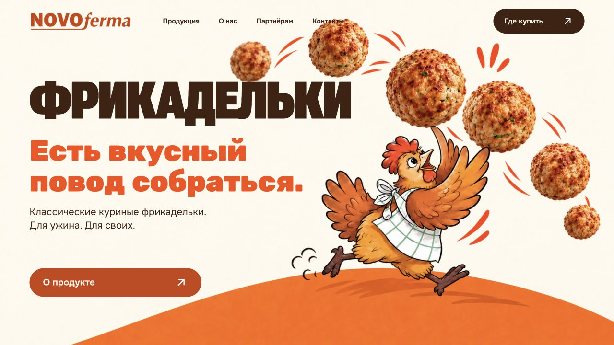

Выразительная еда и характер; B2B предложение и доказательства не видны в первом экране. Декор касается навигации.

[Источник экрана](http://127.0.0.1:8765/output/concept/index.html)

### Экран 2. Вход в раздел партнёров

Партнёрам · 1280×720 · Частично.

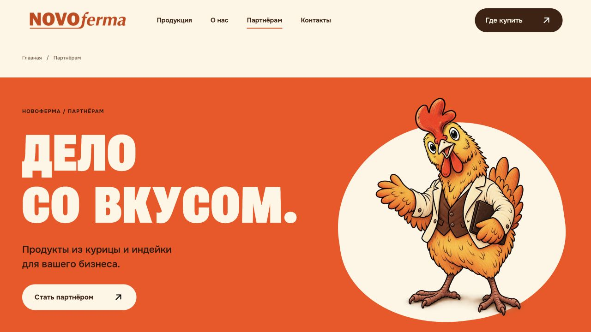

Направление найдено; лозунг и персонаж сильнее конкретного предложения поставщика.

[Источник экрана](http://127.0.0.1:8765/output/concept/partners.html)

### Экран 3. Фасовки и предложения

Партнёрам · 1280×720 · Частично.

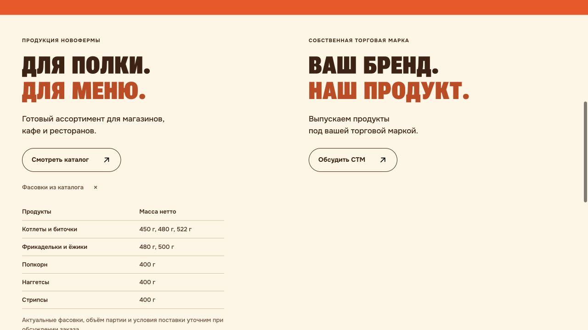

Таблица масс доступна. Розница и HoReCa объединены; процесса СТМ и закупочной спецификации недостаточно.

[Источник экрана](http://127.0.0.1:8765/output/concept/partners.html)

### Экран 4. Переход к запросу СТМ

Партнёрам · 1280×720 · Работает с ограничениями.

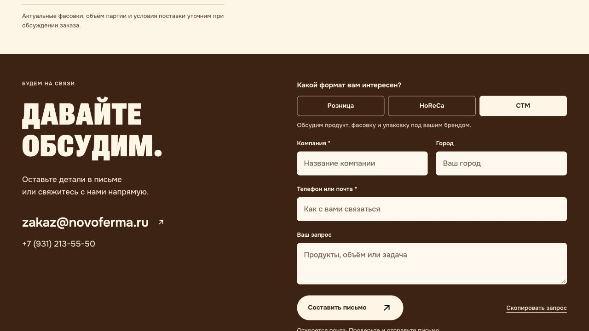

Действие корректно выбирает СТМ. Интерфейс готовит письмо; входящий лид не подтверждается.

[Источник экрана](http://127.0.0.1:8765/output/concept/partners.html#partner-contact)

### Экран 5. Обязательные поля

Партнёрам · 1280×720 · Работает.

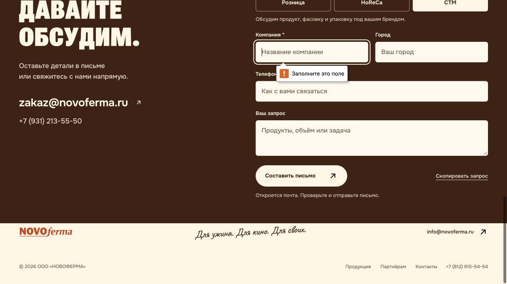

Пустое копирование блокируется, фокус получает компания. Внешнее письмо не отправлялось.

[Источник экрана](http://127.0.0.1:8765/output/concept/partners.html#partner-contact)

### Экран 6. Вход в каталог

Каталог · 1280×720 · Частично.

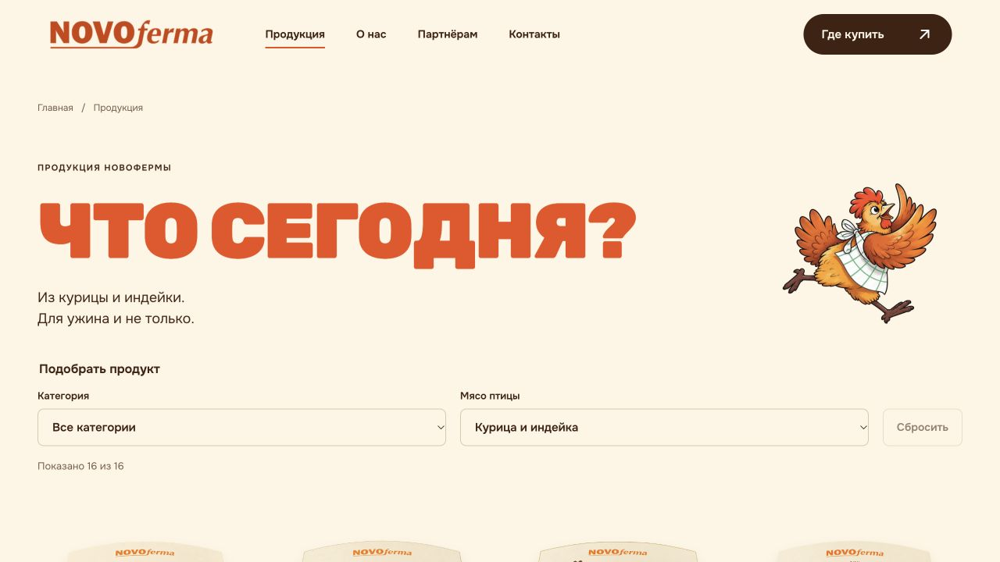

Фильтры понятны, но первый ряд почти ниже экрана.

[Источник экрана](http://127.0.0.1:8765/output/concept/catalogue.html)

### Экран 7. Продуктовая витрина

Каталог · 1280×720 · Хорошая основа.

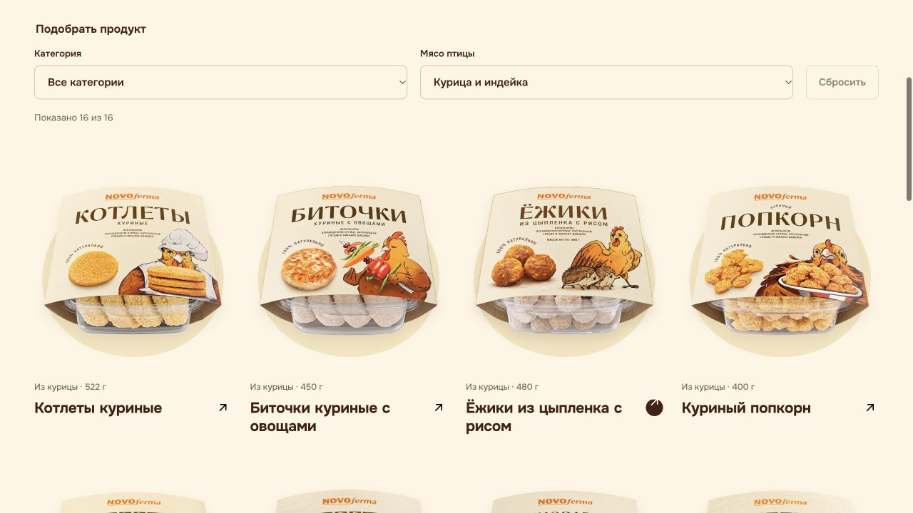

Упаковочная семья и текстовые массы помогают; закупочные и пищевые характеристики не сравнить.

[Источник экрана](http://127.0.0.1:8765/output/concept/catalogue.html)

### Экран 8. Серийный товар

Котлеты куриные · 1280×720 · Нужна доработка.

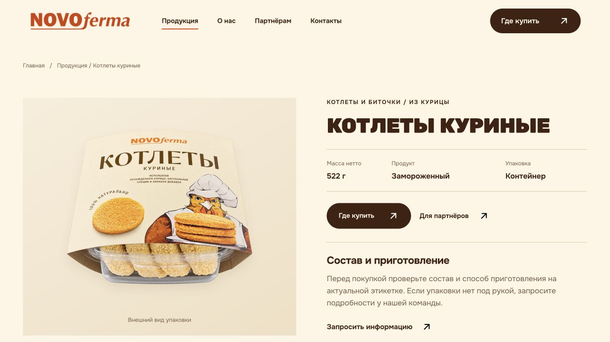

Понятны имя и масса; состав и приготовление предлагается уточнить. Основной CTA розничный.

[Источник экрана](http://127.0.0.1:8765/output/concept/product-kotlety-kurinye.html)

### Экран 9. Фибрики и клетчатка

Фибрики · 1280×720 · Честный концепт.

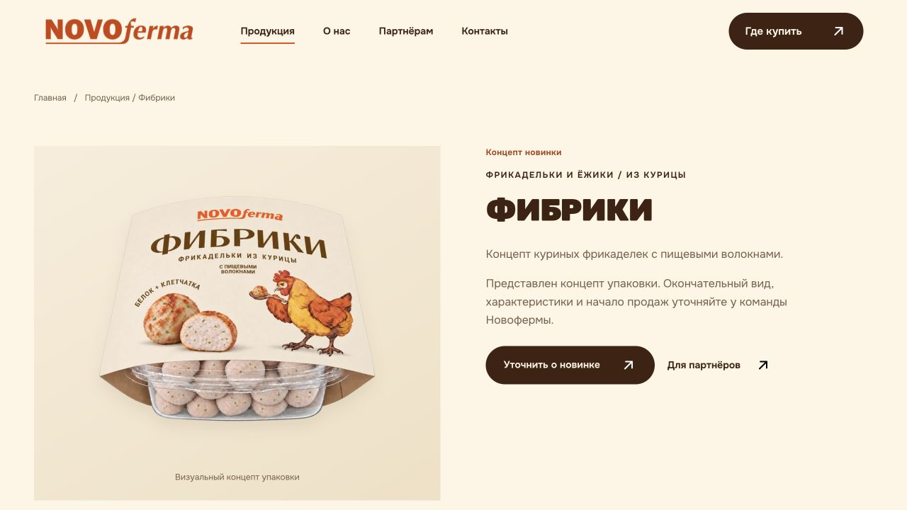

Статус концепта виден. Количество клетчатки и серийная готовность не установлены.

[Источник экрана](http://127.0.0.1:8765/output/concept/product-fibriki.html)

### Экран 10. Кто стоит за брендом

О нас · 1280×720 · Частично.

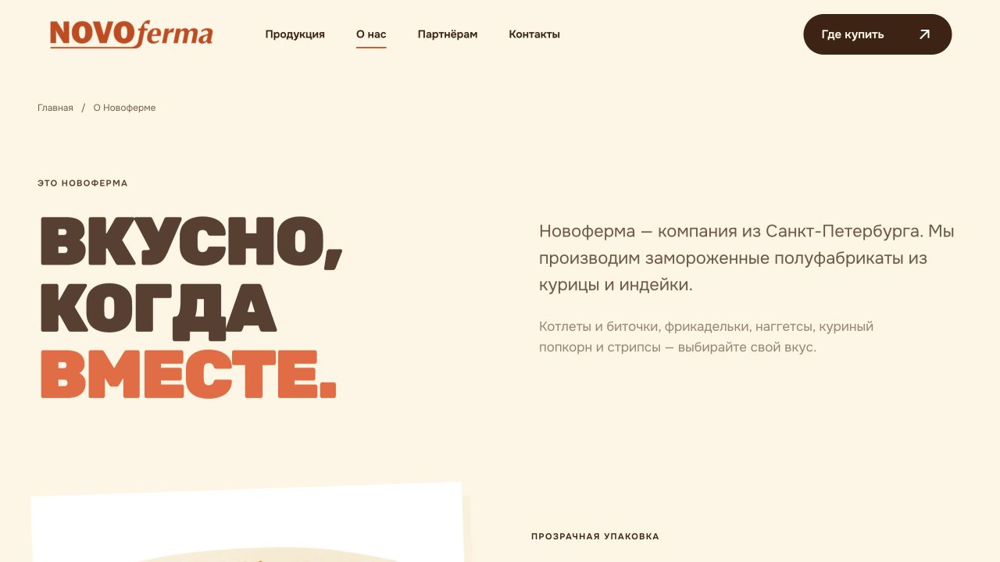

Компания и категория названы; мало оснований для квалификации поставщика.

[Источник экрана](http://127.0.0.1:8765/output/concept/about.html)

### Экран 11. Упаковка и производство

О нас · 1280×720 · Нужна доказательная часть.

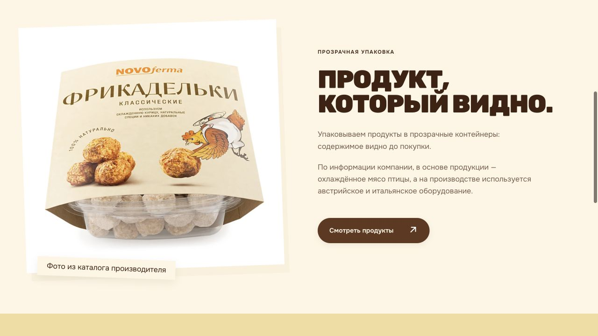

Фото упаковки подписано. Текст об оборудовании не заменяет производственный репортаж и документы.

[Источник экрана](http://127.0.0.1:8765/output/concept/about.html)

### Экран 12. Розничный путь

Где купить · 1280×720 · Работает в своём назначении.

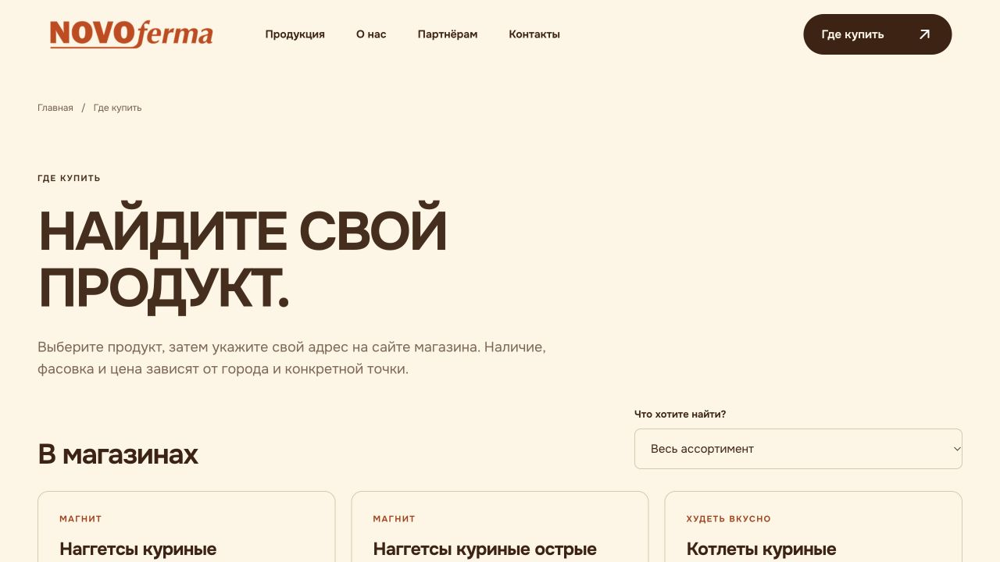

Есть ссылки на продавцов и ограничения; розничный раздел не заменяет оптовое предложение.

[Источник экрана](http://127.0.0.1:8765/output/concept/where-to-buy.html)

### Экран 13. Первый экран телефона

Главная · 390×844 · Хорошая мобильная основа.

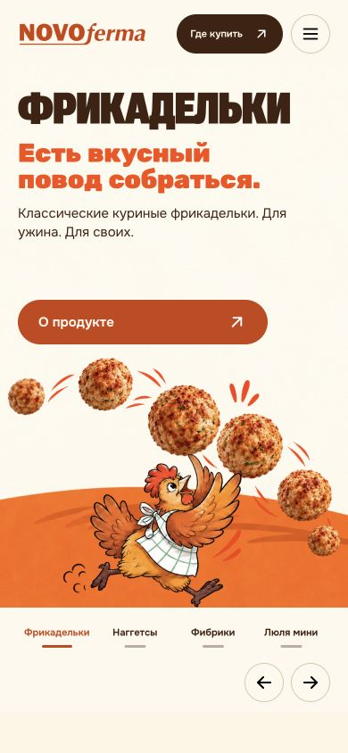

Название и действие читаются, вкладки подписаны; закупочный вход скрыт в меню.

[Источник экрана](http://127.0.0.1:8765/output/concept/index.html)

### Экран 14. Мобильное меню

Главная · 390×844 · Работает, можно усилить.

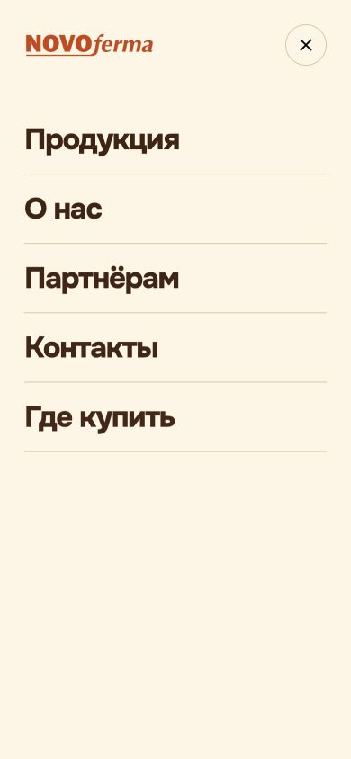

Названия разделов ясны, но нет прямого пункта СТМ/опт.

[Источник экрана](http://127.0.0.1:8765/output/concept/index.html)

### Экран 15. Мобильный B2B вход

Партнёрам · 390×844 · Частично.

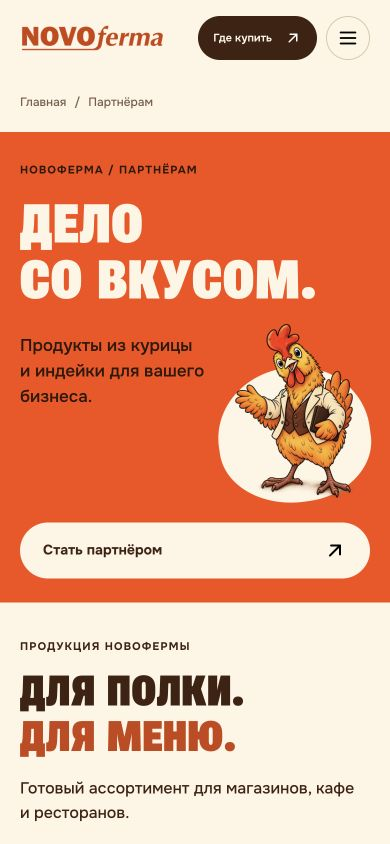

Композиция помещается, CTA заметен; смысл предложения остаётся общим.

[Источник экрана](http://127.0.0.1:8765/output/concept/partners.html)

### Экран 16. Мобильная форма СТМ

Партнёрам · 390×844 · Работает с трением.

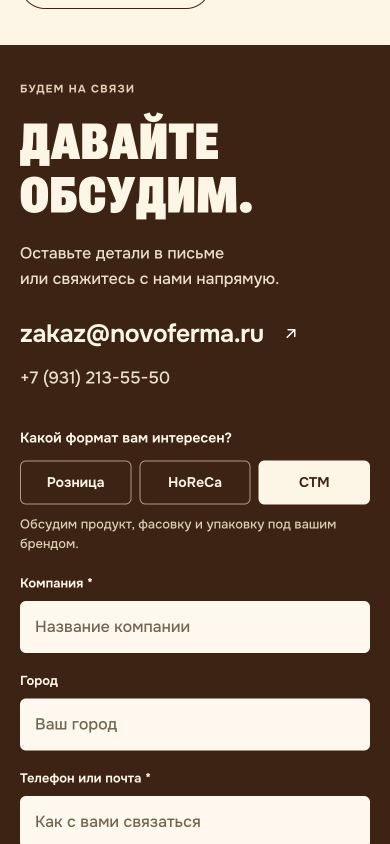

СТМ выбран, форма в одну колонку; заголовок и контакты занимают большую часть экрана перед полями.

[Источник экрана](http://127.0.0.1:8765/output/concept/partners.html#partner-contact)

### Экран 17. Товар на телефоне

Котлеты куриные · 390×844 · Частично.

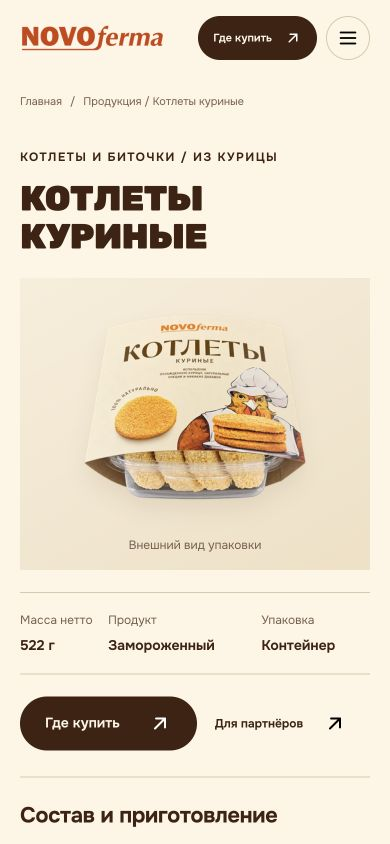

Название перед упаковкой, факты и CTA доступны; пищевой паспорт отсутствует.

[Источник экрана](http://127.0.0.1:8765/output/concept/product-kotlety-kurinye.html)

### Экран 18. Сравнение: вход в СТМ

Казанские Деликатесы · 1280×720 · Референс.

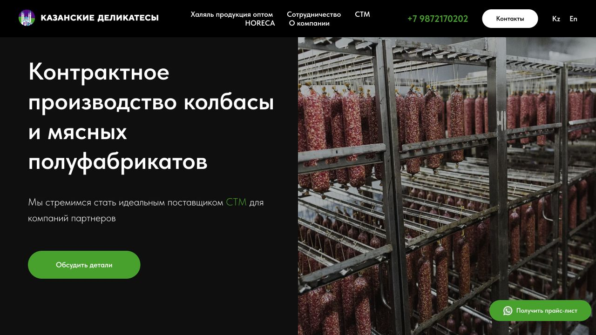

Прямое название услуги и фото производства. Не основание переносить чужие claims или стиль.

[Источник экрана](https://kazandelikates.tatar/stm)

### Экран 19. Сравнение: этапы проекта

Казанские Деликатесы · 1280×720 · Референс.

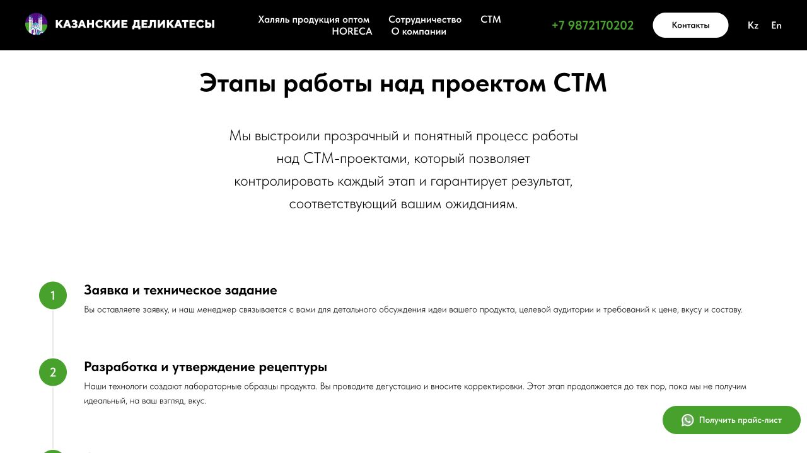

Видна последовательность от задания к образцам. Реальное исполнение не проверялось.

[Источник экрана](https://kazandelikates.tatar/stm#etap)

### Экран 20. Сравнение: производственный контекст

CP Foods UK · 1280×720 · Референс.

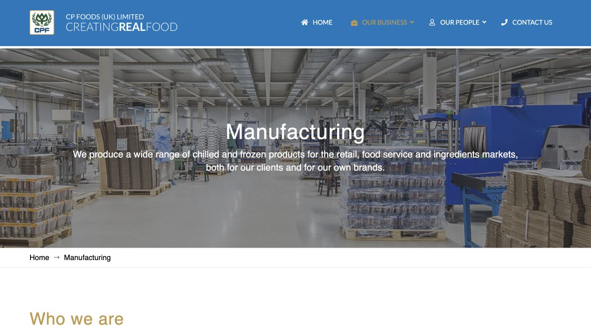

Операционная тема и названные каналы связываются с производственным изображением.

[Источник экрана](https://www.cpfoods.co.uk/manufacturing/)

### Экран 21. Сравнение: продукт и идентификация

Tyson Foodservice · 1280×720 · Референс.

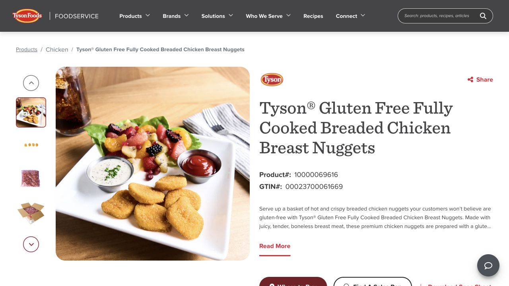

Аппетитная подача соседствует с Product#/GTIN; необязательно копировать объём навигации.

[Источник экрана](https://www.tysonfoodservice.com/products/tyson/chicken/nuggets-%26-specialty-shapes/00023700061669)

### Экран 22. Сравнение: закупочная упаковка

Tyson Foodservice · 1280×720 · Референс.

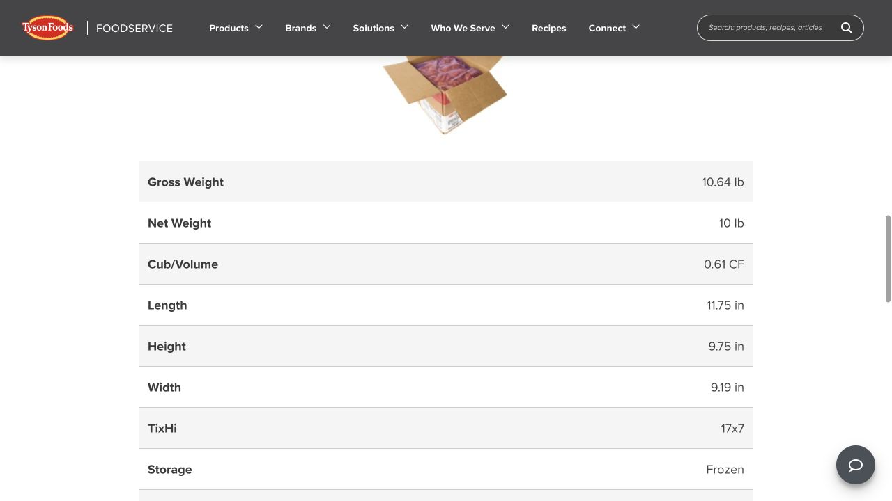

Показаны вес, габариты, схема укладки и frozen статус. Чужие значения не переносятся.

[Источник экрана](https://www.tysonfoodservice.com/products/tyson/chicken/nuggets-%26-specialty-shapes/00023700061669)

### Экран 23. Сравнение: производитель

Щёлковский МПК · 1280×720 · Референс.

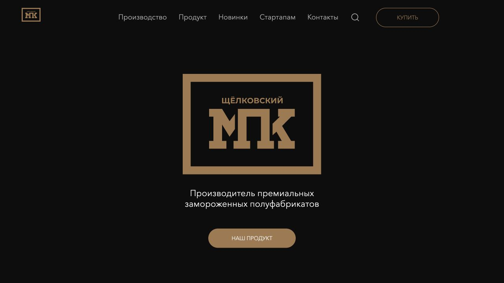

Позиционирование производителя явно; тёмную премиальную палитру копировать не требуется.

[Источник экрана](https://shmpk.ru/)

### Экран 24. Сравнение: контроль качества

Щёлковский МПК · 1280×720 · Референс.

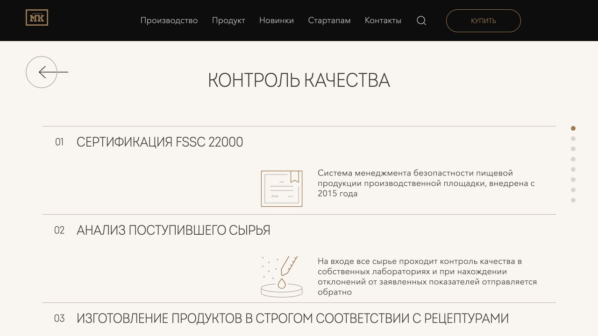

Отдельный путь к контролю сырья и производственной безопасности; сертификаты независимо не валидировались.

[Источник экрана](https://shmpk.ru/quality_control)

### Экран 25. Дельта 05.11: компактный B2B вход

Партнёрам · 390×844 · Улучшено 05.11.

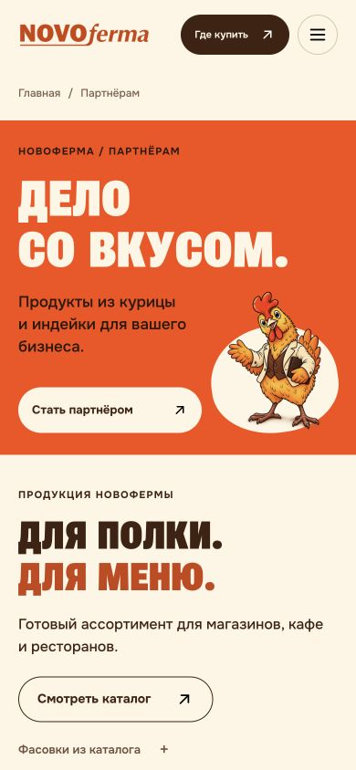

Повторный просмотр обновлённой композиции: CTA рядом с персонажем, больше следующего блока в экране.

[Источник экрана](http://127.0.0.1:8765/output/concept/partners.html)

### Экран 26. Дельта 05.11: карточки без стрелок

Каталог · 390×844 · Улучшено 05.11.

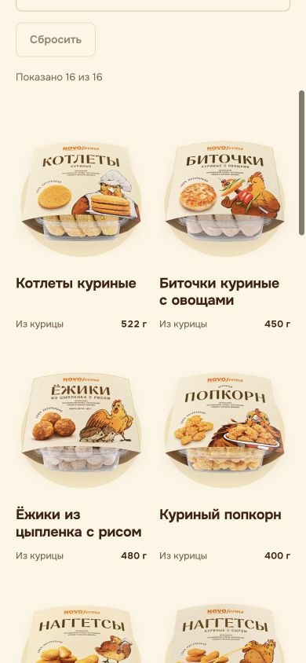

Название выше метаданных, масса выделена, одна ссылка сохранена. Hover эффект проверяется отдельно.

[Источник экрана](http://127.0.0.1:8765/output/concept/catalogue.html)

## 19. Подробные технические и коммерческие замечания

18 карточек. Приоритет — важность готовности B2B пути, а не измеренная потеря выручки. Факты и коммерческие гипотезы разделены.

### TC01 · P0 · Подготовка письма не подтверждает получение лида

**Статус доказательства:** Подтверждённый факт; влияние на продажи является гипотезой

**Наблюдение:** B2B submit создаёт mailto и открывает почтовый клиент. Copy пишет текст в clipboard либо показывает readonly draft. Серверной регистрации, receipt ID и CRM-вызова в подключённом JS нет. Интерфейс честно сообщает о самостоятельной отправке.

**Возможное влияние:** Пользователь может остановиться после подготовки письма; размер фактических потерь неизвестен.

**Рекомендация:** Определить операционную модель приёма: серверная форма с записью либо формализованный учёт входящей почты. Подтверждать «получено» только по входящей записи. Сохранить email/телефон как запасные каналы.

**Приёмка:**

- Контрольный запрос даёт запись с ID, временем, сегментом и ответственным.
- Отказ записи сохраняет введённое; повтор обрабатывается без необъяснимых дублей.
- mailto_open и copy_request не считаются lead_received.

**Кодовые основания:**

- [output/concept/partners-scenes.js:35](../../../output/concept/partners-scenes.js)
- [output/concept/partners-scenes.js:43](../../../output/concept/partners-scenes.js)
- [scripts/build_site.py:246](../../../scripts/build_site.py)

### TC02 · P0 · Воронка не измеряется до сделки

**Статус доказательства:** Подтверждённый факт; влияние на продажи является гипотезой

**Наблюдение:** В шести подключённых JS нет fetch/XMLHttpRequest/sendBeacon, gtag, ym, dataLayer, webhook/CRM. Формы не сохраняют UTM/referrer и lead ID. Доступа к входящей почте и внешней CRM нет. Это относится только к локальному прототипу. По новой проверке публичного novoferma.ru, выполненной root, web extraction видит mc.yandex.ru; доступ к кабинету/событиям/CRM всё равно отсутствует.

**Возможное влияние:** Нельзя отделить недостаток целевого трафика от потерь на квалификации, ответе, цене, логистике и повторном заказе.

**Рекомендация:** Согласовать этапы и минимальный реестр: источник, сегмент, полученный запрос, квалификация, КП, заказ, повтор. В аналитические события не включать содержимое полей. Звонки и внешнюю почту учитывать отдельно.

**Приёмка:**

- Есть словарь событий и знаменателей.
- Получение/квалификация/заказ поступают из операционного источника, не из клика.
- Выборка сверяется с журналом; email, телефон и сообщение не попадают в публичные URL/аналитику.

**Кодовые основания:**

- [scripts/build_site.py:69](../../../scripts/build_site.py)
- [scripts/build_site.py:73](../../../scripts/build_site.py)
- [output/concept/partners-scenes.js:20](../../../output/concept/partners-scenes.js)

### TC03 · P1 · Из товара в B2B теряется SKU

**Статус доказательства:** Подтверждённый факт; влияние на продажи является гипотезой

**Наблюдение:** На 16 product pages ссылка «Для партнёров» ведёт на partners.html без product/anchor. B2B makeRequest не содержит выбранного SKU. Потребительский CTA передаёт product в where-to-buy.

**Возможное влияние:** Закупщику нужно повторно назвать продукт, менеджеру недоступен контекст перехода. Эффект на конверсию не измерен.

**Рекомендация:** Передавать валидированный SKU/фасовку/статус концепта в B2B форму, показывать выбор человеку и разрешить изменить его.

**Приёмка:**

- Все product→B2B переходы сохраняют точный SKU и массу.
- Неизвестный query не вставляет произвольный HTML.
- Концепт не превращается в серийный товар при передаче.

**Кодовые основания:**

- [scripts/build_site.py:220](../../../scripts/build_site.py)
- [output/concept/partners-scenes.js:20](../../../output/concept/partners-scenes.js)
- [output/concept/script.js:80](../../../output/concept/script.js)

### TC04 · P1 · Три сегмента формы получают почти один оффер

**Статус доказательства:** Подтверждённый факт; влияние на продажи является гипотезой

**Наблюдение:** Розница и HoReCa объединены в «Для полки. Для меню.» с переходом в общий каталог. СТМ имеет свой оффер и корректно выбирает radio через data-partner-format. Главный CTA приходит к retail по умолчанию. Отдельного HoReCa маршрута в manifest нет.

**Возможное влияние:** Разные закупщики могут не получить ответы на собственные критерии. Это не доказательство необходимости трёх отдельных сайтов.

**Рекомендация:** Развести сценарии и доказательства: розница — короб/полка/логистика; HoReCa — приготовление/выход/порция; СТМ — разработка/образец/упаковка/согласование.

**Приёмка:**

- Каждый сегмент узнаёт свой сценарий и получает правильный preselect.
- Пять типовых вопросов сегмента имеют проверенный ответ или ясный следующий шаг.
- Нет придуманных MOQ, сроков, маржи.

**Кодовые основания:**

- [scripts/build_site.py:238](../../../scripts/build_site.py)
- [scripts/build_site.py:242](../../../scripts/build_site.py)
- [scripts/build_site.py:243](../../../scripts/build_site.py)
- [scripts/build_site.py:246](../../../scripts/build_site.py)
- [output/concept/partners-scenes.js:16](../../../output/concept/partners-scenes.js)

### TC05 · P1 · Недостаточно продуктовых паспортов

**Статус доказательства:** Подтверждённый факт; влияние на продажи является гипотезой

**Наблюдение:** 14/14 SKU имеют ingredients, nutrition, storage, preparation=null; allergens отсутствует. Масса, упаковка и птица заполнены. Генератор корректно не выдумывает поля и предлагает запросить сведения.

**Возможное влияние:** Нельзя самостоятельно оценить аллергенный профиль, хранение, кухонный процесс и сопоставимость позиций.

**Рекомендация:** Получить от технолога версионные паспорта 14 SKU: этикетка, состав, аллергены, БЖУ, температура/срок, приготовление, владелец и дата. Не переносить рецептуру между фасовками.

**Приёмка:**

- 14/14 SKU имеют источник, владельца и статус обязательных полей.
- Страница/документ соответствуют утверждённой этикетке и фасовке.
- Unknown остаётся unknown; данные не извлекаются по догадке из packshot.

**Кодовые основания:**

- [output/concept/products.json:22](../../../output/concept/products.json)
- [output/concept/products.json:31](../../../output/concept/products.json)
- [scripts/build_site.py:198](../../../scripts/build_site.py)
- [scripts/build_site.py:208](../../../scripts/build_site.py)

### TC06 · P1 · Таблица массы не заменяет B2B спецификацию

**Статус доказательства:** Подтверждённый факт; влияние на продажи является гипотезой

**Наблюдение:** Таблица партнёрам агрегирует категории и потребительские массы 400–522 г. В данных нет короба, GTIN, паллетизации, MOQ, shelf life, lead time и версий документов. На 22 маршрутах 0 PDF/download ссылок.

**Возможное влияние:** Закупщик вынужден уточнять базовые параметры. Отсутствие публичной цены само по себе не дефект.

**Рекомендация:** Создать закупочную карточку/выгрузку и путь запроса спецификации/образцов/условий. Публичный минимум отделить от конфиденциальных параметров. Не придумывать значения.

**Приёмка:**

- Каждый обязательный закупочный параметр заполнен либо имеет причину ограничения и владельца.
- Актуальный документ передаётся без переписывания SKU.
- Следующий шаг и ответственный понятны; SLA обещан только после согласования.

**Кодовые основания:**

- [scripts/build_site.py:232](../../../scripts/build_site.py)
- [scripts/build_site.py:242](../../../scripts/build_site.py)
- [output/concept/products.json:6](../../../output/concept/products.json)

### TC07 · P1 · СТМ заявлена без маршрута проекта

**Статус доказательства:** Подтверждённый факт; влияние на продажи является гипотезой

**Наблюдение:** Оффер СТМ содержит заголовок, одну фразу и кнопку. Нет стадий brief→образцы→утверждение→партия, границ операций, подтверждённых кейсов или downloadable brief.

**Возможное влияние:** Трудно оценить совместимость задачи и подготовить содержательный запрос. Отсутствие кейсов на сайте не доказывает отсутствия опыта.

**Рекомендация:** Описать фактический процесс СТМ, ограничения, испытания, ответственность за рецептуру/маркировку/упаковку. Показать согласованный кейс либо обезличенный процесс.

**Приёмка:**

- Шаги имеют вход, результат, ответственного.
- Brief собирает категорию, канал/упаковку, ориентир объёма и стадию задачи без чрезмерных обязательных полей.
- Публикуемые кейсы и цифры подтверждены.

**Кодовые основания:**

- [scripts/build_site.py:243](../../../scripts/build_site.py)
- [scripts/build_site.py:246](../../../scripts/build_site.py)

### TC08 · P1 · Protein/fiber требуют реестра доказательств

**Статус доказательства:** Подтверждённый факт; влияние на продажи является гипотезой

**Наблюдение:** Главная говорит о птице как природном источнике белка. Fibriki названы концептом с пищевыми волокнами. Количество белка/волокон конкретного продукта в данных не подтверждено; серийные nutrition=null. Рисунок упаковки не заменяет рецептуру/измерения.

**Возможное влияние:** Категорийную фразу могут прочитать как обещание свойств полуфабриката. По коду нельзя установить законность либо нарушение маркировки.

**Рекомендация:** Для каждого claim фиксировать точную фразу, SKU/рецептуру/фасовку, количественное основание и единицы, документ, согласование технологом и актуальную правовую проверку. Концепт оставить концептом.

**Приёмка:**

- Реестр охватывает сайт, изображения, презентации и будущую этикетку.
- Численные заявления относятся к конкретной рецептуре и имеют подтверждение.
- Перед печатью/запуском проверена актуальная редакция применимых норм; аудит не является сертификатом.

**Кодовые основания:**

- [scripts/build_site.py:153](../../../scripts/build_site.py)
- [scripts/build_site.py:177](../../../scripts/build_site.py)
- [scripts/build_site.py:182](../../../scripts/build_site.py)
- [output/concept/products.json:23](../../../output/concept/products.json)

### TC09 · P1 · B2B и потребительские пути конкурируют за контекст

**Статус доказательства:** Подтверждённый факт; влияние на продажи является гипотезой

**Наблюдение:** Главный header CTA — «Где купить». B2B доступен в nav и секции сотрудничества. Product page первично ведёт к потребительской покупке. Contacts уже правильно разделяет B2B и покупателей.

**Возможное влияние:** Если приоритет — новые B2B сделки, универсальная посадочная может не отвечать источнику захода. Реальная доля закупщиков неизвестна.

**Рекомендация:** Вести B2B кампании на контекстный оффер; проверить вариант ясного входа «Поставки для бизнеса», сохраняя покупательский путь.

**Приёмка:**

- Релевантная кампания ведёт к своему сегменту.
- Оценивается qualified lead received, не только CTR.
- Потребительский поиск покупки остаётся понятным.

**Кодовые основания:**

- [scripts/build_site.py:56](../../../scripts/build_site.py)
- [scripts/build_site.py:59](../../../scripts/build_site.py)
- [scripts/build_site.py:187](../../../scripts/build_site.py)
- [scripts/build_site.py:220](../../../scripts/build_site.py)
- [scripts/build_site.py:250](../../../scripts/build_site.py)

### TC10 · P2 · Контакт валидируется только на непустоту

**Статус доказательства:** Подтверждённый факт; влияние на продажи является гипотезой

**Наблюдение:** company/contact required; JS отсекает пустые и пробельные строки. contact type=text без pattern принимает любую непустую строку. Смешанное «Телефон или почта» не объявляется нарушением autocomplete/SC1.3.5.

**Возможное влияние:** Опечатка может сделать обращение непригодным, но чрезмерная маска тоже блокирует клиентов.

**Рекомендация:** Уточнить предпочтительный канал, дать пример и мягкую проверку выбранного типа. При backend валидировать повторно на сервере. Не требовать два канала без необходимости.

**Приёмка:**

- Корректные международные номера и email не блокируются.
- Ошибки имеют ясный текст и доступны с клавиатуры/диктором.
- Отсутствие autocomplete у mixed-purpose input не названо доказанным WCAG fail.

**Кодовые основания:**

- [scripts/build_site.py:246](../../../scripts/build_site.py)
- [output/concept/partners-scenes.js:31](../../../output/concept/partners-scenes.js)

### TC11 · P1 · Обнаружимость этой сборки ещё не подтверждена

**Статус доказательства:** Подтверждённый факт; влияние на продажи является гипотезой

**Наблюдение:** publicUrl=null; текущие 22 HTML имеют 0 canonical/JSON-LD, нет sitemap/robots. Генератор включает canonical/OG/Breadcrumb/discovery с --site-url. README сообщает об отсутствии публичного деплоя; публичный production этим блоком не исследован. Root отдельно установил, что публичный сайт отличается от прототипа. Нельзя связывать исторически низкие продажи с конверсией этой локальной версии.

**Возможное влияние:** Нельзя переносить выводы preview на индексацию novoferma.ru. GitHub-публикация аудита не является коммерческим деплоем.

**Рекомендация:** Определить production domain/URL, проверить HTTPS, robots/noindex, canonical, sitemap, редиректы и поисковые кабинеты. Product/Offer schema — только с подтверждёнными полями.

**Приёмка:**

- Production URL доступны и имеют согласованную политику индексации.
- Старые URL сопоставлены с новыми до миграции.
- Индексация/показы проверяются по данным инструментов; позиций не обещают.

**Кодовые основания:**

- [scripts/build_site.py:76](../../../scripts/build_site.py)
- [scripts/build_site.py:254](../../../scripts/build_site.py)
- [output/concept/site-manifest.json:1](../../../output/concept/site-manifest.json)
- [README.md:6](../../../README.md)

### TC12 · P2 · Поисковый B2B контент общий

**Статус доказательства:** Подтверждённый факт; влияние на продажи является гипотезой

**Наблюдение:** Title партнёров — «Партнёрам — Новоферма», H1 — «Дело со вкусом». Description описывает каналы, но три сегмента объединены на одном URL. Все 22 title и description уникальны.

**Возможное влияние:** Сниппет может слабо объяснять предложение. Потеря органического трафика без поисковых данных не доказана.

**Рекомендация:** Семантика из реальных запросов/обращений: производство полуфабрикатов, СТМ, магазины/кухни. Уточнить title/lead; отдельные страницы создавать при самостоятельной полезной информации.

**Приёмка:**

- Сниппет и первый экран называют продукт/сегмент/действие.
- Новые страницы отвечают самостоятельному intent, а не дублируют шаблон.
- Проверяются релевантные показы и квалифицированные обращения.

**Кодовые основания:**

- [scripts/build_site.py:238](../../../scripts/build_site.py)
- [scripts/build_site.py:248](../../../scripts/build_site.py)
- [output/concept/partners.html:1](../../../output/concept/partners.html)

### TC13 · P2 · B2B hero требует отдельного image budget

**Статус доказательства:** Подтверждённый факт; влияние на продажи является гипотезой

**Наблюдение:** 447 img occurrences имеют alt/width/height; 90 используют srcset. Partner-host — один 1024×1536 источник без srcset, high priority/sync decode. Уникальные прямые img src партнёрской страницы суммарно 368031 байт: это не сетевой вес страницы.

**Возможное влияние:** На mobile возможна лишняя загрузка декора. Не установлено, является ли маскот LCP или препятствует ли обращению.

**Рекомендация:** Измерить currentSrc/network/LCP на целевых устройствах; по результату добавить небольшие варианты и точные sizes, сохранив рисунок/alpha.

**Приёмка:**

- Записаны viewport/DPR, cache/network profile, выбранный файл и bytes.
- CWV и CLS шрифтов/изображений проверяются отдельно от VM.
- Production p75 ориентиры сопровождаются мониторингом, не одиночным screenshot.

**Кодовые основания:**

- [scripts/build_site.py:239](../../../scripts/build_site.py)
- [output/concept/partners-scenes.css:121](../../../output/concept/partners-scenes.css)
- [output/concept/partners-scenes.css:123](../../../output/concept/partners-scenes.css)
- [scripts/build_site.py:22](../../../scripts/build_site.py)

### TC14 · P2 · Доступность: хорошая база, ограниченная приемка

**Статус доказательства:** Подтверждённый факт; влияние на продажи является гипотезой

**Наблюдение:** Есть lang/skip-link/один h1/native dialog, label/fieldset/legend, role=status, readonly draft, tab/panel semantics. B2B поля min-height52px, radios44px, focus-visible. VM не проверяет произношение, контраст или zoom.

**Возможное влияние:** Настоящее прохождение задачи с диктором не гарантируется наличием атрибутов.

**Рекомендация:** Проверить клавиатуру, VoiceOver/NVDA, zoom200/400%, узкий viewport: сегмент, ошибка, copy/denied API, draft, mailto fallback, меню/панели.

**Приёмка:**

- Нет недоступного фокуса и скрытых интерактивных панелей.
- Статусы/ошибки читаются, draft имеет имя.
- Реальные пары контраста и clipping измерены; полного WCAG compliance claim пока нет.

**Кодовые основания:**

- [scripts/build_site.py:59](../../../scripts/build_site.py)
- [scripts/build_site.py:246](../../../scripts/build_site.py)
- [output/concept/partners-scenes.css:65](../../../output/concept/partners-scenes.css)
- [output/concept/partners-scenes.css:74](../../../output/concept/partners-scenes.css)
- [output/concept/product-hero.js:46](../../../output/concept/product-hero.js)

### TC15 · P2 · Motion оценивается по задаче

**Статус доказательства:** Подтверждённый факт; влияние на продажи является гипотезой

**Наблюдение:** Hero ручной, без autoplay; inactive art загружается по выбору/idle, saveData/2g/hidden ограничивают prefetch. Reveal сохраняет первый viewport и focusin. Depth ограничен >=900px/no-preference/fine pointer, paused hidden/menu. На partners product-hero.js не подключён.

**Возможное влияние:** Нет основания называть всю анимацию причиной продаж. Локальные задержки/отвлечение требуют наблюдения.

**Рекомендация:** Проверять B2B задачу с motion/reduced-motion; менять эффект по понятности, latency и фокусу, а не по моде.

**Приёмка:**

- Задача доступна при reduced-motion и без декора.
- Нет автосмены смысла и устаревшей сцены при быстрых кликах.
- Нагрузочные утверждения основаны на профилировании.

**Кодовые основания:**

- [output/concept/product-hero.js:102](../../../output/concept/product-hero.js)
- [output/concept/script.js:44](../../../output/concept/script.js)
- [output/concept/script.js:53](../../../output/concept/script.js)
- [output/concept/depth.js:5](../../../output/concept/depth.js)
- [output/concept/depth.js:24](../../../output/concept/depth.js)
- [scripts/build_site.py:63](../../../scripts/build_site.py)

### TC16 · P2 · Retail links отражают покрытие ссылок, не спрос

**Статус доказательства:** Подтверждённый факт; влияние на продажи является гипотезой

**Наблюдение:** 5 карточек для 5/14 SKU, два магазина; две отмечены недоступными в наблюдавшейся странице, три — order control без независимого подтверждения stock. verifiedAt24.10.2026; магазины в этом блоке сегодня не перепроверялись. У 9SKU и 2 концептов retail-ссылок нет.

**Возможное влияние:** Это не доказательство фактической дистрибуции, дефицита или причины низких продаж.

**Рекомендация:** Вести retailer evidence по городу/фасовке/дате, назначить перепроверку. Согласовать реальные каналы с продажами; не выдавать карточку за наличие.

**Приёмка:**

- Даты и owner актуализации назначены.
- Наличие проверяется по выбранному городу.
- Концепты не выдаются за товар в продаже.

**Кодовые основания:**

- [output/concept/retailers.json:1](../../../output/concept/retailers.json)
- [scripts/site_sections.py:18](../../../scripts/site_sections.py)
- [output/concept/where-to-buy.js:7](../../../output/concept/where-to-buy.js)

### TC17 · P1 · Нет оформленного supplier evidence pack

**Статус доказательства:** Подтверждённый факт; влияние на продажи является гипотезой

**Наблюдение:** About сообщает об оборудовании и охлаждённом мясе «по информации компании». Партнёрам не показаны проверяемые кейсы/версии документов/география и процесс поставки. Скачиваемого закупочного пакета на 22 маршрутах нет.

**Возможное влияние:** Закупщику трудно проверить обещание и представить поставщика коллегам. Иллюстрация не доказывает мощности; отсутствие документов на сайте не означает отсутствие их у компании.

**Рекомендация:** Собрать компактный supplier pack: юридическое лицо, ответственный, фактические возможности, документы SKU, логистика, утверждённые фото/контроль качества, согласованный кейс.

**Приёмка:**

- Каждый factual claim имеет документ/owner.
- Пакет можно переслать закупщику/технологу с версией и датой.
- Концепты не смешаны с доказательствами реального производства.

**Кодовые основания:**

- [scripts/build_site.py:224](../../../scripts/build_site.py)
- [scripts/build_site.py:237](../../../scripts/build_site.py)
- [scripts/build_site.py:245](../../../scripts/build_site.py)

### TC18 · P2 · GitHub публикация должна оставаться audit only

**Статус доказательства:** Подтверждённый факт; влияние на продажи является гипотезой

**Наблюдение:** main/origin main и git ls-remote main подтверждают 3894d447cbff0a6a2e9d7b637910ca71e736ae5d. Origin hjj96/novoferma. Tracked workflows .github отсутствуют. Исходный чужой untracked: output/research/fibriki-pack-repair-v12/.

**Возможное влияние:** git add . может захватить несвязанный artwork. Commit/push отчёта не означает deployment сайта.

**Рекомендация:** Root публикует только audit directory и согласованный индекс при необходимости. Проверить staged diff/stat, evidence/ссылки; обычный commit/push без изменения приватности.

**Приёмка:**

- В commit нет runtime/build scripts и fibriki-pack-repair-v12.
- Evidence включены либо имеют честный внешний source.
- В финале ссылка на GitHub commit/report; Pages/деплой/смена видимости не подразумеваются.

**Кодовые основания:**

- [README.md:57](../../../README.md)
- [.gitignore:1](../../../.gitignore)

## 20. Независимый второй визуальный проход

20 карточек по восьми свежим кадрам. Это второй экспертный просмотр, а не независимое исследование поведения покупателей. Часть тем пересекается с предыдущим разделом; складывать карточки как 38 независимых причин потерь нельзя.

### VB01 · P1 · Еда пересекает навигацию на текущем desktop-кадре

**Видно на кадре:** На кадре 1280×720 верхняя крупная фрикаделька находится за областью пункта «Контакты». В mobile390 текст навигации скрыт за меню и такой коллизии на кадре нет.

**Эффект по экспертной оценке:** Декоративный объект конкурирует с функциональной строкой. Это выглядит как недосмотр адаптива и снижает ощущение аккуратности ещё до знакомства с компанией.

**Рекомендация:** Задать защищённую область header: пищевые объекты и их тени не должны пересекать логотип, текст ссылок или кнопку. Проверять интервал ширин, а не только два крайних breakpoint.

**Приёмка:** На 1280, соседних desktop-ширинах и при увеличении текста навигационные элементы остаются на чистой подложке; сцена не обрезается ради случайного исправления.

Кадры: [01-home-desktop](screens/01-home-desktop.png), [13-home-mobile](screens/13-home-mobile.png)

### VB02 · P1 · B2B-первый экран обещает настроение раньше делового результата

**Видно на кадре:** В desktop-входе основную площадь занимают «Дело со вкусом» и персонаж; конкретика ограничивается птицей для бизнеса и кнопкой «Стать партнёром». На mobile начало следующего блока уже поясняет «Для полки. Для меню».

**Эффект по экспертной оценке:** Эмоция бренда есть, но закупщик ещё не понимает, какой формат сотрудничества подходит ему и что он получит после клика. Это вывод о первом экране, а не заявление об отсутствии информации на всей странице.

**Рекомендация:** Сохранить лозунг как брендовый акцент, рядом кратко назвать подтверждённые направления и результат обращения: ассортимент/условия, образцы или обсуждение СТМ. Важное обещание должно быть конкретным и выполнимым.

**Приёмка:** В первом экране пользователь может объяснить, кому адресовано предложение, что поставляется и какой следующий деловой шаг доступен.

Кадры: [02-partners-entry-desktop](screens/02-partners-entry-desktop.png), [15-partners-mobile](screens/15-partners-mobile.png), [19-reference-kazan-process](screens/19-reference-kazan-process.png)

### VB03 · P2 · Глобальный header сильнее направляет в розницу, чем в B2B

**Видно на кадре:** «Где купить» оформлено заметной тёмной кнопкой; «Партнёрам» на desktop — текстовая ссылка. На B2B-странице розничная кнопка остаётся в header, а на mobile она видна раньше коммерческого предложения.

**Эффект по экспертной оценке:** Для смешанного сайта это допустимый выбор, но в B2B-сценарии визуальный приоритет расходится с задачей страницы.

**Рекомендация:** Определить приоритет по контексту страницы: на B2B-входе коммерческий контакт должен быть не менее понятным, чем потребительский поиск покупки. Общую навигацию оставить предсказуемой.

**Приёмка:** По одному взгляду на B2B-header и первый экран можно найти обращение по поставкам; названия действий не заставляют угадывать их назначение.

Кадры: [01-home-desktop](screens/01-home-desktop.png), [02-partners-entry-desktop](screens/02-partners-entry-desktop.png), [15-partners-mobile](screens/15-partners-mobile.png)

### VB04 · P2 · Персонаж в деловом костюме сообщает роль, но не доказывает компетентность

**Видно на кадре:** Петух с пиджаком, жилетом и папкой занимает почти правую половину desktop-входа. Сам визуальный знак «деловой» понятен; рядом нет показанного в этом кадре производственного факта или этапа работы.

**Эффект по экспертной оценке:** Для тёплого бренда приём уместен. При таком масштабе он может восприниматься как замена содержательному деловому доказательству. Это профессиональная оценка тона, а не измеренный результат исследований покупателей.

**Рекомендация:** Сохранить персонажа как проводника, а доверие строить на подтверждённой информации и следующем шаге. Не добавлять костюму ещё больше атрибутов «солидности».

**Приёмка:** Даже если мысленно убрать персонажа, предложение партнёру остаётся содержательным и убедительным.

Кадры: [02-partners-entry-desktop](screens/02-partners-entry-desktop.png), [15-partners-mobile](screens/15-partners-mobile.png), [19-reference-kazan-process](screens/19-reference-kazan-process.png)

### VB05 · P2 · Семейность сильнее там, где герой участвует в понятном бытовом действии

**Видно на кадре:** Домашний герой в фартуке, семейная фраза и продукты на упаковках образуют связный мир. Взлетающие фрикадельки и жестикуляция усиливают игровой характер. На Фибрики птица взаимодействует с конкретным продуктом.

**Эффект по экспертной оценке:** Домашняя узнаваемость поддерживает семью и общую трапезу. Избыток игрового действия может сдвигать восприятие в сторону детского развлечения; возрастную адресацию по иллюстрации доказать нельзя.

**Рекомендация:** Закрепить роли: персонаж на упаковке объясняет продукт/ситуацию; campaign допускает игру; B2B отдаёт главное место ассортименту и процессу. Не объявлять маскота проблемой сам по себе.

**Приёмка:** В каждой сцене можно назвать одну функцию персонажа. Его эмоция и реквизит связаны с продуктом, а не добавлены только для заполнения места.

Кадры: [01-home-desktop](screens/01-home-desktop.png), [13-home-mobile](screens/13-home-mobile.png), [07-catalogue-grid](screens/07-catalogue-grid.png), [09-fiber-concept](screens/09-fiber-concept.png)

### VB06 · P2 · Семейство персонажей узнаваемо, но манера исполнения неоднородна

**Видно на кадре:** У домашней курицы, делового петуха и птиц на упаковках общий цветовой мир и перьевые мотивы. При этом различаются глаза, плотность контура, штриховка и объём; деловой персонаж выглядит более округлым и подробно отрисованным.

**Эффект по экспертной оценке:** Разные роли допустимы, однако без общих правил серия может восприниматься как набор удачных отдельных картинок. По этим кадрам нельзя устанавливать происхождение изображений или способ их создания.

**Рекомендация:** Описать краткий character guide: пропорции головы/тела, контур, свет, палитра, уровень детализации, реквизит и пределы эмоций. Сначала согласовать правила, затем решать, какие изображения действительно нуждаются в правке.

**Приёмка:** Новые персонажи проходят сравнение с эталоном семейства; различия объясняются ролью, а не случайной манерой рисования.

Кадры: [01-home-desktop](screens/01-home-desktop.png), [02-partners-entry-desktop](screens/02-partners-entry-desktop.png), [07-catalogue-grid](screens/07-catalogue-grid.png), [09-fiber-concept](screens/09-fiber-concept.png)

### VB07 · P2 · Главная продаёт готовое блюдо, но не показывает товарную форму в первом экране

**Видно на кадре:** В hero видны приготовленные фрикадельки и герой. Упаковка появляется в каталожной системе, но в этих двух первых экранах не показана.

**Эффект по экспертной оценке:** Для потребительской рекламы это эмоционально понятно. Для закупщика связь «аппетитная сцена → конкретный SKU/фасовка» возникает позже.

**Рекомендация:** Не превращать hero в складской прайс. Обеспечить короткий переход от сцены к конкретному товару и его доступной фасовке; различать сервировку и вид поставляемого продукта.

**Приёмка:** После действия из hero человек попадает к тому же продукту и понимает, что именно поставляется, а что является примером подачи.

Кадры: [01-home-desktop](screens/01-home-desktop.png), [13-home-mobile](screens/13-home-mobile.png), [07-catalogue-grid](screens/07-catalogue-grid.png)

### VB08 · P3 · Каталог — сильнейший видимый аргумент реальности ассортиментной линейки

**Видно на кадре:** Четыре карточки выстроены в регулярную сетку; реальные товарные формы, кремовые этикетки, бренд и домашние герои связывают ряд. Название вынесено обычным текстом под упаковкой.

**Эффект по экспертной оценке:** Серия выглядит более предметно и убедительно для закупки, чем отдельная рекламная сцена. Упаковки показывают, что за брендом есть различимый ассортимент.

**Рекомендация:** Оставить общий принцип сетки и семейство упаковок. При расширении каталога нормировать масштаб товарной формы, оптический центр и поля изображения.

**Приёмка:** Карточки можно сравнивать без зрительного скачка размера упаковок; имя товара читается независимо от мелкого текста на этикетке.

Кадры: [07-catalogue-grid](screens/07-catalogue-grid.png), [09-fiber-concept](screens/09-fiber-concept.png)

### VB09 · P2 · У карточек есть потребительские признаки, но мало закупочных сигналов

**Видно на кадре:** В видимом ряду каталога под упаковкой показаны мясо птицы, масса и имя. У Tyson в первом экране рядом с именем сразу находятся Product# и GTIN. Отсутствие артикулов на других страницах Новофермы здесь не устанавливается.

**Эффект по экспертной оценке:** Наш ряд удобен для знакомства, но слабее помогает закупщику составить список, сверить позиции или отправить точный запрос.

**Рекомендация:** Добавлять закупочные поля выборочно: артикул и формат поставки там, где они помогают сравнению. Не перегружать карточку всеми данными паспорта.

**Приёмка:** Из списка можно однозначно сослаться на выбранный товар; детальная карточка содержит согласованный паспорт с тем же идентификатором.

Кадры: [07-catalogue-grid](screens/07-catalogue-grid.png), [21-reference-tyson-product](screens/21-reference-tyson-product.png)

### VB10 · P2 · Тёплая подложка объединяет ассортимент, но снижает отделение светлой упаковки

**Видно на кадре:** Кремовые этикетки, светлые органичные подложки и общий кремовый фон близки по светлоте. На Фибрики крупное изображение находится в отдельном бежевом прямоугольнике.

**Эффект по экспертной оценке:** Палитра цельная и спокойная, однако верхний контур упаковок местами мало отделяется от среды. Разные типы подложек создают лёгкую несогласованность между каталогом и PDP.

**Рекомендация:** Задать одну логику товарной сцены: достаточное отличие фона и упаковки, одинаковые принципы тени, чистые поля. Решать контраст нейтральной подложкой, не добавлением декоративной рамки.

**Приёмка:** Светлая упаковка различима при уменьшении изображения; фон поддерживает товар, а не формирует отдельный декоративный объект.

Кадры: [07-catalogue-grid](screens/07-catalogue-grid.png), [09-fiber-concept](screens/09-fiber-concept.png)

### VB11 · P2 · У типографики есть характер, но роли нужно зафиксировать

**Видно на кадре:** Главная использует очень тяжёлое широкое название и крупный акцентный слоган. B2B-вход — узкий высокий заголовок. Каталожные названия и основной текст заметно спокойнее. Конкретные семейства шрифтов по скриншотам не устанавливаются.

**Эффект по экспертной оценке:** Различие ролей может работать на бренд; проблема появляется, если каждая страница самостоятельно выбирает новую степень громкости. Требование свести всё к одному шрифту из этих кадров не следует.

**Рекомендация:** Закрепить назначение трёх основных ролей: campaign, деловой/редакционный заголовок, информационный текст. Для каждого определить регистр, интервалы, длину строки и допустимую плотность.

**Приёмка:** Новый заголовок можно оформить по существующему правилу, не выбирая очередной визуальный стиль; длинные товарные названия остаются читаемыми.

Кадры: [01-home-desktop](screens/01-home-desktop.png), [02-partners-entry-desktop](screens/02-partners-entry-desktop.png), [07-catalogue-grid](screens/07-catalogue-grid.png), [09-fiber-concept](screens/09-fiber-concept.png)

### VB12 · P2 · Два крупных сообщения hero конкурируют по громкости

**Видно на кадре:** Название «Фрикадельки» и эмоциональная фраза оба тяжёлые и крупные; пояснение о продукте существенно тише. На mobile они умещаются и не обрезаны, но занимают почти всю верхнюю текстовую часть.

**Эффект по экспертной оценке:** Бренд запоминается, однако иерархия построена в основном на цвете двух громких блоков. Информация о самом продукте становится третьестепенной.

**Рекомендация:** Сохранить выразительный заголовок, уточнить порядок чтения между именем, слоганом и описанием. Не ослаблять весь брендовый характер — выбрать один главный голос в пределах одного экрана.

**Приёмка:** При быстром взгляде сначала считывается одна главная мысль, затем конкретика, затем действие; порядок не зависит только от оранжевого цвета.

Кадры: [01-home-desktop](screens/01-home-desktop.png), [13-home-mobile](screens/13-home-mobile.png)

### VB13 · P1 · Статус Фибрики честный, но упаковка уже выглядит коммерчески готовой

**Видно на кадре:** Страница явно содержит «Концепт новинки», пояснение о концепте упаковки и уточнении характеристик/начала продаж. Сам packshot v11 тщательно оформлен и несёт заметное «Белок + клетчатка». Количества нутриентов в этом кадре нет.

**Эффект по экспертной оценке:** Дисклеймер снижает риск неправильного ожидания, но сильный packshot может запомниться раньше статуса. Наличие ингредиента и изображённого claim не является подтверждением пищевой характеристики; нарушения законодательства по кадру не устанавливаются.

**Рекомендация:** Согласовать видимость стадии продукта во всех точках входа. Для перехода к продаже нужны утверждённая спецификация и проверенные формулировки; визуальная готовность упаковки не должна опережать подтверждённую готовность предложения.

**Приёмка:** Посетитель и получатель пересланной карточки отличают концепт от доступного SKU; смысл подписи и утверждений на упаковке не противоречит состоянию проекта.

Кадры: [09-fiber-concept](screens/09-fiber-concept.png), [07-catalogue-grid](screens/07-catalogue-grid.png)

### VB14 · P3 · Фибрики v11 уже встроены в визуальную семью

**Видно на кадре:** У Фибрики сохранены кремовая этикетка, коричневая продуктовая типографика, красный бренд, курица и прозрачный контейнер. Название легко отделяется от общей категории.

**Эффект по экспертной оценке:** Новинка воспринимается продолжением линейки, а не случайным сторонним продуктом. Это сильная отправная точка для обсуждения ассортимента.

**Рекомендация:** Оставить семейную архитектуру упаковки и различимость имени. Проверять дальнейшие изменения по соседним SKU, а не в изоляции.

**Приёмка:** Новая упаковка узнаётся как Новоферма и одновременно не путается с классическими фрикадельками.

Кадры: [09-fiber-concept](screens/09-fiber-concept.png), [07-catalogue-grid](screens/07-catalogue-grid.png)

### VB15 · P2 · Мелкие пояснения визуально слабее, чем их деловой смысл

**Видно на кадре:** Масса/тип мяса, подпись концепта под изображением и часть пояснений набраны небольшим спокойным текстом. На снимке они читаются хуже крупных продуктовых названий. Формальный контраст по screenshot не измерен.

**Эффект по экспертной оценке:** Если именно подпись сообщает готовность товара или важное ограничение, её низкий визуальный приоритет мешает правильной оценке предложения.

**Рекомендация:** Разделить действительно второстепенные подписи и существенные статусы. Значимые данные оставить текстом с достаточным размером/контрастом; WCAG оценивать по реальным CSSцветам и состояниям отдельно.

**Приёмка:** В масштабе 100% и на mobile статус, масса и категория не требуют приближения; проверка контраста документируется измерением, а не субъективным впечатлением.

Кадры: [07-catalogue-grid](screens/07-catalogue-grid.png), [09-fiber-concept](screens/09-fiber-concept.png)

### VB16 · P1 · В B2B доверие формирует последовательность работы, а не деловая иллюстрация

**Видно на кадре:** На референсе Казанских деликатесов видны нумерованные шаги с заявкой/техническим заданием и разработкой/утверждением рецептуры. В наших первых экранах таких результатов и действий ещё нет.

**Эффект по экспертной оценке:** Сравнение показывает содержательную разницу: референс объясняет участие заказчика. Его белый фон и сдержанность сами по себе не доказывают более высокое качество производства.

**Рекомендация:** Применить принцип наблюдаемого процесса: что делает клиент, что делает производитель и какой результат согласуют. Разместить достаточно близко к B2Bпредложению; не копировать конкретные обещания чужого бизнеса.

**Приёмка:** Каждый показанный этап связан с подтверждённым рабочим процессом и имеет понятный результат. Сроки и гарантии не придуманы дизайнером.

Кадры: [02-partners-entry-desktop](screens/02-partners-entry-desktop.png), [15-partners-mobile](screens/15-partners-mobile.png), [19-reference-kazan-process](screens/19-reference-kazan-process.png)

### VB17 · P2 · У Tyson эмоциональная подача связана с товарными ракурсами

**Видно на кадре:** На кадре Tyson крупная сервировка сопровождается вертикальным рядом миниатюр: отдельный продукт, пакет, транспортная коробка. Справа — полное имя и коды. В кадре Фибрики показан один packshot.

**Эффект по экспертной оценке:** Референс одновременно обслуживает желание увидеть блюдо и потребность понять форму поставки. Это полезная структура, не аргумент копировать его шрифт или большую навигацию.

**Рекомендация:** Для продаваемых SKU при наличии достоверных материалов предусмотреть последовательность: упаковка, сам продукт, пример подачи, короб. Для концепта не добавлять вымышленные производственные доказательства.

**Приёмка:** Каждый ракурс отвечает на отдельный вопрос; подписи различают поставляемый продукт и сервировку, а галерея не содержит повторяющиеся декоративные картинки.

Кадры: [21-reference-tyson-product](screens/21-reference-tyson-product.png), [09-fiber-concept](screens/09-fiber-concept.png), [07-catalogue-grid](screens/07-catalogue-grid.png)

### VB18 · P3 · Mobile сохраняет бренд и даёт читаемые действия

**Видно на кадре:** На 390px заголовки не обрезаны, кнопки визуально заметны. Под home-сценой четыре подписанных продукта и отдельные стрелки. На B2Bперсонаж уменьшен, CTA занимает самостоятельную строку.

**Эффект по экспертной оценке:** Базовая композиция адаптирована: смысл не держится на desktop-раскладке. При этом поведение свайпа, клавиатуры, меню и состояния кнопок по статике не проверяется.

**Рекомендация:** Оставить подписанные переключатели и самостоятельные CTA. Контролировать, чтобы новые подписи и длинные названия не разрушали эти места при увеличении текста.

**Приёмка:** Функциональная проверка отдельно подтверждает фокус, переключение, читаемость и отсутствие горизонтального переполнения; screenshot не считается её заменой.

Кадры: [13-home-mobile](screens/13-home-mobile.png), [15-partners-mobile](screens/15-partners-mobile.png)

### VB19 · P3 · Кремовый и оранжевый уже могут разделять настроение и чтение

**Видно на кадре:** Насыщенный оранжевый используется на B2Bвходе, а каталог, PDP и следующий mobile-блок возвращаются к спокойной кремовой среде. Тёмные/кремовые кнопки читаются как самостоятельные элементы.

**Эффект по экспертной оценке:** Это пригодная система для эмоционального бренда и деловой информации. Риск — продолжать яркую рекламную плотность в длинных спецификациях.

**Рекомендация:** Сохранить цветовую преемственность, но ограничить яркий фон короткими сообщениями. Паспорта, условия и сложные формы должны иметь спокойный режим чтения.

**Приёмка:** Длинные информационные блоки читаются без цветового напряжения; бренд остаётся узнаваемым без постоянного полноэкранного оранжевого.

Кадры: [02-partners-entry-desktop](screens/02-partners-entry-desktop.png), [15-partners-mobile](screens/15-partners-mobile.png), [07-catalogue-grid](screens/07-catalogue-grid.png), [09-fiber-concept](screens/09-fiber-concept.png)

### VB20 · P2 · Референсы нужно брать по функции, а не объявлять визуальным идеалом

**Видно на кадре:** У Казанских деликатесов хорошо видны последовательные шаги, но мелкое описание и большие пустоты тоже заметны. У Tyson ясные коды и несколько типов изображений; длинное имя и насыщенная верхняя навигация требуют места.

**Эффект по экспертной оценке:** Механическое копирование сделает небольшой сайт тяжелее. Ни один кадр не подтверждает превосходство сайта по всем параметрам.

**Рекомендация:** Заимствовать один полезный принцип за раз: процесс у СТМреференса, товарную идентичность/галерею у Tyson. Форму адаптировать к нашему ассортименту и двум-трём реальным сценариям закупки.

**Приёмка:** Каждый заимствованный элемент решает конкретный вопрос покупателя и не добавляет навигацию или информацию только ради сходства с крупным производителем.

Кадры: [19-reference-kazan-process](screens/19-reference-kazan-process.png), [21-reference-tyson-product](screens/21-reference-tyson-product.png)

## 21. Россия: производители, рынок и границы сравнения

Пять досье, включая ограниченное доступом. Это текстовое исследование публичного предложения; визуально рассмотрены отдельно снятые страницы. Полный набор — [russia-research.json](russia-research.json).

### Границы российского рынка

Российский рынок B2B-поставок и производства под СТМ замороженных продуктов/полуфабрикатов из птицы, в границах фактических SKU и возможностей Новофермы.

В прочитанных открытых первичных источниках не получена сопоставимая оценка именно этой категории, каналов и географии. Число для готовой еды или всей заморозки не подставлялось вместо неё.

- Замороженный полуфабрикат, требующий приготовления, и готовое блюдо, требующее только разогрева, могут относиться к разным исследовательским категориям.
- Retail sell-out, производство в тоннах, оборот общественного питания и выручка производителя измеряют разные операции; их нельзя складывать.
- Производственная мощность не равна фактическому выпуску или продажам. Денежный рост не равен натуральному росту спроса.
- Данные 2024/2025 не называются состоянием рынка 2026. Прогноз 2026 остаётся прогнозом даже при доступе к публикации в ноябре.
- Категория задания — замороженная птица. Если коммерческое предложение бренда включает охлаждённые товары, требуется отдельное определение сегмента; данные не объединяются автоматически.

#### ME01 · INFOLine: Готовая еда в розничной торговле РФ по определению INFOLine

Публикация: 2026-04-23.

- 2025: 1.12 трлн RUB, включая НДС · published_estimate.
- 2025 к 2024: 18.5 % денежного роста · published_estimate.
- 2026: >1.3 трлн RUB, включая НДС · forecast.
- 2026 к 2025: 17 % денежного роста · forecast.

**Охват:** Включает готовую к употреблению еду, собственную свежую выпечку и часть напитков. Определение прямо исключает ready-to-cook, замороженные блюда и полуфабрикаты, а также охлаждённые мясные/рыбные полуфабрикаты.

**Применимость:** Только контекст соседнего рынка и конкуренции за удобство питания. Не размер рынка Новофермы и не доказательство роста её доступного спроса.

[M01](https://infoline.spb.ru/news/?news=306796)

#### ME02 · NTech: Готовые блюда по определению NTech

Публикация: 2025.

- январь–декабрь 2024: 375 млрд RUB · published_estimate.
- апрель 2024 — март 2025: 459 млрд RUB · published_estimate.

**Охват:** Включает, в частности, горячие напитки, салаты, закуски, гарниры и готовые многокомпонентные блюда; исключает классическую выпечку и консервы. Это не сегмент сырой замороженной птицы.

**Применимость:** Показывает, насколько оценка зависит от определения. Периоды перекрываются: из 375 и 459 нельзя вычислять корректный годовой темп роста.

[M02](https://adindex.ru/publication/analitics/search/334299/img/NTech.%20%D0%98%D1%82%D0%BE%D0%B3%D0%B8%20I%20%D0%BA%D0%B2.%202025.pdf)

#### ME03 · Nielsen: Готовая еда в сетевой рознице, метод TSR

Публикация: 2025-02-04.

- 12 месяцев по декабрь 2024 против предыдущих 12 месяцев: 28.8 % роста продаж в RUB · observed_panel.
- 2023: 6.8 % денежных продаж скоропортящихся продуктов · category_share.
- 2024: 7.5 % денежных продаж скоропортящихся продуктов · category_share.

**Охват:** Сетевой розничный канал и скоропортящийся ассортимент в указанной методологии. Доля 7,5% не относится ко всем продовольственным продажам России и не является темпом роста.

**Применимость:** Исторический контекст развития готовой еды в сетях. Не прогноз 2026, не оценка HoReCa и не количественное доказательство спроса на продукты Новофермы.

[M03](https://adindex.ru/publication/analitics/search/330602/img/2025_02_04_%D0%A1%D0%BE%D1%8E%D0%B7_%D0%9C%D1%8F%D1%81%D0%BE%D0%BF%D0%B5%D1%80%D0%B5%D1%80%D0%B0%D0%B1%D0%BE%D1%82%D1%87%D0%B8%D0%BA%D0%BE%D0%B2_%D0%93%D0%B0%D1%80%D0%B0%D0%BD%D0%B8%D0%BD%D0%B0_%D0%9D%D0%B8%D0%BB%D1%8C%D1%81%D0%B5%D0%BD.pdf)

#### ME04 · NeoAnalytics: Широкий рынок замороженных полуфабрикатов

Публикация: 2025-05-05.

**Охват:** Оглавление охватывает не только мясо, но и замороженные картофель, овощи, грибы, фрукты/ягоды и хлебобулочные изделия. Исследование описывает итоги 2024 и прогноз до 2028.

**Применимость:** Более близкое название рынка не устраняет несопоставимость границ. Открытая карточка не дала проверенной числовой оценки нужного сегмента; платные данные не реконструировались.

[M04](https://www.neoanalytics.ru/rossiiskii-rynok-zamorozhennyh-polufabrikatov-2025/)

#### ME05 · INFOLine: Наблюдение за новинками мясной индустрии

Публикация: 2026-04-02.

**Охват:** Обзор запусков и продуктовых направлений, включая вкусовые новинки и интерес производителей к функциональности/белку.

**Применимость:** Качественный сигнал для проверки гипотез ассортимента. Не доказывает спрос на конкретную рецептуру, значение клетчатки для покупателя или будущую конверсию сайта.

[M05](https://infoline.spb.ru/news/index.php?news=306448)

### Казанские Деликатесы

Полное текстовое досье: СТМ, HoReCa и пример спецификации · Сильный соседний B2B-ориентир по процессу СТМ. Специализация халяль и широкий мясной ассортимент отличаются от Новофермы.

[Входная страница](https://kazandelikates.tatar/stm)

**Предложение:**

- Разведены два сценария: выпуск существующей рецептуры под маркой заказчика и разработка индивидуального продукта по техническому заданию. Это снимает часть неопределённости до обращения. [RU01](https://kazandelikates.tatar/stm)
- Процесс описан от исходного задания через разработку и дегустацию, упаковку и пробную партию к серийному выпуску. Упоминаются варианты вакуума, модифицированной атмосферы и весовой фасовки. [RU01](https://kazandelikates.tatar/stm)
- Минимальная партия обсуждается с учётом рецептуры и упаковки. Отдельные формулировки о готовых рецептурах нельзя трактовать как отсутствие MOQ для любого заказа. [RU01](https://kazandelikates.tatar/stm)

**Основания качества:**

- Есть отдельная галерея сертификатов; действительность и область применения показанных документов в этой проверке не установлены. [RU03](https://kazandelikates.tatar/certificates)

**Продуктовые данные:**

- На странице котлет для бургеров указаны стандартные массы 100/120/150 г, индивидуальный диапазон 45–200 г и диаметры 100/120 мм. Это пример параметров для кухни и закупщика, а не только массы розничной упаковки. [RU02](https://kazandelikates.tatar/kotlety-dlya-burgerov-halal)
- Описанная говяжья позиция сопровождается простым составом и сроком 180 суток при −18 °C. Рядом присутствует куриный ассортимент, но перенос этих параметров на курицу недопустим. Полные БЖУ и отдельный блок аллергенов в прочитанном тексте не найдены. [RU02](https://kazandelikates.tatar/kotlety-dlya-burgerov-halal)

**Следующее действие:**

- Страница предлагает обсудить проект и начать сотрудничество; форма запрашивает имя, город, почту и телефон. На товарной B2B-странице есть предложение образцов и расчёта поставки. [RU01](https://kazandelikates.tatar/stm), [RU02](https://kazandelikates.tatar/kotlety-dlya-burgerov-halal)

**Применить:**

- Сделать два ясно названных пути СТМ: «Наш продукт под вашей маркой» и «Разработка по вашему заданию», если оба действительно доступны.
- Дать рабочие этапы проекта, входные данные и ответственного менеджера; неизвестные MOQ и сроки обозначать как предмет согласования.
- Указать операционные характеристики каждого B2B-SKU: массу единицы, калибр/размер при необходимости, число единиц в коробе, состояние продукта и образец спецификации.
- Показывать документы с названиями, областью действия и датой проверки, а не только уменьшенные изображения.

**Не копировать автоматически:**

- Халяль, сертификацию, доступные технологии упаковки и возможность индивидуальной рецептуры без подтверждения именно для Новофермы.
- Универсальные заявления о меньшей усадке, чистоте состава или экономии без методики испытаний и сопоставимого продукта.
- Большой объём повторяющихся SEO-формулировок: для закупщика полезнее короткий ответ и спецификация.

**Не установлено:**

- Реальный MOQ, цены и условия конкретного проекта
- Фактический срок ответа менеджера
- Действующие сертификаты по точным SKU
- Результативность сайта в продажах

### Щёлковский МПК / Сибирская коллекция

Полное текстовое досье производителя и связанного потребительского бренда · Близкий ориентир замороженных полуфабрикатов. Особенно полезно сочетание потребительского образа продукта и отдельного слоя производственных доказательств.

[Входная страница](https://shmpk.ru/)

**Предложение:**

- На сайте производителя отдельно представлены собственный бренд, СТМ и HoReCa. Для СТМ заявлена разработка продукции под маркой заказчика; для HoReCa — поставки кафе, ресторанам и гостиницам. [RU05](https://shmpk.ru/), [RU06](https://shmpk.ru/brand/ctm), [RU07](https://shmpk.ru/brand/horeca)
- Разработка новых продуктов имеет отдельную страницу с опубликованным средним ориентиром три месяца и шестью этапами анализа. Это обещание конкретной компании, не рыночный норматив. [RU10](https://shmpk.ru/development_of_new_products)
- Страница стартапов предлагает производственные, лабораторные и другие ресурсы для вывода продукта. Это пример упаковки компетенции в самостоятельную услугу. [RU11](https://shmpk.ru/startup)

**Основания качества:**

- Раздел контроля описывает семь стадий, включая входной контроль, соблюдение рецептуры и технологии, заморозку, металлодетекцию, лабораторные проверки и дегустацию партий. Упоминание FSSC не было сверено с действующим сертификатом. [RU08](https://shmpk.ru/quality_control)
- Лабораторный раздел отдельно описывает физико-химические и микробиологические проверки сырья, продукта и санитарного состояния. Это конкретнее общей фразы о высоком качестве, но не независимая проверка лаборатории. [RU09](https://shmpk.ru/laboratories)

**Продуктовые данные:**

- Карточка запечённых котлет с фермерской индейкой указывает массу 280 г. В составе названы и курица, и индейка, а также растительная клетчатка из пшеницы. Название с индейкой не означает монопродукт из индейки. [RU13](https://sibircollection.ru/products/kotlety/zapechennye-s-fermerskoy-indeykoy/)
- Показаны числовые значения: белки 15,0 г, жиры 14,5 г, углеводы 3,0 г и энергия 202,5 ккал / 842,5 кДж. Основание расчёта в полученном тексте явно не видно; пересчитывать их на порцию или на 100 г по предположению нельзя. [RU13](https://sibircollection.ru/products/kotlety/zapechennye-s-fermerskoy-indeykoy/)
- Количество клетчатки, отдельная маркировка аллергенов, приготовление и хранение в прочитанном тексте этой карточки не подтверждены. Наличие пшеничной клетчатки в составе не доказывает право на количественное пищевое заявление. [RU13](https://sibircollection.ru/products/kotlety/zapechennye-s-fermerskoy-indeykoy/)

**Следующее действие:**

- Есть отдельные формы СТМ, HoReCa и разработки, а также ссылка на PDF-каталог HoReCa. Содержимое PDF не прочитано из-за ограничения размера; формы не отправлялись. [RU06](https://shmpk.ru/brand/ctm), [RU07](https://shmpk.ru/brand/horeca), [RU10](https://shmpk.ru/development_of_new_products), [RU14](https://shmpk.ru/uploads/brand/horeca-presentation-ru-compressed-FTfk.pdf)

**Применить:**

- Выстроить связку «аппетитный продукт → точный паспорт → производственные доказательства → подходящий запрос». Это архитектурная рекомендация, а не измеренный эффект на конверсию.
- Разделить покупку готового ассортимента и заказ разработки: разная информация нужна уже в первом обращении.
- Публиковать подтверждённые точки контроля: что проверяют, на каком этапе, кем и каким документом это можно подтвердить.
- Для белка и клетчатки показывать утверждённые значения с единицей и основанием расчёта. Если рецептура смешанная, говорить об этом прямо.
- Объяснять СТМ через возможности команды и этапы проекта; обещания сроков вводить только после проверки собственных процессов.

**Не копировать автоматически:**

- Разводить небольшой ассортимент Новофермы по нескольким доменам только потому, что так устроена большая группа.
- Присваивать Новоферме чужую лабораторную инфраструктуру, FSSC, детское назначение или участие профильного института.
- Копировать чужие три месяца разработки или обещанный срок ответа без подтверждённого сервиса.

**Не установлено:**

- Актуальность сертификатов и аттестатов
- Реальные SLA, MOQ и логистика
- Содержимое большого PDF-каталога
- Полная маркировка точного SKU
- Влияние разделения сайтов на продажи

### Мираторг

Частично доступное текстовое досье: индекс HoReCa, открытые продуктовая и производственная страницы · Полезен как ориентир глубины закупочной информации; масштаб, вертикальная интеграция и сервисы крупной группы несопоставимы с автоматически предполагаемыми возможностями Новофермы.

[Входная страница](https://miratorg.ru/business/horeca/)

**Предложение:**

- Индексируемая HoReCa-страница показывает таблицы с артикулом, термическим состоянием, массой единицы и короба, числом единиц, условиями хранения, сроком и упаковкой. Это наблюдение поискового текста; прямой доступ завершался ошибкой. [RU15](https://miratorg.ru/business/horeca/)
- Текст описывает партнёрское подключение и кабинет для заказов, статусов и финансовой информации. Кабинет не тестировался; в тексте есть недатированное обещание будущей функции, которое нельзя считать актуальным подтверждением. [RU15](https://miratorg.ru/business/horeca/)

**Основания качества:**

- Производственная страница описывает предприятие полуфабрикатов и готовых блюд в Калининграде, ассортимент более 200 видов, мощность 120 тыс. тонн в год и FSSC 22000. Это опубликованные заявления производителя; мощность не равна фактическому выпуску. [RU17](https://miratorg.ru/about/activity/proizvodstvo-polufabrikatov-i-gotovykh-blyud/)

**Продуктовые данные:**

- Открытая карточка классических куриных наггетсов указывает массу 250 г, хранение до −18 °C и срок 485 суток; продукт описан как готовый к разогреву. Эти данные относятся только к данному SKU производителя. [RU16](https://miratorg.ru/products/catalog/naggetsy/naggetsy_kurinye_klassicheskie_/)
- Полного состава, аллергенов и полноценной таблицы БЖУ в полученном тексте карточки не обнаружено. Наличие рецептов и раздела сертификатов не закрывает эти пропуски. [RU16](https://miratorg.ru/products/catalog/naggetsy/naggetsy_kurinye_klassicheskie_/)

**Следующее действие:**

- В индексируемом B2B-тексте есть вход для партнёра, а в открытой части сайта — отдельные профессиональные и профильные контакты. Фактическое оформление заявки не проверено. [RU15](https://miratorg.ru/business/horeca/), [RU16](https://miratorg.ru/products/catalog/naggetsy/naggetsy_kurinye_klassicheskie_/)

**Применить:**

- Показывать для B2B короб и единицу отдельно, с артикулом и состоянием продукта: закупщик должен понимать, что именно будет поставлено.
- Дать отдельный контакт для профессионального заказа и перечень информации для первичного расчёта.
- Указывать дату коммерческого предложения и правила применимости цены, если цены будут опубликованы.
- Сначала обеспечить достоверный каталог и передачу обращения менеджеру; кабинет заказов имеет смысл только при подтверждённом объёме повторных заказов и операционной поддержке.

**Не копировать автоматически:**

- Мегаменю и широкий каталог крупного холдинга ради внешнего сходства.
- Чужие сроки годности, способы приготовления, сертификаты, интеграцию производства и масштабы.
- Недатированные обещания функций и неработающие закрытые сценарии, которые покупатель не может проверить.

**Не установлено:**

- Текущее состояние HoReCa-страницы и кабинета
- Актуальность индексируемых цен и условий
- Полная маркировка проверенного продукта
- Текущая действительность сертификата

### Морозко

Полное текстовое досье выбранных страниц бренда; СТМ не подтверждено · Близкий семейный бренд замороженных продуктов. Полезен для связи повседневного сценария еды с конкретными сведениями о приготовлении.

[Входная страница](https://morozko.ru/)

**Предложение:**

- Потребительский каталог разделяет виды котлет и фасовки, используя контекст домашнего питания. Это помогает выбирать продукт, но само по себе не формирует предложение для закупщика. [RU21](https://morozko.ru/catalog/kotleti/)
- Раздел с общим названием «Сотрудничество» посвящён закупке сырья и компонентов у поставщиков. Это не подтверждённый вход для оптовой покупки продукции и не предложение СТМ. [RU19](https://morozko.ru/cooperation/)

**Основания качества:**

- Главная страница рассказывает об истории и производственном масштабе компании. Такие сведения полезны для представления компании, но не заменяют документы и параметры конкретного SKU. [RU18](https://morozko.ru/)

**Продуктовые данные:**

- Карточка куриных котлет 330 г сообщает способ приготовления на сковороде 15–20 минут без обязательного предварительного размораживания и срок 180 суток при −18 °C. Это инструкция только данного продукта. [RU20](https://morozko.ru/catalog/kotleti/kurinye_423e/)
- Состав, БЖУ и отдельные аллергены не найдены в прочитанном тексте. Упоминание состава в поисковом заголовке не заменяет сами данные; отсутствие в извлечении не доказывает отсутствие на этикетке. [RU20](https://morozko.ru/catalog/kotleti/kurinye_423e/)

**Следующее действие:**

- У продуктовой карточки есть переход к информации о покупке. Проверка наличия в магазинах и завершение покупки не проводились. [RU20](https://morozko.ru/catalog/kotleti/kurinye_423e/)

**Применить:**

- Сочетать семейную ситуацию употребления с конкретной инструкцией приготовления, утверждённой для данного SKU.
- Назвать направления однозначно: «Покупателям оптом», «Заказать СТМ», «Поставщикам сырья». Одно слово «Сотрудничество» скрывает различие ролей.
- Помещать условия хранения и пищевую информацию рядом с продуктом, а не оставлять их исключительно на упаковке.

**Не копировать автоматически:**

- Обобщать время и способ приготовления одной позиции на весь ассортимент Новофермы.
- Выдавать исторический масштаб или эмоциональное обещание семейности за доказательство состава и безопасности.
- Предполагать наличие СТМ по общему слову «сотрудничество».

**Не установлено:**

- СТМ на изученных страницах не подтверждено
- Полный состав и аллергены выбранного SKU
- Профессиональный путь покупки вне изученных страниц
- Работа перехода от карточки к фактической покупке

### Черкизово Foodservice

Ограниченное досье: доступ к текущему сайту не получен · Профильный ориентир крупного производителя для профессиональных кухонь. Включён ради прозрачности покрытия; не ранжируется наравне с открытыми страницами.

[Входная страница](https://foodservice.cherkizovo-group.com/)

**Предложение:**

- Текущий Foodservice-сайт не удалось прочитать из-за 403/ошибки соединения. Его нынешнее коммерческое предложение и структура не установлены. [RU22](https://foodservice.cherkizovo-group.com/)
- В индексе найден официальный каталог 2023 года для профессионального канала; он подтверждает историческое направление, но не текущий ассортимент 2026 года. [RU23](https://cherkizovo-group.com/upload/files/catalog%20Food%20Service%20%D0%A7%D0%B5%D1%80%D0%BA%D0%B8%D0%B7%D0%BE%D0%B2%D0%BE%202023.pdf)

**Основания качества:**

- Текущие документы качества и соответствие точным SKU не проверены. [RU22](https://foodservice.cherkizovo-group.com/)

**Продуктовые данные:**

- Полнота и актуальность текущего продуктового паспорта не оценивались. Числа из старого каталога в сравнение не перенесены. [RU22](https://foodservice.cherkizovo-group.com/), [RU23](https://cherkizovo-group.com/upload/files/catalog%20Food%20Service%20%D0%A7%D0%B5%D1%80%D0%BA%D0%B8%D0%B7%D0%BE%D0%B2%D0%BE%202023.pdf)

**Следующее действие:**

- Текущие формы и профессиональный контакт не проверены. Агентский кейс описывает задачу соединить аппетитность и техническую информацию для B2B-аудитории. [RU22](https://foodservice.cherkizovo-group.com/), [RU24](https://www.dada.llc/cases/foodservice.html)

**Применить:**

- Проверить на Новоферме гипотезу сочетания аппетитного изображения с отдельным компактным блоком закупочных характеристик. Это самостоятельная рекомендация, согласующаяся с заявленной задачей кейса, а не доказанный эффект сайта Черкизово.

**Не копировать автоматически:**

- Не использовать каталог 2023 года как описание рынка или условий 2026 года.
- Не оценивать красоту, удобство и конверсию недоступного сайта по поисковым фрагментам или агентскому описанию.

**Не установлено:**

- Текущий сайт целиком
- Текущие SKU и фасовки
- СТМ-условия
- Качество документов и рабочих CTA
- Результаты продаж и конверсии

## 22. Международные досье и измеряемые тренды

Это пять разных референсов: птица/foodservice, бренд/процесс, разработка ассортимента, контрактные операции и смежная СТМ. Их присутствие в сделках Новофермы не установлено.

### Tyson Foodservice

Близкий категорийный аналог по птице и готовым полуфабрикатам; B2B-референс товарных данных. Прямая конкуренция за российских покупателей не установлена.

**Покупатель:** Рестораны и операторы питания; Школьное и университетское питание; Healthcare, гостиницы, convenience и deli.

**Что заявлено/наблюдено:**

- На главной есть входы по отрасли покупателя, продукту и бренду; отдельно предлагаются поиск sales representative и запрос образцов определённых продуктов. [TY1](https://www.tysonfoodservice.com/)
- Публичный SKU10000069616 показывает GTIN00023700061669, состав, nutrition facts на порцию, упаковку/короб, паллетную схему, срок годности и температуру хранения. Есть действие скачивания spec sheet. [TY2](https://www.tysonfoodservice.com/products/tyson/chicken/nuggets-%26-specialty-shapes/00023700061669)
- В тексте SKU объяснена практическая роль fully cooked: приготовление из замороженного состояния, экономия труда и порционное использование. [TY2](https://www.tysonfoodservice.com/products/tyson/chicken/nuggets-%26-specialty-shapes/00023700061669)

**Паспорт и CTA:** Важен переход от названия к операционным полям: Product#/GTIN → состав и питание → обращение с продуктом → короб/паллет → продажи. Наличие надписи Download Spec Sheet подтверждено; получение файла и печатная версия в этой проверке не тестировались.

**СТМ:** На исследованных страницах нет подтверждённой публичной последовательности запуска СТМ и MOQ. Наличие в меню бренда Pierre Unlabeled не трактуется как полный процесс контрактного производства.

**Применить:**

- Создать один утверждённый паспорт на каждый продаваемый SKU: артикул, масса, состояние сырой/готовый, состав, аллергены, питание на 100 г, срок/температура, упаковка, короб, паллета. PDF и HTML должны брать значения из одного источника.
- Рядом с товаром дать конкретный следующий шаг: запросить спецификацию, цену и образцы выбранного артикула. В заявку автоматически переносить название и код.
- Для HoReCa объяснять выход после приготовления, массу порции и количество порций из упаковки только после фактической проверки технологом. Это полезнее обещания «высокого качества».

**Не копировать автоматически:**

- Не копировать огромную отраслевую навигацию при 16SKU: хватит трёх входов — опт/магазины, HoReCa, СТМ.
- Не переносить US claims, меры lb/°F и американскую трактовку excellent source of protein в российскую коммуникацию.
- Не обещать открытые цены, бесплатные samples и готовность отгрузки, если бизнес этого не подтверждает.

**Пределы:** Не проверялись отправка формы, скачивание спецификации и работа sales rep matching. Поиск сначала дал dev/qa страницы Tyson: они исключены из основных доказательств. Визуальная оценка не выполнялась.

### Bell & Evans

Близкий ассортиментный аналог по куриным фрикаделькам/наггетсам; референс объяснения производства и premium-позиционирования. Не подтверждён прямой конкурент в РФ; не основной образец B2B-воронки.

**Покупатель:** Конечный покупатель и розничная торговля; Косвенно закупщик, проверяющий продуктовые свойства и производство.

**Что заявлено/наблюдено:**

- Каталог разделяет frozen/fresh/organic/other poultry; заявленные свойства ведут к отдельным объяснениям процесса. [BE1](https://www.bellandevans.com/products/)
- У Traditional Chicken Meatballs опубликованы состав и способы приготовления; прямо поясняется, что фрикадельки сырые. Есть варианты духовки, плиты и air fryer. [BE2](https://www.bellandevans.com/product/traditional-chicken-meatballs/)
- Our Process предлагает виртуальные туры убоя, дальнейшей переработки/упаковки и изготовления наггетсов. [BE3](https://www.bellandevans.com/inside-bell-evans/our-process/)
- FAQ различает аллергенные риски по производственным площадкам и описывает очистку/проверку оборудования как заявление производителя. [BE4](https://www.bellandevans.com/faq/)

**Паспорт и CTA:** Полезен потребительский слой: что внутри, сырое или готовое, как приготовить, где искать. На выбранной карточке не подтверждены B2Bполя короба, паллеты, MOQ или открытый паспорт поставки.

**СТМ:** Публичная СТМ-услуга и её шаги в проверенном наборе страниц не установлены. Нельзя считать отсутствие на этих страницах доказательством того, что компания вообще не предлагает её.

**Применить:**

- В разделе о производстве связывать каждое обещание с конкретным этапом: выбор сырья, формование, заморозка, упаковка, контроль. Публиковать собственные фото и подписи с площадкой/датой.
- Для фрикаделек и наггетсов выделить сырой/термически обработанный статус и проверенные инструкции. Аппетитный вид готового блюда не должен создавать впечатление готовности сырого товара.
- Разделить доказательства компании и конкретного SKU: возможности производства не равны наличию всех свойств у каждой упаковки.

**Не копировать автоматически:**

- Не заимствовать «без антибиотиков», organic, air chilled или стандарты благополучия животных без собственной доказательной базы.
- Не переносить потребительский рейтинг и рецепты в самое начало B2Bпути: закупщику сначала нужны ассортимент, условия и документы.
- Не заменять производственный репортаж изображениями подачи либо сгенерированным цехом.

**Пределы:** Видеоролики не просмотрены, наличие ссылок на них проверено. Самодекларируемые свойства не являются независимой сертификационной проверкой. Типографика и качество съёмки не оценивались.

### GoodLife Foods — glfoods.com

Категорийный аналог и сильный референс разработки ассортимента для retail/foodservice/СТМ. Не путать с одноимёнными компаниями goodlifefoods.com и goodlife-foods.com; прямое пересечение с РФ не доказано.

**Покупатель:** Категорийный менеджер розницы; Foodservice/оптовый канал; Заказчик собственной марки или нового снекового продукта.

**Что заявлено/наблюдено:**

- Текущий ассортимент структурирован по пяти продуктовым направлениям, включая курицу; отдельные позиции сопровождают обозначения фритюра, air fryer и духовки. [GL1](https://glfoods.com/), [GL3](https://glfoods.com/assortiment/kip)
- На chicken-странице объясняются категории vegan/vegetarian, halal и hybrid; hybrid определяется как сочетание мясных и растительных ингредиентов. [GL3](https://glfoods.com/assortiment/kip)
- Форма контакта запрашивает имя, компанию, email, телефон и страну; текст приглашает совместно разработать собственный снек. [GL4](https://glfoods.com/contact)
- Sustainability-страница перечисляет IFS/BRC и другие схемы, но сама по себе не устанавливает область действия сертификата на каждый SKU. [GL5](https://glfoods.com/duurzaamheid)
- Текущий CSRdownload описывает запуск hybrid frikandel в foodservice2024 и retail2025, а hybrid meatballs/meatsticks — с начала 2026; отдельно объясняется помощь партнёрам с ассортиментом и выбором бренд/СТМ. [GL6](https://glfoods.com/sites/default/files/2026-07/LR_GOOD_CSR%20brochure_2026.pdf)

**Паспорт и CTA:** На проверенной chicken-странице — обзор форматов, назначение и способы приготовления, но не подтверждён полный технический паспорт каждого артикула. В текущем корпусе видно взаимодействие разработки и категории, а не открытая автоматическая калькуляция СТМ.

**СТМ:** Наблюдается приглашение к совместной разработке и поддержка выбора branded/private label. Публичные MOQ, сроки тестовой партии, ответственность за маркировку и точные этапы согласования здесь не подтверждены.

**Применить:**

- Описывать продукты через задачи полки и кухни: котлеты для семейного ужина, наггетсы для порционного меню, фрикадельки как компонент готового блюда. Путь можно дать поверх одного общего SKUкаталога.
- Для СТМ показать доступные параметры разработки: форма, рецептура, масса, фасовка, упаковка; у каждого отметить «доступно сейчас» или «проверяем техническую возможность».
- Фибрики позиционировать как конкретный проект разработки с проверяемым составом и стадией готовности. Растительные ингредиенты не доказывают автоматически high-fibre, lower-calorie или пользу для кишечника.

**Не копировать автоматически:**

- Не называть hybrid глобально гарантированным хитом: это пример портфеля одной европейской группы.
- Не копировать количество заводов/SKU, отраслевое лидерство и экологические эффекты крупной группы.
- Не смешивать в каталоге коммерчески доступные продукты, исследовательские идеи и визуальные концепты упаковки.

**Пределы:** Старый поисковый PDF /_file/247/csr_brochure_2025.pdf вернул 404. Заменён текущей ссылкой с действующей sustainability-страницы. У актуального PDF смешанные временные подписи 2025/2026; точный день публикации неизвестен. Сроки/MOQ не придуманы.

### CP Foods UK

Продуктовый аналог и процессный референс разделения каналов и производственных услуг. Не подтверждён прямой конкурент Новофермы в РФ.

**Покупатель:** Сети и независимая розница; Оптовики и операторы общепита; Производители ready meals, пиццы, сэндвичей; Заказчики contract packing/разработки.

**Что заявлено/наблюдено:**

- Главная разделяет retail, foodservice, B2Bingredients и manufacturing. Retail явно говорит о собственной марке заказчика и брендах CP. [CP1](https://www.cpfoods.co.uk/), [CP3](https://www.cpfoods.co.uk/retail/)
- Manufacturing перечисляет фасовку/упаковку, сборку многокомпонентных продуктов, нарезку и shredding; third-party solution охватывает разработку, производство, contract packaging и distribution. [CP2](https://www.cpfoods.co.uk/manufacturing/)
- B2Bingredients объясняет применение сырья в готовых блюдах, пасте, пицце, салатах и сэндвичах. [CP4](https://www.cpfoods.co.uk/b2b/)
- Контактная страница ведёт на форму Smartsheet и обещает стремиться ответить в течение 5 рабочих дней. Это обещание сайта, не измеренный SLA. [CP6](https://www.cpfoods.co.uk/contact-us/)
- На главной перечислены в том числе ISOверсии 2008/2004 и дана оговорка о зависимости аккредитации от фабрики, с предложением запросить актуальные копии. [CP1](https://www.cpfoods.co.uk/)

**Паспорт и CTA:** Ссылка на B2B Product Catalogue существует. Однако текстовое извлечение страницы показало [product-catalogue id=9]; поэтому содержимое товарного списка и паспортов по этому URL не подтверждено. Это ограничение извлечения, не доказанный браузерный баг.

**СТМ:** Подтверждена цепочка возможностей: разработка → производство/обработка → контрактная упаковка → хранение/распределение. Публичных гарантированных сроков и минимальных партий в просмотренных страницах нет.

**Применить:**

- На первом B2Bэкране разделить «Продукция Новофермы», «Для кухни/HoReCa» и «Под вашей маркой». Каждая ветка должна приводить к своему набору документов и вопросам заявки.
- Создать короткую карту подтверждённых операций: что умеем на собственном производстве, что выполняет партнёр, за какие этапы отвечает заказчик.
- Опубликовать реалистичный срок ответа только после назначения ответственного и мониторинга обращений. Прямой контакт должен оставаться рядом с формой.

**Не копировать автоматически:**

- Не переносить старые версии стандартов и названия систем в блок доказательств. Показывать актуальный документ, срок, площадку и область действия.
- Не обещать полный end-to-end цикл, если компания выполняет только часть.
- Не копировать пять дней ответа как стандарт отрасли; небольшая команда может согласовать свой достижимый срок.

**Пределы:** Отправка внешней формы не выполнялась. Актуальность сертификатов не проверена у органов сертификации. Текст сайта подтверждает структуру предложения, не реальное исполнение каждой услуги.

### Greenyard Frozen / Pinguin

Смежный процессный и информационный референс СТМ/порционирования. Не прямой продуктовый конкурент куриным полуфабрикатам; не доказанный конкурент в РФ.

**Покупатель:** Розничные СТМ; Foodservice; Промышленные покупатели ингредиентов.

**Что заявлено/наблюдено:**

- Private label страница прямо связывает ассортимент Pinguin с выпуском под маркой клиента и совместной разработкой frozen meals/components. [GY1](https://www.pinguinfoods.com/en/nl/private-label/)
- Каталог даёт переключение retail/foodservice/food industry, категории, ингредиенты и organic-фильтр. [GY2](https://www.pinguinfoods.com/en/nl/products/)
- Fit mix показывает доли ингредиентов, питание на 100 г, аллергены, dietary information, фасовку 4×2.5 кг, SAP/EAN, коробки и слои на паллете, ссылки на product sheet и sales contact. [GY3](https://www.pinguinfoods.com/en/nl/products/fit-mix/)
- Convenience-страница объясняет использование порционируемых компонентов и перечисляет супы, соусы, смеси и блюда для разных способов приготовления. [GY4](https://www.greenyard.group/divisions/frozen/our-products/convenience)

**Паспорт и CTA:** Показательный мост между вдохновением и закупкой: назначение блюда → информация о продукте → логистика → паспорт → контакт. В извлечённых значениях Fit mix встречаются подозрительные одинаковые числа kJ/kcal и размеры 1×1; значения нельзя переносить без проверки исходного паспорта и рендера.

**СТМ:** Наблюдаются co-creation, разработка под стратегию марки и категория поставки. Пошаговый SLA/MOQ/пилотная партия публично в выбранной странице не установлены.

**Применить:**

- Добавить к карточкам два независимых контекста: «как использовать в меню/ассортименте» и «как закупать/хранить/готовить».
- Сделать логистические поля частью структуры данных, а не только картинкой упаковки. Отсутствующее значение показывать как уточняемое, а не ноль.
- Для СТМ объяснить, какие готовые SKU можно адаптировать и какие разработки требуют отдельного согласования. Продуктовая страница должна сохранять переход к заказу под своей маркой.

**Не копировать автоматически:**

- Не объявлять порционирование доказательством нулевых отходов: это возможность, эффект зависит от кухни и хранения.
- Не копировать длинный ингредиентный фильтр для малого ассортимента.
- Не трактовать «овощной» как подтверждённо богатый клетчаткой: нужна количественная спецификация конкретного продукта.

**Пределы:** Не скачивался фактический product sheet. Аномальные поля отмечены как повод проверки, не как окончательный дефект компании. Внешний вид и удобство фильтров не проверялись.

### Измеряемые международные сигналы

#### TR1 · Frozen как плановая покупка и рабочий компонент блюда

**Публикация:** 2026-02-23. **Измерение:** Октябрь 2025, США. **Кого/что измеряли:** 1560 потребителей frozen, отвечающих минимум за 50% продуктовых закупок домохозяйства;210Analytics, наложение Circana sales data.

- 40% используют frozen ежедневно/раз в несколько дней (35% в 2019).
- 77% покупают frozen под конкретный приём пищи/день (71% в 2023).
- Ключевые мотивы: простота приготовления, цена, вкус;37% используют frozen для уменьшения отходов.

**Вывод для гипотезы:** Показать на сайте сценарии использования и экономику порции, а не только удобство хранения. Это вывод для гипотезы контента, не оценка российских продаж.

**Применение:** В B2Bпаспорте — подготовка, порция, упаковка, хранение; в коммерческом предложении — проверяемый сценарий блюда и расчёт выхода.

**Ограничение:** Опрос покупателей США не доказывает спрос на конкретную российскую марку. «2026report» не означает полевой этап 2026. Полный платный отчёт не был прочитан; использованы открытые выводы.

[AF1](https://affi.org/americas-rethinking-meal-planning-new-report-finds-frozen-foods-becoming-a-kitchen-essential/), [AF2](https://affi.org/insights/)

#### TR2 · Protein остаётся сильным запросом; fiber — значимая, но отдельная тема

**Публикация:** 2026-10-07. **Измерение:** США 22.03–08.04.2026; отдельная Канада 27.03–08.04.2026. **Кого/что измеряли:** США n=3005,18–80 лет, онлайн, демографическое взвешивание; канадский n=1006 не смешивался с США.

- В США 70% говорят, что стараются потреблять protein;62% — fiber (PDFпечатная стр.36).
- 27% сообщают о следовании high-protein diet за последний год против 23% в 2025 (стр.34).
- 70% стремящихся потреблять protein включают в рацион птицу; это подвыборка, не все жители США (стр.38).

**Вывод для гипотезы:** Функциональная тема существует, но покупатель должен понимать конкретное количество и состав. Числа фиксируют ответы людей, не продажи и не клинический эффект.

**Применение:** Для «Фибрики» сначала подтвердить состав, фактические г клетчатки/100 г и порцию; затем тестировать формулировку с закупщиками. Для основной птицы — понятная таблица питания вместо абстрактного «суперпротеина».

**Ограничение:** Нельзя называть 62% долей готовых купить enriched meatballs или прогнозировать объём РФ. Не утверждать, что все protein/fiber показатели резко растут: многие стабильны, вопросы и базы различаются. В PDF есть несогласованность данных beans/legumes между графиком и текстом; эти значения не использованы.

[IF1](https://ific.org/research/2026-ific-food-health-survey-a-focus-on-food-nutrition/), [IF2](https://ific.org/wp-content/uploads/2026-IFIC-Food-Health-Survey-Nutrition.pdf)

#### TR3 · Private label — самостоятельное товарное предложение и инновации

**Публикация:** Итоги 20.01.2026; awards20.10.2026. **Измерение:** 52 недели до 28.12.2025 для годовой статистики. **Кого/что измеряли:** США, all outlets Circana Unify+; store brands включают food и nonfood.

- Общие продажи store brands:282.8 млрдUSD, +3.3% в деньгах и +0.6% в единицах за 2025.
- Frozen private label:22.4 млрдUSD, +2.4% денежные продажи, +0.9% единицы; доля 26.4% в деньгах и 27.9% в единицах внутри frozen (PDFстр.11–12).
- В релизе наград 20.10.2026 среди тем победителей названы protein/fiber и международные вкусы; это наблюдение конкурсной выборки.

**Вывод для гипотезы:** СТМ стоит объяснять как способность создать подходящий ассортимент и стабильную спецификацию. Конкурсные тренды не являются репрезентативной статистикой рынка.

**Применение:** Отдельное предложение СТМ с диапазоном возможностей и реальными стадиями запуска; примеры задачи и решения можно давать обезличенно при отсутствии разрешений на логотипы клиентов.

**Ограничение:** 282.8 млрд — не frozen и не мировой рынок. +2.4% в долларах — не +2.4% физического объёма. Доли рынка США нельзя переносить в РФ. Не называть события 15–17.11.2026 уже состоявшимися на дату 04.11.

[PL1](https://www.plma.com/events/press-room/plma-news-releases), [PL2](https://www.plma.com/sites/default/files/files/2026-01/plma-2026-report.pdf)

#### TR4 · Питательная характеристика должна иметь измеримое основание

**Публикация:** Дата страницы не указана; проверена 04.11.2026. **Измерение:** Не исследование рынка. **Кого/что измеряли:** Регуляторные определения ЕС

- В ЕС source of fibre:≥3 г/100 г либо≥1.5 г/100 ккал; high fibre:≥6 г/100 г либо≥3 г/100 ккал.
- Source of protein:≥12% энергии от белка; high protein:≥20% энергии от белка. Это доля энергии, не процент массы.

**Вывод для гипотезы:** Это пример строгой дисциплины claim→измерение→правило. Он не заменяет проверку применимых российских/ЕАЭС требований.

**Применение:** Завести реестр утверждений по каждому SKU: текст, документ-основание, измеряемый показатель, условия применения, ответственное лицо, дата пересмотра.

**Ограничение:** Не переносить европейские пороги автоматически на российскую этикетку; не выводить обещания здоровья/пищеварения из одного лишь наличия клетчатки. Это не доказательство тренда и не юридическое заключение.

[EU1](https://food.ec.europa.eu/food-safety/labelling-and-nutrition/nutrition-and-health-claims/nutrition-claims_en)

## 23. Источники, метод и повторяемость

Использованы текущий Git-проект, свежий захват браузера, код, открытые первичные страницы производителей, отраслевых организаций и официальные стандарты. Прямых данных CRM, кабинета аналитики, входящей почты и интервью клиентов нет. Закрытые отчёты не прочитаны и их содержимое не приписывается этому аудиту.

Существующие проверки: 21/21 сценарий Node VM; статическая структура 22 страниц и 1442 локальных ссылок без ошибок. Это не полный браузерный регрессионный тест и не проверка доставки заявок. Файлы runtime в ходе этого аудита не менялись.

Неполученный визуальный захват production — явно названное ограничение. Ошибка одной среды не доказывает массовую недоступность сайта. Сохраняются существенные неизвестные о продажах, рецептуре, производственных условиях и исполнении конкурентов. Аудит определяет, как их проверять; не выдаёт их отсутствие за отрицательный факт.

1. [Tyson Foodservice — homepage](https://www.tysonfoodservice.com/) — доступ: 2026-11-04.
2. [Tyson Gluten Free Fully Cooked Breaded Chicken Breast Nuggets, 10000069616](https://www.tysonfoodservice.com/products/tyson/chicken/nuggets-%26-specialty-shapes/00023700061669) — доступ: 2026-11-04.
3. [Tyson — Find A Sales Rep](https://www.tysonfoodservice.com/connect/find-a-sales-rep) — доступ: 2026-11-04.
4. [Bell & Evans — Products](https://www.bellandevans.com/products/) — доступ: 2026-11-04.
5. [Bell & Evans — Traditional Chicken Meatballs](https://www.bellandevans.com/product/traditional-chicken-meatballs/) — доступ: 2026-11-04.
6. [Bell & Evans — Our Process](https://www.bellandevans.com/inside-bell-evans/our-process/) — доступ: 2026-11-04.
7. [Bell & Evans — FAQ](https://www.bellandevans.com/faq/) — доступ: 2026-11-04.
8. [GoodLife Foods — Home](https://glfoods.com/) — доступ: 2026-11-04.
9. [GoodLife Foods — About](https://glfoods.com/over-ons) — доступ: 2026-11-04.
10. [GoodLife Foods — Chicken assortment](https://glfoods.com/assortiment/kip) — доступ: 2026-11-04.
11. [GoodLife Foods — Contact](https://glfoods.com/contact) — доступ: 2026-11-04.
12. [GoodLife Foods — Sustainability](https://glfoods.com/duurzaamheid) — доступ: 2026-11-04.
13. [GoodLife Foods — current CSR download](https://glfoods.com/sites/default/files/2026-07/LR_GOOD_CSR%20brochure_2026.pdf) — доступ: 2026-11-04.
14. [CP Foods UK — Corporate homepage](https://www.cpfoods.co.uk/) — доступ: 2026-11-04.
15. [CP Foods UK — Manufacturing](https://www.cpfoods.co.uk/manufacturing/) — доступ: 2026-11-04.
16. [CP Foods UK — Retail](https://www.cpfoods.co.uk/retail/) — доступ: 2026-11-04.
17. [CP Foods UK — B2B ingredients](https://www.cpfoods.co.uk/b2b/) — доступ: 2026-11-04.
18. [CP Foods UK — B2B Product Catalogue](https://www.cpfoods.co.uk/b2b/b2b-catalogue/) — доступ: 2026-11-04.
19. [CP Foods UK — Contact](https://www.cpfoods.co.uk/contact-us/) — доступ: 2026-11-04.
20. [Greenyard/Pinguin — Private label](https://www.pinguinfoods.com/en/nl/private-label/) — доступ: 2026-11-04.
21. [Pinguin — Products](https://www.pinguinfoods.com/en/nl/products/) — доступ: 2026-11-04.
22. [Pinguin — Fit mix](https://www.pinguinfoods.com/en/nl/products/fit-mix/) — доступ: 2026-11-04.
23. [Greenyard Frozen — Convenience](https://www.greenyard.group/divisions/frozen/our-products/convenience) — доступ: 2026-11-04.
24. [AFFI/FMI — Power of Frozen2026 launch](https://affi.org/americas-rethinking-meal-planning-new-report-finds-frozen-foods-becoming-a-kitchen-essential/) — доступ: 2026-11-04.
25. [AFFI — Business Insights public findings](https://affi.org/insights/) — доступ: 2026-11-04.
26. [IFIC2026 Food & Health Survey: Food & Nutrition](https://ific.org/research/2026-ific-food-health-survey-a-focus-on-food-nutrition/) — доступ: 2026-11-04.
27. [IFIC2026 Food & Health Survey — Nutrition PDF](https://ific.org/wp-content/uploads/2026-IFIC-Food-Health-Survey-Nutrition.pdf) — доступ: 2026-11-04.
28. [PLMA — News Releases:2025 results and2026 awards](https://www.plma.com/events/press-room/plma-news-releases) — доступ: 2026-11-04.
29. [PLMA2026 Private Label Report](https://www.plma.com/sites/default/files/files/2026-01/plma-2026-report.pdf) — доступ: 2026-11-04.
30. [European Commission — Nutrition claims](https://food.ec.europa.eu/food-safety/labelling-and-nutrition/nutrition-and-health-claims/nutrition-claims_en) — доступ: 2026-11-04.
31. [Производство под СТМ](https://kazandelikates.tatar/stm) — доступ: 2026-11-04.
32. [Котлеты для бургеров халяль](https://kazandelikates.tatar/kotlety-dlya-burgerov-halal) — доступ: 2026-11-04.
33. [Сертификаты](https://kazandelikates.tatar/certificates) — доступ: 2026-11-04.
34. [Продукты для HoReCa](https://kazandelikates.tatar/horeca-produkty-pitaniya) — доступ: 2026-11-04.
35. [Главная страница производителя](https://shmpk.ru/) — доступ: 2026-11-04.
36. [СТМ](https://shmpk.ru/brand/ctm) — доступ: 2026-11-04.
37. [HoReCa](https://shmpk.ru/brand/horeca) — доступ: 2026-11-04.
38. [Контроль качества](https://shmpk.ru/quality_control) — доступ: 2026-11-04.
39. [Лаборатории](https://shmpk.ru/laboratories) — доступ: 2026-11-04.
40. [Разработка новых продуктов](https://shmpk.ru/development_of_new_products) — доступ: 2026-11-04.
41. [Стартап](https://shmpk.ru/startup) — доступ: 2026-11-04.
42. [Потребительский сайт](https://sibircollection.ru/) — доступ: 2026-11-04.
43. [Котлеты запечённые с фермерской индейкой](https://sibircollection.ru/products/kotlety/zapechennye-s-fermerskoy-indeykoy/) — доступ: 2026-11-04.
44. [Каталог HoReCa PDF](https://shmpk.ru/uploads/brand/horeca-presentation-ru-compressed-FTfk.pdf) — доступ: 2026-11-04.
45. [HoReCa](https://miratorg.ru/business/horeca/) — доступ: 2026-11-04.
46. [Наггетсы куриные классические](https://miratorg.ru/products/catalog/naggetsy/naggetsy_kurinye_klassicheskie_/) — доступ: 2026-11-04.
47. [Производство полуфабрикатов и готовых блюд](https://miratorg.ru/about/activity/proizvodstvo-polufabrikatov-i-gotovykh-blyud/) — доступ: 2026-11-04.
48. [Главная страница](https://morozko.ru/) — доступ: 2026-11-04.
49. [Сотрудничество](https://morozko.ru/cooperation/) — доступ: 2026-11-04.
50. [Котлеты куриные 330 г](https://morozko.ru/catalog/kotleti/kurinye_423e/) — доступ: 2026-11-04.
51. [Каталог котлет](https://morozko.ru/catalog/kotleti/) — доступ: 2026-11-04.
52. [Foodservice](https://foodservice.cherkizovo-group.com/) — доступ: 2026-11-04.
53. [Каталог Food Service 2023](https://cherkizovo-group.com/upload/files/catalog%20Food%20Service%20%D0%A7%D0%B5%D1%80%D0%BA%D0%B8%D0%B7%D0%BE%D0%B2%D0%BE%202023.pdf) — доступ: 2026-11-04.
54. [Кейс Черкизово Foodservice](https://www.dada.llc/cases/foodservice.html) — доступ: 2026-11-04.
55. [Рынок готовой еды: итоги 2025 года и прогноз 2026](https://infoline.spb.ru/news/?news=306796) — доступ: 2026-11-04.
56. [Итоги I квартала 2025](https://adindex.ru/publication/analitics/search/334299/img/NTech.%20%D0%98%D1%82%D0%BE%D0%B3%D0%B8%20I%20%D0%BA%D0%B2.%202025.pdf) — доступ: 2026-11-04.
57. [Презентация Марии Гараниной для Союза мясопереработчиков](https://adindex.ru/publication/analitics/search/330602/img/2025_02_04_%D0%A1%D0%BE%D1%8E%D0%B7_%D0%9C%D1%8F%D1%81%D0%BE%D0%BF%D0%B5%D1%80%D0%B5%D1%80%D0%B0%D0%B1%D0%BE%D1%82%D1%87%D0%B8%D0%BA%D0%BE%D0%B2_%D0%93%D0%B0%D1%80%D0%B0%D0%BD%D0%B8%D0%BD%D0%B0_%D0%9D%D0%B8%D0%BB%D1%8C%D1%81%D0%B5%D0%BD.pdf) — доступ: 2026-11-04.
58. [Российский рынок замороженных полуфабрикатов 2025](https://www.neoanalytics.ru/rossiiskii-rynok-zamorozhennyh-polufabrikatov-2025/) — доступ: 2026-11-04.
59. [Тренды мясной индустрии 2026](https://infoline.spb.ru/news/index.php?news=306448) — доступ: 2026-11-04.
60. [IETF RFC 6068 — mailto URI Scheme](https://www.rfc-editor.org/rfc/rfc6068) — доступ: 04–05.11.2026.
61. [W3C Understanding SC 1.3.5 — Identify Input Purpose](https://www.w3.org/WAI/WCAG22/Understanding/identify-input-purpose.html) — доступ: 04–05.11.2026.
62. [W3C Understanding SC 4.1.3 — Status Messages](https://www.w3.org/WAI/WCAG22/Understanding/status-messages.html) — доступ: 04–05.11.2026.
63. [W3C Understanding SC 3.3.1 — Error Identification](https://www.w3.org/WAI/WCAG22/Understanding/error-identification.html) — доступ: 04–05.11.2026.
64. [Google Search Essentials](https://developers.google.com/search/docs/essentials) — доступ: 04–05.11.2026.
65. [Google Search Central — canonical URLs](https://developers.google.com/search/docs/crawling-indexing/consolidate-duplicate-urls) — доступ: 04–05.11.2026.
66. [web.dev — Web Vitals](https://web.dev/articles/vitals) — доступ: 04–05.11.2026.
67. [web.dev — Serve responsive images](https://web.dev/articles/serve-responsive-images) — доступ: 04–05.11.2026.
68. [EEC: первичный текст ТР ТС 022/2011; консолидация редакции не установлена](https://eec.eaeunion.org/upload/medialibrary/9db/TrTsPishevkaMarkirovka.pdf) — доступ: 2026-11-04.
69. [Публичный Novoferma: текстовое извлечение](https://novoferma.ru/) — доступ: 2026-11-04.
70. [NN/G: B2B usability — исследование 2006, базовые принципы, не тренд 2026](https://www.nngroup.com/articles/b2b-usability/) — доступ: 2026-11-04.
71. [NN/G: About Us, 2019](https://www.nngroup.com/articles/about-us-information-on-websites/) — доступ: 2026-11-05.
72. [NN/G: Trustworthiness in Web Design, 2016](https://www.nngroup.com/articles/trustworthy-design/) — доступ: 2026-11-05.
73. [W3C WCAG 2.2](https://www.w3.org/TR/WCAG22/) — доступ: 2026-11-04.
74. [Google: оценка CWV и p75](https://support.google.com/webmasters/answer/9205520?hl=en-EN) — доступ: 2026-11-04.
75. [BFFF Business Conference 2026: открытые выводы](https://bfff.co.uk/industry-leaders-come-together-at-the-bfff-business-conference-2026/) — доступ: 2026-11-05.

## 24. Карта файлов полного аудита

- [План и проверка требований](work-plan.json).
- [Скриншоты и состояния](screenshot-manifest.json).
- [Технические замечания и воронка](technical-commercial.json).
- [Второй визуальный разбор](visual-b2b-second-pass.json).
- [Российское исследование](russia-research.json).
- [Международное исследование](global-research.json).
- [Реестр источников](sources.json).
- [Автономный HTML](audit.html).
- [Генератор отчёта](build_report.py).

Полные чужие страницы, cookies, браузерные журналы и временные загрузки не входят в публикацию. Снимки используются как иллюстрации анализа интерфейса, с адресом источника.
