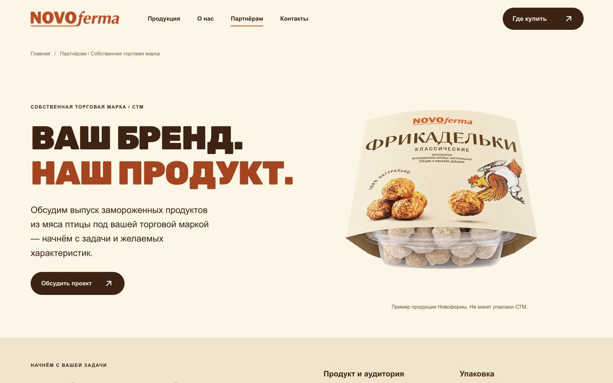
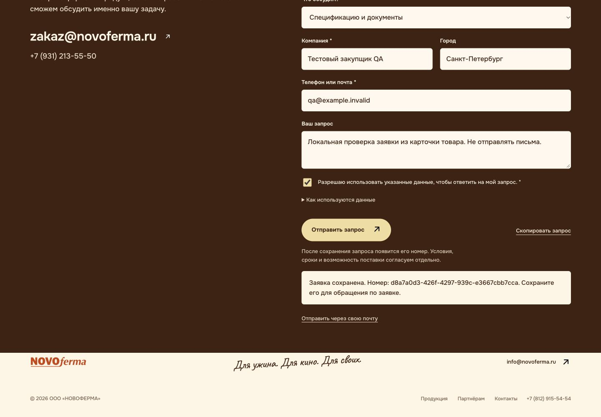

# Реализация приоритетов B2B и СТМ — 5 ноября 2026

Выполнен первый этап плана из [раздела 15 полного аудита](../b2b-audit-2026-11-04/audit.md): понятные входы закупщика, сохранение контекста товара, подтверждённый приём запроса, отдельная страница СТМ и материал по ассортименту. Внешние документы и коммерческие условия не заменены предположениями.

## Что изменилось для посетителя

1. **Три входа вместо общего приглашения.** Розница, HoReCa и СТМ получили отдельные описания и действия. Фирменные цвета, продукты и персонажи сохранены. СТМ ведёт на самостоятельную страницу с параметрами первого обсуждения и последовательностью согласования.
2. **Товар не теряется.** Из каждой из 16 карточек можно перейти к запросу спецификации или образцов. В форме уже выбраны товар и цель обращения; два концепта явно подписаны. Переход со страницы СТМ выбирает формат и цель СТМ.
3. **Подтверждение имеет основание.** Форма обращается к серверу. Номер появляется после транзакционной записи в постоянную SQLite-базу, размещённую вне публичной папки. Точный повтор с тем же ключом возвращает тот же номер. Повторное нажатие в текущей странице не создаёт вторую заявку.
4. **Сбой не выдаётся за успех.** При недоступном приёме поля остаются заполненными, пользователь видит отсутствие подтверждения и может повторить попытку, скопировать запрос или подготовить письмо. Почта и копирование сами по себе не учитываются как полученная заявка.
5. **Смена сегмента не уничтожает введённое.** Ссылки формата и спецификаций меняют соответствующие поля без перезагрузки, сохраняют товар и контакт и сбрасывают старое сообщение результата. В состоянии отправки поля и действия временно блокируются.
6. **Ассортимент можно открыть отдельно.** Самостоятельный HTML-каталог содержит 14 проверенных названий и масс, поля выбора и объёма, официальные контакты и версию сведений. Внешних ресурсов у него нет; логотип встроен. Материал открывается из раздела партнёров в новой вкладке, чтобы сохранить незавершённую форму.
7. **Навигация главной освобождена от иллюстрации.** Убран отрицательный отступ кампании на широких экранах. На 1280 px продукт больше не заходит на «Контакты»; на всех шести проверенных ширинах начало hero совпадает с нижним краем шапки.

## Соответствие плану раздела 15

| Приоритет | Результат этого этапа | Что остаётся внешней зависимостью |
| --- | --- | --- |
| Базовая версия и источники | Работа в отдельной ветке от `1c1fe78`; сохранены имевшиеся к началу уточнения карточек, мобильного hero партнёров и приглашения в каталоге | Публичная версия нового сайта и доступ к истории реальных обращений отсутствуют |
| Сегменты и предложение | Три сегмента, явные действия, отдельная СТМ, параметры запроса | Проверка формулировок и процесса с командой продаж |
| Контекст и приём | SKU/цель/сегмент, серверный receipt, безопасный повтор, состояния ошибок, локальные команды оператора | Настройка выбранного хостинга, ответственный оператор, уведомления почты/CRM |
| Материалы и доказательства | Версионный реестр, каталог названий/масс, запрос точной спецификации | Утверждённые паспорта, короб/GTIN, фото производства, действующие документы, условия поставки |
| Визуальная и доступная подача | Исправлено наложение шапки, адаптация новых секций, подписи формы, согласие, сообщения статуса и клавиатурное меню | Полный повторный аудит после наполнения реальными документами и публичного размещения |
| Измерение результата | Операторские стадии `received → qualified → quote → order`, история и агрегаты по сегменту/товару/цели | Посещаемость, атрибуция каналов, CRM-сверка, интервью закупщиков и доказательство влияния на продажи |

Этот этап не означает закрытия всего аудита. Он закрывает инженерную основу приоритетных сценариев и делает недостающие сведения явными.

## Данные и заявления

У 14 позиций подтверждены только опубликованные названия и фасовки. Прямой источник проверялся 24 октября; 5 ноября совпадение перепроверено по индексируемому тексту официального сайта. Свежие прямые обращения к сайту завершились тайм-аутом — дата старой проверки не подменена новой.

Состав, аллергены, БЖУ, хранение и приготовление не заполнены данными продавца или похожего SKU. Основной генератор останавливается при появлении непроверенного непустого пищевого поля. Каталог закупщика отдельно проверяет происхождение разрешённых фактов и блокировки остальных. Старая автоматическая подпись «на 100 г» удалена: база расчёта должна прийти вместе с утверждёнными значениями.

Для публикации паспортов потребуется осознанно обновить данные, реестр и отображение. Реестр сейчас не является готовым пищевым паспортом или юридическим заключением. Количественные заявления о белке/клетчатке, мощности, сертификаты, MOQ, география, бесплатные образцы и сроки не выдуманы. Процесс СТМ обозначен как ориентир разговора, а возможность выпуска подтверждается после задачи.

Источники и ограничения: [готовность контента](../../../docs/b2b-content-readiness.md), [реестр](../../../data/b2b-content.json).

## Проверки

| Проверка | Результат |
| --- | --- |
| Структура сайта | 23 страницы, уникальные заголовки и описания, локальные ссылки и якоря, контекст SKU, статусы концептов — PASS |
| JavaScript | Синтаксис всех runtime-файлов и 37 проверок поведения — PASS |
| HTTP + SQLite | 15 тестов: commit/rollback, перезапуск, повтор и конфликт, конкурентные запросы, ошибки записи, валидация, Origin/Host, proxy-origin, лимиты, отсутствие публичного доступа к БД, backup и восстановление — PASS |
| Реальный браузер → API → база → интерфейс | Карточка фрикаделек → запрос спецификации → видимый номер → чтение той же записи оператором — PASS |
| Мобильный СТМ | Страница СТМ → выбранные СТМ/цель → сохранённая заявка и номер — PASS |
| Повтор и ошибки | Повторное нажатие без нового запроса; недоступный API сохраняет поля; копирование содержит SKU/сегмент; переключение сегмента сохраняет ввод — PASS |
| Адаптивность | Главная, партнёры, СТМ и карточка фрикаделек на 320, 390, 768, 1024, 1280, 1440 px: 24 сочетания без горизонтального переполнения |
| Клавиатура | Мобильное меню открывается, Escape закрывает его и возвращает фокус — PASS |
| Каталог | 14 строк, автономность, повторная сборка, открытие по кнопке сайта — PASS |
| ZIP | 23 маршрута + HTML-каталог, 167 файлов, все ресурсы/якоря, целостность и повторное чтение архива — PASS |

Тестовые заявки используют адреса домена `.invalid`. Реальные письма, сообщения третьим лицам и заявки в CRM не отправлялись. В доказательствах сохранены только номера и классификация тестовых записей; рабочая база остаётся вне репозитория. Пример агрегатов — две синтетические записи, а не результат продаж.

Одна немедленная проверка главной застала фоновую загрузку неактивного слайда; последующее наблюдение подтвердило загрузку всех четырёх изображений. Это отражено в журнале, а не скрыто как ошибка отсутствующего файла.

Границы проверки: автоматическое событие скачивания во встроенном браузере не подтвердилось, поэтому основной путь открывает материал; этот переход проверен. Печатные стили просмотрены, нативная пагинация диалога печати/сохранение PDF не проверялись. Docker здесь недоступен, сборка образа и облачный запуск не выполнялись. Реальная конверсия, доставка письма и рост продаж не измерялись.

Журналы: [автоматические проверки](automated-checks.json), [браузер](browser-checks.json), [размеры экрана](responsive-checks.json), [синтетическая воронка](operator-test-funnel.json).

## Размещение и дальнейшая работа

Пользователь рассматривает российский Beget или Amvera; окончательная площадка пока не выбрана. Подготовлены Dockerfile, конфигурация Amvera с `/data` и портом8080, а также инструкция VPS. Публичная папка содержит только сайт; запросы живут в отдельном постоянном хранилище. SQLite-вариант рассчитан на один экземпляр процесса, без реплик с независимыми томами.

До запуска нужны фактический домен, HTTPS-вход и ограничения на нём, права постоянного тома, резервное копирование с проверкой восстановления и ответственный за входящие. Локальный сервер не обещает доставку на `zakaz@novoferma.ru`: почтовый или CRM-канал подключается отдельно. Ключей и ресурсов облака в ходе этого этапа не создавали.

Инструкции: [приём и оператор](../../../docs/partner-intake-operations.txt), [размещение в России](../../../docs/hosting-russia.txt). Обычный статический ZIP не заменяет сервер приёма.

Следующий содержательный этап — паспорта приоритетных продуктов и документальные доказательства производства. Следующий операционный этап — выбранный хостинг, ответственный и канал уведомлений. После этого можно провести пилот с закупщиками и измерять цепочку до квалификации и коммерческого предложения.
