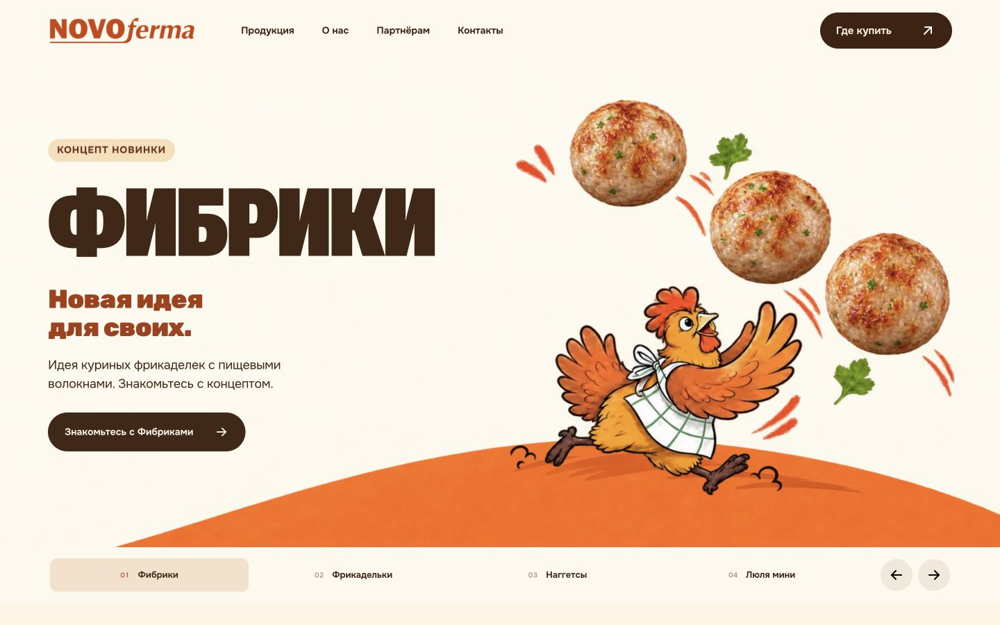
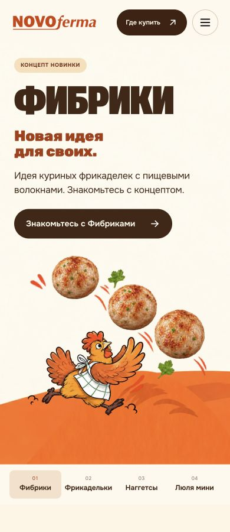
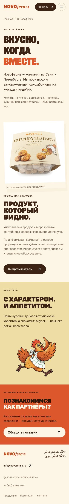

# Реализация замечаний о дизайне, шрифтах, движении и мобильной версии

Дата: 5 ноября 2026 года. Основа: main 3f56adcb31ee4eba1f2d8563db046980c7563e1d.

Это продолжение [полного аудита](../b2b-audit-2026-11-04/audit.md) и [предыдущего этапа B2B](../b2b-implementation-2026-11-05/implementation.md). Большой исходный аудит, исследование конкурентов и его ограничения сохранены. Здесь описаны реальные изменения и их приёмка. Классификация всех 23 замечаний TC13–15 и VB01–20 находится в [реестре](../../../docs/design-acceptance-ledger.json). Пункт с остатком не считается полностью закрытым.

## Результат

Сохранены фирменная палитра, персонажи, ассортимент и четыре ручные сцены. Перестроен первый экран с отдельными областями навигации, текста и иллюстрации. Уточнены шрифтовые роли, увеличены существенные подписи, исправлены переносы длинных русских названий, факты, контакты, форма и мобильная сетка.

Текст не исчезает за появлением блока. Декоративное движение учитывает reduced motion, состояние страницы, меню и тип указателя. Ожидание картинки не блокирует выбор продукта бесконечно. Для изображений подготовлены уменьшенные варианты; браузерный выбор файлов проверен отдельно.

## Композиция и смысл

1. Шапка занимает защищённую область над сценой. Иллюстрация не пересекает логотип, навигацию и главное действие. Название, второе сообщение, описание и кнопка имеют разные уровни. Второе сообщение уменьшено, текст не накладывается на еду.
2. Первая сцена — Фибрики art-v5 из текущего направления общей рабочей папки; изображение перенесено вместе с его разметкой кадрирования. Остальные сцены используют art-v4. Сборка останавливается при переносе только половины пары v5 image/layout.
3. Неподтверждённые «Белок + клетчатка» и «Наша новинка» из параллельного направления не перенесены в HTML. Фибрики и Люля мини названы концептами на главной, в каталоге, PDP, выборе товара и тексте запроса. Изображение концепта само по себе не подтверждает рецептуру или запуск.
4. Каталог использует актуальное компактное вступление и полную сетку 14 серийных позиций + 2 концепта. Удалённые фильтры не восстановлены. Порядок карточки: упаковка → название → вид птицы и масса/стадия.
5. В B2B-шапке действие «Написать» ведёт к коммерческой форме. Сценарий поиска покупки доступен в общей навигации. Сохранены отдельные входы для розницы, HoReCa и СТМ.
6. На 14 серийных PDP добавлен раскрываемый пример подачи производителя. Он привязан к тому же SKU, загружается лениво и подписан отдельно от внешнего вида упаковки. Оригинальное фото производителя сохранено. Для концептов реальные производственные ракурсы не выдуманы.
7. При независимом просмотре обнаружена увеличенная подпись на странице «О нас», закрывавшая прозрачный контейнер. Она перенесена под фотографию, набрана информационным шрифтом 14 px; мобильное фото показывает весь предмет. Повторная проверка — 42 ширины.

## Шрифты и читаемость

Единый договор ролей описан в [паспорте визуальной системы](../../../docs/visual-system.md), а typography.css подключён после компонентных стилей на всех 23 страницах.

| Роль | Решение |
|---|---|
| Короткий плакат | Novoferma Protein / Roboto Flex, вес 850; без искусственного сжатия букв |
| Названия товаров, абзацы, форма, факты | Onest, обычный регистр, свободные переносы |
| Короткая рукописная реплика | Caveat; существенные статусы и источник фото используют информационный текст |
| Вторичные акценты | Rubik; не заменяет длинные товарные заголовки |

Длинные H1 на PDP перешли к Onest. Факты используют адаптивные колонки; на узком экране не сталкиваются масса и вид продукта. Метаданные, стадия концепта, подписи фактов, реквизиты и служебные действия усилены. Переносы в форме, e-mail, хлебных крошках и подвале не требуют уменьшения букв. Минимум 16 px не выдается за универсальное правило WCAG.

Убраны повторные определения Protein в компонентных стилях. У шрифтов сохранён font-display:swap. Проверен реальный отказ загрузки всех шрифтов: 46 посещений, все 23 страницы на 320 и 1440 px, фактические HTTP404 и fallback. Горизонтального переполнения нет. Статус FontFaceSet «loaded» не принимался за доказательство успешной загрузки: сохранены отдельные FontFace error и сетевые ответы.

[Финальная проверка без шрифтов](font-fallback-final-checks.json) · [Пример длинного названия](screenshots/fallback-product-naggetsy-kurinye-s-syrom-320.png)

Из браузера извлечены цвета шести типов страниц и состояний клавиатурного выбора/ошибки. В 274 автоматически вычислимых непрозрачных текстовых парах после исправления нет результатов ниже соответствующего порога 4.5/3. Ещё 13 пар требуют контекста градиента, прозрачности или перехода; они не объявлены прошедшими эту автоматическую проверку. Дополнительно документированы 14 исходных пар, включая худший цвет градиента PDP.

Конкретно исправлен заголовок каталога: прежний #ee4b12 на #f4e5c7 давал 2.987:1; текущий #c94310 — 3.931:1 для крупного заголовка. Фокус вкладок — явная обводка 3 px. Это ограниченная проверка, а не сертификат соответствия всей версии WCAG.

[Цвета и состояния браузера](computed-colors-browser.json) · [Исходные пары и размеры](../design-mobile-2026-11-05/typography-source-evidence.json)

## Движение и управление

- Появление редакционных блоков не прячет текст через opacity. Элемент с фокусом немедленно освобождается от подготовленного смещения. На небольшом экране и грубом указателе необязательное движение ограничено.
- Первое изображение и обычная смена сцены не растворяются. Небольшое смещение иллюстрации применяется только после осознанного выбора; при reduced motion оно отключено вместе с переходами.
- Выбор сцены ждёт декодирования изображения с пределом 1500 мс. После предела доступны актуальные текст и ссылка; устаревшее завершение загрузки не подменяет последний выбор.
- Сохранены отсутствие autoplay и последовательная фоновая подготовка сцен. Перед загрузкой повторно учитываются экономия трафика, медленное соединение, скрытая страница и открытое меню. Снятие ограничения возобновляет подготовку, не выбирая другой товар.
- Потеря захвата указателя отменяет незавершённый свайп. Вертикальная прокрутка и масштабирование остаются доступны.
- Слой глубины не подключает лишнюю геометрию к карточкам с отключённым наклоном. На текущей странице активных depth-целей нет, поэтому из этой правки не выводится измеренное ускорение.
- Реальная проверка меню выявила лишний шаг Tab из последней ссылки к браузерной области. Добавлен явный цикл Tab/Shift+Tab по видимым доступным элементам. Закрытое меню не перехватывает Tab; Escape возвращает фокус кнопке открытия.

Actual reduced motion проверен в отдельной вкладке Chrome через Rendering → prefers-reduced-motion:reduce: выбор мышью и стрелками сохранял нужную сцену, подпись и ссылку. Проверка уже работавшего режима не записана как найденный дефект.

Отдельные браузерные сценарии: HTTP404 всех изображений; задержка hero 2500 мс и быстрый выбор нескольких сцен. При ошибке доступны название и действие; после медленной загрузки остаётся последняя выбранная сцена и фокус. В VM отдельно проверяются deadline, порядок завершений, переключение preference и ограничения prefetch.

[Сценарии ошибки/медленной загрузки](image-failure-browser-checks.json) · [Финальный цикл меню](menu-wrap-final-browser.json) · [Запись ручных проверок](manual-browser-verification.md)

## Изображения и загрузка

Все мастера сохранены. Производные меняют размер и кодирование; сравнение alpha с эталонным resize даёт delta 0. Прозрачность и кадрирование не обрезаны. Путь к оригиналу и хеши зафиксированы в паспорте.

| Изображение | Исходник | Выбор браузера DPR1 | Вес выбранного файла |
|---|---:|---|---:|
| Персонаж партнёрам | 362180 B | 240 px на 320/390 | 33582 B, −90.7% |
| Персонаж партнёрам | 362180 B | 400 px на 768–1440 | 72726 B, −79.9% |
| Фибрики hero | 237222 B | 640 px на 320 | 47682 B, −79.9% |
| Фибрики hero | 237222 B | 1280 px на 1440 | 140544 B, −40.8% |

Подготовлены 5 вариантов персонажа и 20 вариантов четырёх hero-сцен. Для hero sizes описывает полный прозрачный холст внутри кадра, а не только видимый bounding box. Отложенные изображения получают srcset/sizes до src. Проверены реальные currentSrc, CSS-ширина, naturalWidth и сетевые bytes; это не предположение по исходному HTML.

[18 браузерных наблюдений](responsive-image-browser-checks.json) · [Оптимизация персонажа](../design-mobile-2026-11-05/partner-host-optimization.json) · [Оптимизация hero](../design-mobile-2026-11-05/hero-optimization.json)

Холодные локальные посещения через QA-сервер с Cache-Control:no-store, без ограничения сети, DPR1:

| Страница | Наблюдение | LCP | CLS |
|---|---|---:|---:|
| Главная, 390×900 | Нормальные шрифты загружены | 140 мс | 0 |
| Главная, 1440×900 | Нормальные шрифты загружены | 120 мс | 0.01383 |

Кандидат LCP — фон сцены. Эти быстрые loopback-значения описывают только одну локальную сессию и не прогнозируют скорость у посетителей. Сумма encodedBodySize наблюдавшихся ресурсов главной на 390 px снизилась с 1943519 до 1125793 B, но это не полный стабильный page budget: ленивые изображения и фоновая подготовка зависят от момента наблюдения. Надёжное сравнение отдельных файлов приведено выше.

[Профили обычной загрузки](normal-load-profiles.json) · [Профиль до responsive hero](home-pre-responsive-profile.json)

## Приёмка и сохранение B2B

| Проверка | Фактический результат |
|---|---|
| Геометрия окончательной сборки | 23 страницы × 42 ширины = 966, включая обе стороны всех найденных media-границ в диапазоне; переполнений/выхода текстов и действий за экран нет |
| Дополнительная правка «О нас» | Повторно 42 ширины после переноса подписи, без переполнений |
| Ошибка шрифтов | 23 страницы × 2 ширины = 46 реальных HTTP404-посещений, без переполнений |
| Ручной hero | Все 4 сцены на 320/768/1440; действия внутри сцены, шапка отдельно, выбранный tab и панель согласованы |
| Hero → PDP | Все 4 реальных клика ведут к тому же продукту; оба концепта отмечены |
| PDP → B2B | Все 16 реальных переходов сохраняют SKU; concept option назван концептом |
| Native Chrome zoom | 200% и 400%, форма читается и работает; при 400% получена реальная локальная квитанция |
| Ошибка API | Реальный отказ QA-сервера не объявляет успех; выбранный SKU и введённые поля сохранены |
| Независимый визуальный просмотр | 16 полных видов основных типов страниц + отдельные кадры; исправлена закрывавшая фото подпись |
| Проверки исходников/JS | 23 страницы, 440 изображений, 1571 локальная ссылка, 37 interaction-тестов — pass |
| Motion/menu | 18 отдельных регрессионных тестов — pass |
| Приём заявок | 15 тестов сервера, записи, повторов, сбоев и доступа — pass |
| Статический архив | 187 файлов, 23 маршрута + отдельный HTML-каталог, ссылки/фрагменты/целостность — pass |

Матрица измеряет геометрию, а не художественный вкус и не все виды clipping внутри компонентов. Поэтому её дополняют фактические действия, отдельные состояния, снимки и [независимый визуальный разбор](visual-review.md).

[966 проверок](layout-final-checks.json) · [42 проверки подписи](about-caption-final-checks.json) · [16 переходов](sku-b2b-browser-checks.json) · [Hero](hero-browser-checks.json) · [Статическая проверка](static-checks.json) · [Архив](../site-package-validation.json)

## Что остаётся открытым

1. Реальное озвучивание VoiceOver/NVDA не выполнено. Проверены клавиатура, браузерная семантика, live-status и focus; они не подменяют диктор. Отдельного text-only zoom200% не проводилось: выполнены именно native browser zoom200/400% и reflow. Полное WCAG-соответствие не заявляется.
2. Доступный браузерный инструмент меняет viewport, но не DPR. Фактически проверен DPR1; DPR2/3 остаются дополнительной проверкой на соответствующих устройствах. Варианты до 1672/1024 подготовлены, но наличие srcset не считается прохождением этой проверки.
3. Production p75 Core Web Vitals и мобильная сеть требуют опубликованной версии и наблюдений. Публичный хостинг, CRM и почтовая доставка не подключены; локальный сервер действительно сохраняет входящие заявки, а статический архив этого не делает.
4. Единый утверждённый модельный лист персонажей не получен. Паспорт фиксирует реальные роли, источники, сохраняемые различия и ограничения; CSS и resize не объявлены художественной унификацией.
5. Согласованные паспорта SKU, GTIN/короб, обратные этикетки, права на коммерческие материалы, фактический процесс продаж и утверждение выпуска концептов остаются у владельцев данных. Вместо вымышленных цифр сохранены запрос спецификации и публикационные блокировки.
6. Рост конверсии, предпочтение аудитории и порядок взгляда не измерялись. Иерархия и ритм приняты экспертным просмотром; eye-tracking и коммерческий эффект не приписаны.

## Основания решений

Использованы функциональные принципы из исходного сравнения: товарная идентичность и отдельный ракурс подачи отвечают на вопрос «что это за продукт»; процесс СТМ — на вопрос «как начать обсуждение». Мегаменю, чужие сроки, достижения, бесплатные образцы и требования к поставке не копировались. Новые эффекты ради тренда 2026 года не добавлялись.

Первичные источники проверенных требований: [WCAG Resize Text](https://www.w3.org/WAI/WCAG22/Understanding/resize-text.html), [Animation from Interactions](https://www.w3.org/WAI/WCAG22/Understanding/animation-from-interactions.html), [WAI APG Modal Dialog](https://www.w3.org/WAI/ARIA/apg/patterns/dialog-modal/), [Chrome Rendering emulation](https://developer.chrome.com/docs/devtools/rendering/emulate-css). Animation from Interactions — критерий AAA; он не используется для необоснованного заявления о нарушении всей страницы.

Работа выполнена в отдельной ветке codex/design-motion-mobile-2026-11-05. Параллельные несохранённые изменения основной Desktop-папки не перезаписаны. QA-серверы и диагностика не включены в приложение или статический архив.
