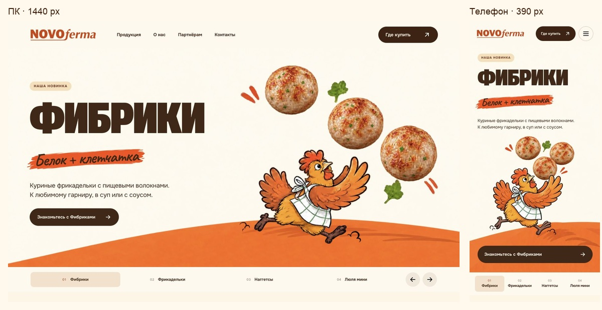
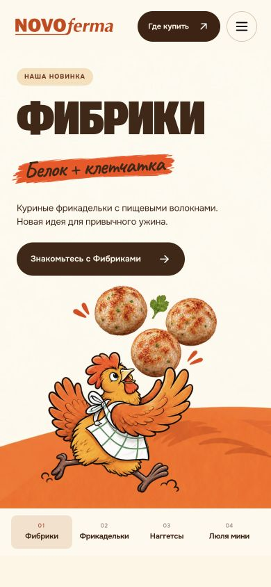
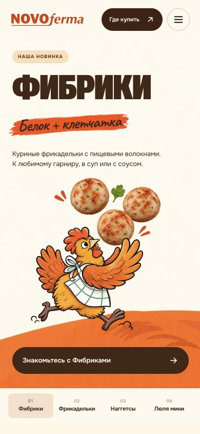
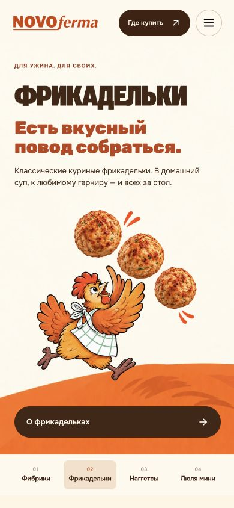
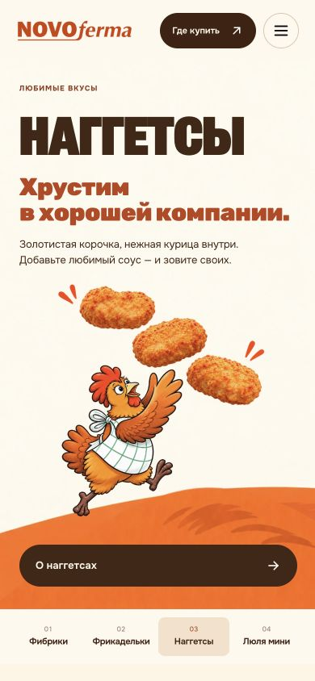
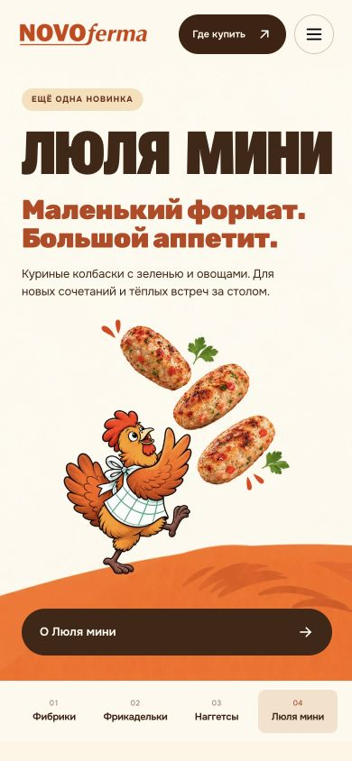

# Кнопка под курочкой и баланс информации — 5 ноября 2026

## Вывод по композиции

На ПК название уже крупное: 136,8 px при ширине 1440 и 150 px при 1920.
Видимое слово и иллюстрация сопоставимы по ширине. Само по себе преобладание
рисунка справа уместно для продуктового первого экрана: он привлекает внимание,
а слева должны быстро читаться название, отличие, объяснение продукта и действие.
Это оценка композиции, а не измеренный рост конверсии.

Слабее читалось пояснение (18 px) и общая фраза «Новая идея для привычного ужина».
Пояснение увеличено до 20 px на ширинах от 1200, общая фраза заменена конкретной
подачей: «Куриные фрикадельки с пищевыми волокнами. К любимому гарниру, в суп
или с соусом». Добавочных нутриентных и физиологических обещаний нет.
Название, фирменный мазок, иллюстрации и их расположение на ПК сохранены.

## Изменение на телефоне

На всех четырёх вертикальных слайдах действие стоит под целой курочкой:
статус → название/акцент/описание → иллюстрация → кнопка → переключатели.
Одна существующая ссылка перемещена визуально средствами сетки; дублей нет.
Кнопка имеет ширину до 360 px и высоту от 52 px. Старые фиксированные высоты
текстового контейнера не создают пустое место: на телефоне он display:contents.
Контейнер обычный div, декоративный рисунок aria-hidden; смысловой порядок
чтения и фокуса сохраняется. Горизонтальный макет остаётся двухколоночным.

## Проверенные шаги

1. Вертикальный телефон — PASS. Все четыре слайда на 390 px просмотрены;
   кнопка ниже рисунка, отступ от рамки минимум 10 px, реальный визуальный
   промежуток до ног курочки около 32–40 px. Приняты кадры в after/.
2. ПК — PASS. Снимки до/после на 1440 px и итог на 1920 px подтверждают
   сохранённый масштаб заголовка и более заметное пояснение.
3. Адаптация и управление — PASS. 15 размеров, 60 сочетаний сцены и размера:
   нет переполнения, пересечения текста/кнопки с рисунком, наложения шапки.
   Реальный клик по новой мобильной кнопке открыл product-fibriki.html.
   Существующие 22 проверки поведения/синтаксиса и проверка 23 страниц пройдены.

Независимые визуальное ревью до/после и проверка CSS/доступности — PASS.
Изображения не менялись. Пределы: один браузерный движок, заданные размеры,
без физического телефона, экранного диктора и измерения конверсии.

[Сводка измерений](after/summary.json), [координаты](after/measurements.json),
[проверки](after/checks.txt). Исходники до изменения — в before/.

