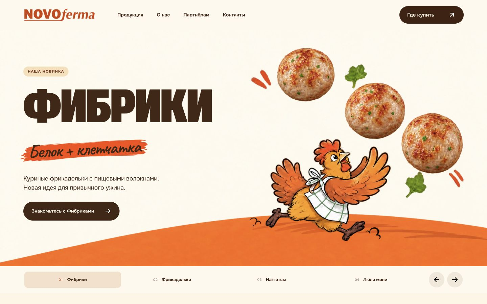
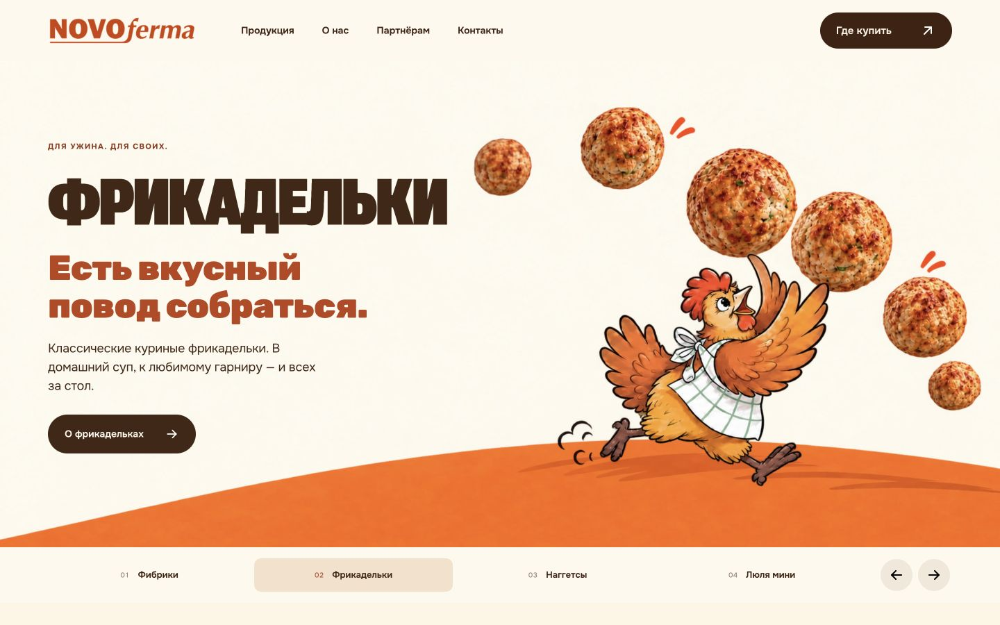
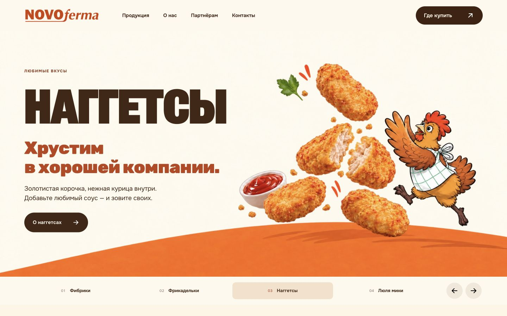
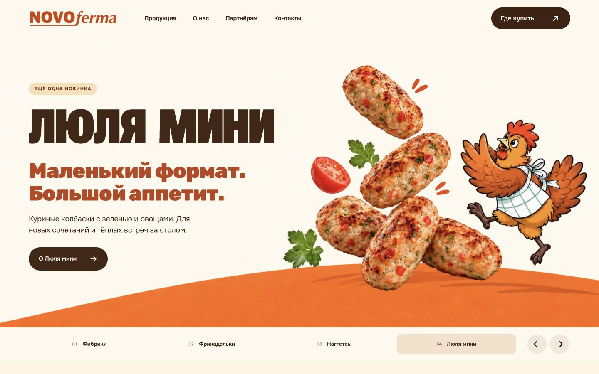
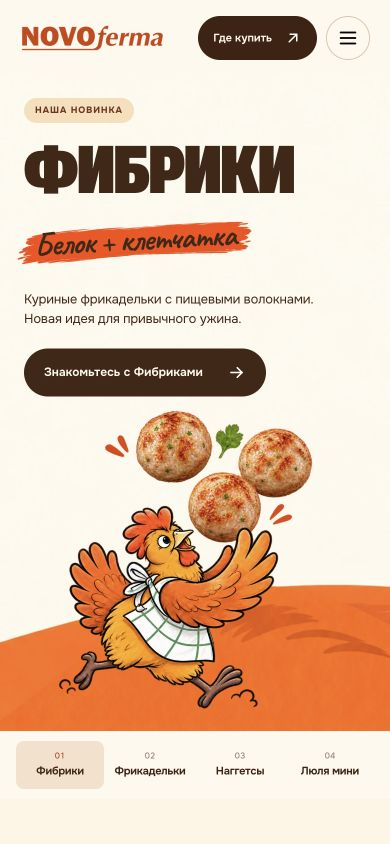
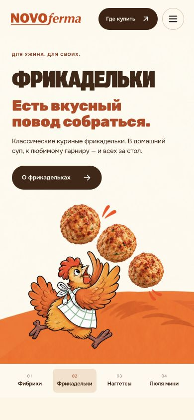
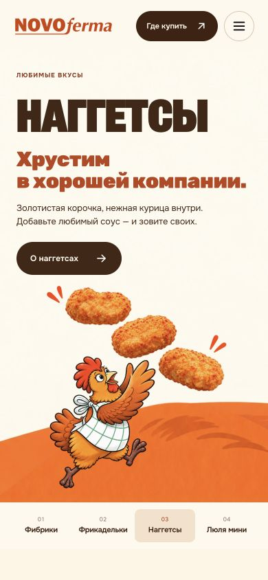
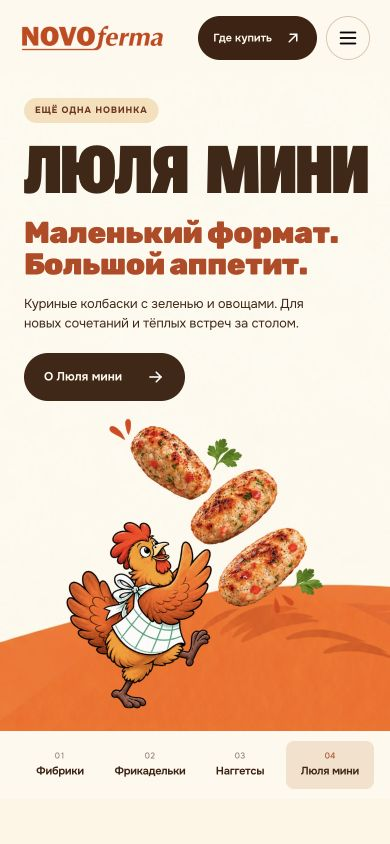

# Первый экран главной — итоговая проверка 5 ноября 2026

Сохранена исходная идея с курочкой и подброшенной едой. Фибрики открываются
первыми: «Наша новинка», живой акцент «Белок + клетчатка», описание и конкретная
кнопка. Все Фибрики в hero целые. На широких сценах осталось по две небольшие
пары оранжевых штрихов. Убраны публичные пометки о концептах и разработке.

Для четырёх продуктов созданы отдельные мобильные иллюстрации. Picture выбирает
их на вертикальном телефоне до 699 px; при повороте используется широкий
рисунок в компактном двухколоночном макете. Оранжевая дуга заполняет края.

## Проверенные шаги

1. Главная и Фибрики — PASS. Шапка, заголовок, плашка, описание, кнопка и
   иллюстрация не пересекаются; новинка открывается первой.
2. Четыре продукта — PASS. Кнопки/свайп/клавиатура переключают правильную сцену;
   названия, описания и назначения ссылок соответствуют продукту.
3. Вертикальный телефон — PASS. Отдельная композиция каждого продукта,
   читаемые тексты, целая курочка и еда. Проверены 320/360/390/480/699 px.
4. Поворот телефона — PASS. На 667×375, 844×390 и 932×430 текст и рисунок стоят
   рядом, верхние кнопки свободны; содержимое доступно прокруткой по вертикали.
5. ПК/планшет — PASS. Проверены границы 700/768/1024/1099/1100/1280/1440/1920 px.
   Оранжевая дуга заполняет ширину, края рисунков не подрезаны.
6. Переход и доступность управления — PASS. Реальный клик открыл страницу
   Фибриков; меню открывается/закрывается; End/Home перемещают выбор и фокус.
   Неактивные панели inert, есть озвучивание смены и учёт reduced motion.

[Итог на ПК и телефоне](final-v2/preview-desktop-mobile.jpg).

## Принятые снимки

Фибрики, ПК:

Фрикадельки, ПК:

Наггетсы, ПК:

Люля мини, ПК:

Четыре мобильных слайда:

Дополнительные принятые кадры: mobile-320-fibriki.png,
landscape-667-fibriki.png, landscape-844-fibriki.png,
landscape-932-fibriki.png, desktop-1920-fibriki.png в final-v2/.

## Результаты и исправления

Независимые визуальное и техническое ревью пройдены. Исправлены небольшое
подрезание краёв двух настольных рисунков и выход квадратной рамки в нижний
отступ мобильной сцены. Переключатели имеют безопасные боковые отступы для
обводки фокуса. После исправлений проверены 64 сочетания сцены и размера:
нет переполнения документа, выхода текста, пересечения с рисунком или шапкой.

22 проверки поведения/синтаксиса и статическая проверка текущих 23 страниц
пройдены. Архив пересобран с мобильными source и проверен на целостность и ссылки.
Доказательства: final-v2/layout-measurements.json, verification-summary.json,
source-and-interaction-checks.txt и ../site-package-validation.json.

Контраст кнопки 13,01:1; терракотового подзаголовка 5,06:1; текста на мазке
минимально около 3,43:1 при крупном начертании от 29 px. Это проверка контраста
конкретных элементов, не заявление о полной доступности сайта.

## Иллюстрации и происхождение

Встроенный ImageGen, не CLI. Текущий desktop: assets/product-hero/fibriki-art-v6
и {meatballs,nuggets,lulia-mini}-art-v5. Для каждого сохранены PNG, WebP,
точный *-prompt.txt и *-layout.json. Телефон: assets/product-hero/mobile-v1/ —
четыре отдельных WebP 960×960, PNG-мастера, промпты и generated-assets.json.
Все пути в этом абзаце относительно output/concept/. Исходники не перезаписаны.

Графика — иллюстрация подачи, не замена фотографии актуального продукта.
Первая упаковочная попытка, отклонённая пользователем, сохранена отдельно
в discarded-packshot/ и не подключается к сайту. Старые папки final/ и
screenshots/ не являются доказательствами итогового варианта; итог — final-v2/.

## Пределы проверки

Один браузерный движок с заданными размерами; физические телефоны не подключались.
Полноценный тест экранным диктором, увеличение текста на 200% и полевые Core Web
Vitals не проводились. Публикация, отправка заявок и внешние покупки не выполнялись.
