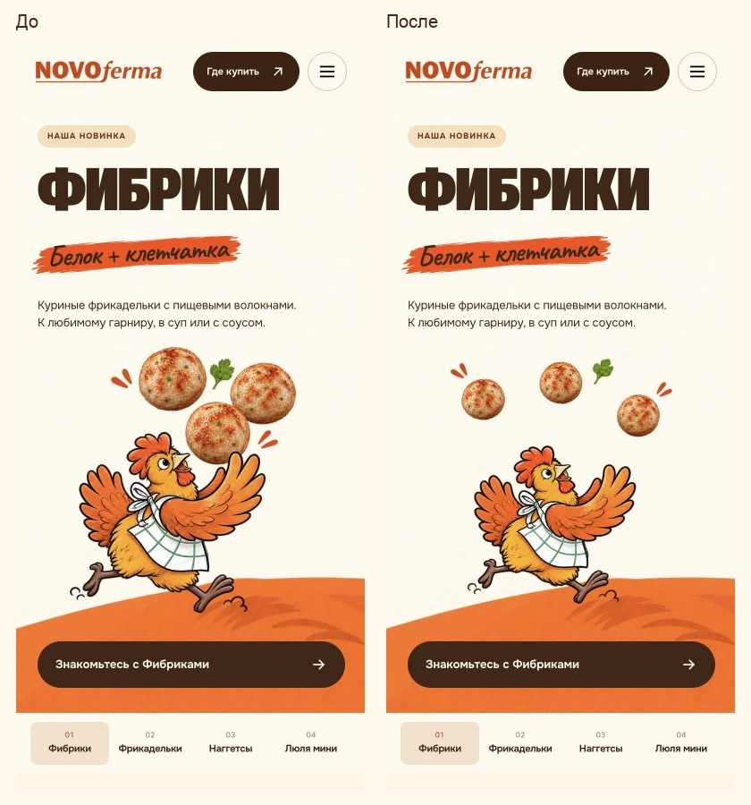
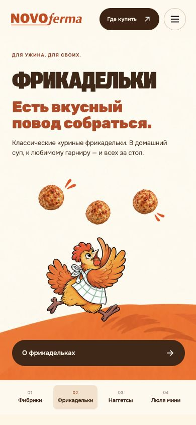
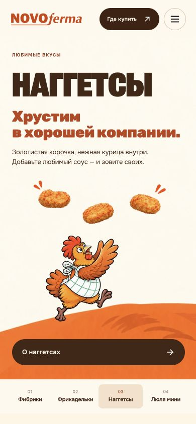
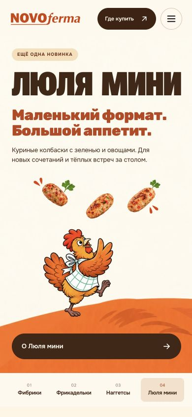

# Воздух между едой и курочкой на телефоне — 5 ноября 2026

Заменены только четыре мобильные иллюстрации на версию mobile-v2. Реалистичные
кусочки немного уменьшены и разнесены по свободной дуге над персонажем.
Еда не касается другой еды, клюва, гребня или крыльев. Сохранены рисунок
курочки, фотореалистичная еда, три целых продукта и немного штрихов движения.

## Проверенные шаги

1. Четыре мобильных слайда на 390 px — PASS. Все контуры целиком видны, касаний нет,
   прозрачность чистая на настоящем кремовом фоне страницы. Приняты четыре
   браузерных кадра after/mobile-390-*.png; независимое визуальное ревью PASS.
2. Узкий телефон 320 px — PASS. Касаний и обрезания нет, кнопка остаётся под сценой.
3. ПК 1440 px — PASS. Браузер использует прежний fibriki-art-v6.webp. Хеши CSS и
   четырёх компьютерных изображений совпадают с исходными; разметка hero после
   исключения portrait-source совпадает побайтно. Горизонтальный source прежний.
4. Подключение ресурсов — PASS. 22 проверки поведения/синтаксиса и статическая
   проверка 23 страниц пройдены. Архив пересобран и проверен. Источники отложенной
   загрузки указывают mobile-v2, без изменения логики слайдера.

Все PNG созданы встроенным ImageGen; WebP получены только уменьшением и
перекодированием. В assets/product-hero/mobile-v2 сохранены4 PNG-мастера,
4 WebP, точные промпты, layout.json и происхождение. Предыдущая v1 сохранена.
На чёрном alpha-preview местами виден RGB-шум в почти прозрачных пикселях;
на принятом кремовом браузерном изображении заметной каймы и подложки нет.

[Итоги](after/summary.json), [проверки](after/checks.txt).

Пределы: один браузерный движок, заданные размеры; физических устройств и
нового полного теста экранным диктором не было. Правка не меняет макет и тексты.
