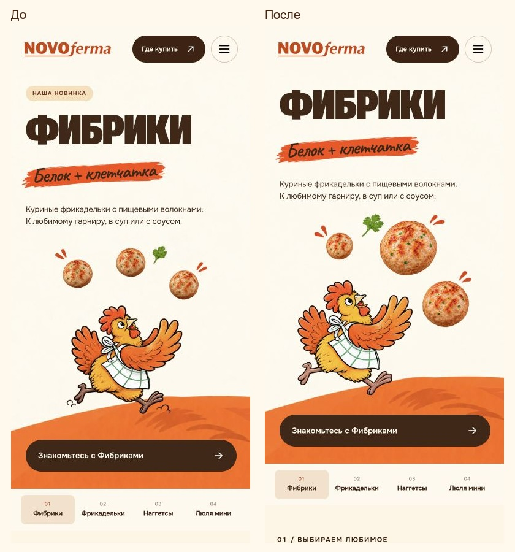
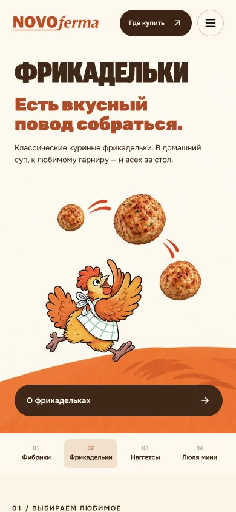
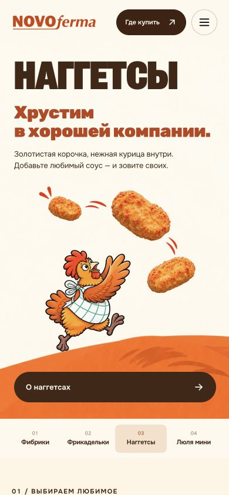
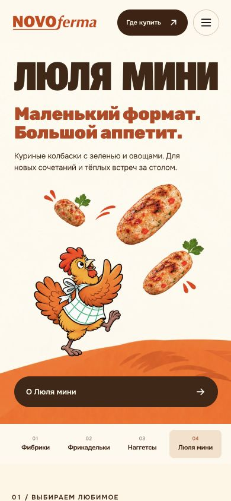
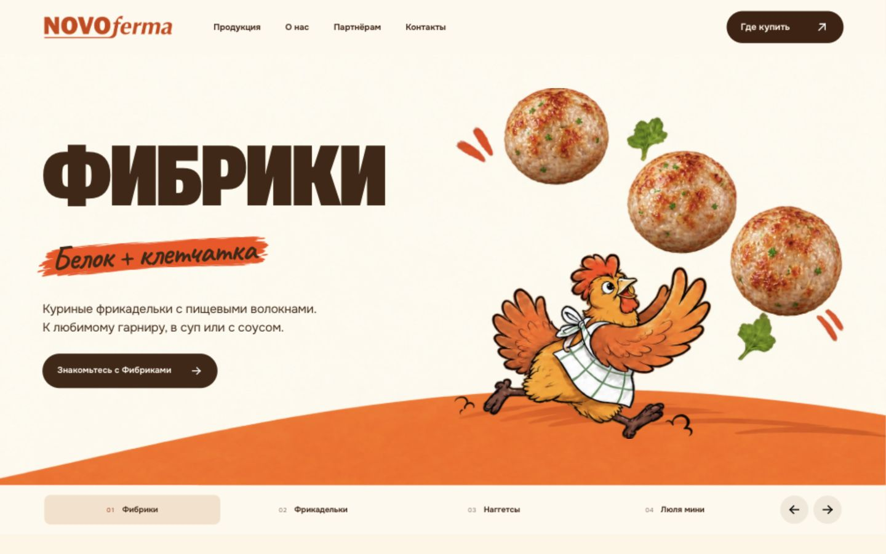

# Крупнее продукт, больше движения — 5 ноября 2026

В первом экране убраны все мелкие надписи над названиями, включая «Наша новинка»
и «Ещё одна новинка», на телефоне и ПК. На остальных разделах сайта статусы и
содержание не менялись. Название продукта теперь первый видимый акцент.

Мобильная графика v3 пересобрана встроенным ImageGen по предыдущим PNG v2:
три целых продукта разного масштаба идут по диагональной траектории. Крупный
кусочек сверху справа, средний ниже справа, маленький в начале движения.
Короткие красно-оранжевые штрихи поддерживают траекторию. Между продуктами и
клювом/гребнем/крылом сохранён воздух. Фрикадельки не разрезаны.

Мобильная сетка сокращена до трёх строк: текст → иллюстрация → кнопка.
Удалённая подпись не оставила пустой ряд; верхние отступы текста 22/28 px сохранены.
На ПК рисунки, размеры заголовков и их шрифты сохранены; текстовый блок
естественно перераспределился после удаления верхней подписи.

## Проверенные шаги

1. Четыре мобильных слайда на 390 px — PASS. В каждом заметная разница масштабов,
   диагональная динамика, еда крупнее версии v2, нет касаний и видимой подложки.
   Независимое визуальное ревью всех четырёх браузерных кадров — PASS.
2. Узкий телефон 320 px — PASS. Крупные продукты, курочка и все края видны;
   кнопка под сценой, заголовок не прижат к шапке.
3. ПК 1440 px — PASS. Верхних подписей нет, название ведёт композицию.
   Хеши четырёх настольных изображений совпадают с исходными.
4. Адаптация — PASS. 17 размеров и 68 сочетаний со слайдами: нет горизонтального
   переполнения, выхода текста, пересечений с рисунком или шапкой. Подписи
   отсутствуют при всех размерах. 22 проверки поведения/синтаксиса и проверка
   текущих 23 страниц пройдены; архив пересобран.

Итоги: after/summary.json; координаты: after/measurements.json;
проверки: after/checks.txt. Исходные HTML/CSS/генератор — в before/.

## Графика и промпты

assets/product-hero/mobile-v3/ относительно output/concept/: четыре PNG-мастера,
четыре WebP 960×960 quality 92, *-prompt.txt, layout.json и происхождение.
Фибрики дополнительно очищены от подложки встроенным ImageGen; точный второй
промпт — fibriki-alpha-cleanup-prompt.txt. Первая итерация сохранена в generation/.
Старые v1/v2 не перезаписаны. Все новые изображения проверены на реальном
кремовом фоне страницы; PNG-превью на чёрном фоне может показывать RGB-шум
в почти прозрачных пикселях, который не виден в браузере.

Пределы проверки: один браузерный движок с заданными размерами, без физических
телефонов, нового теста экранным диктором и замеров конверсии.
